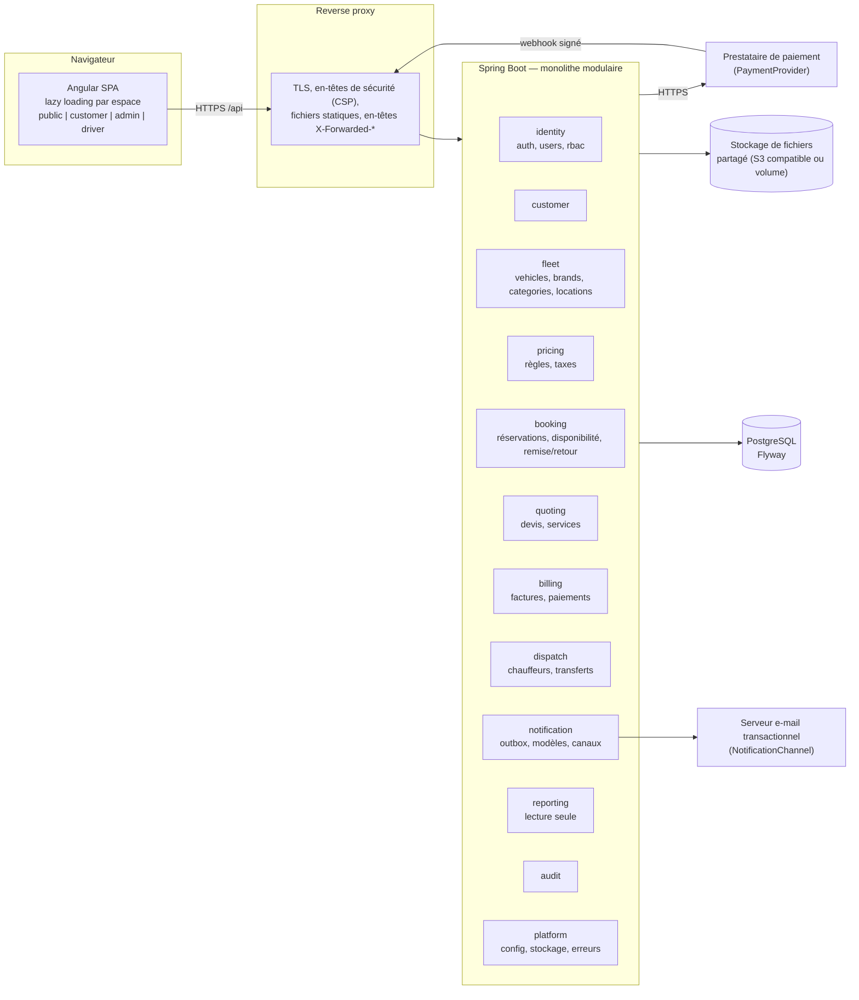
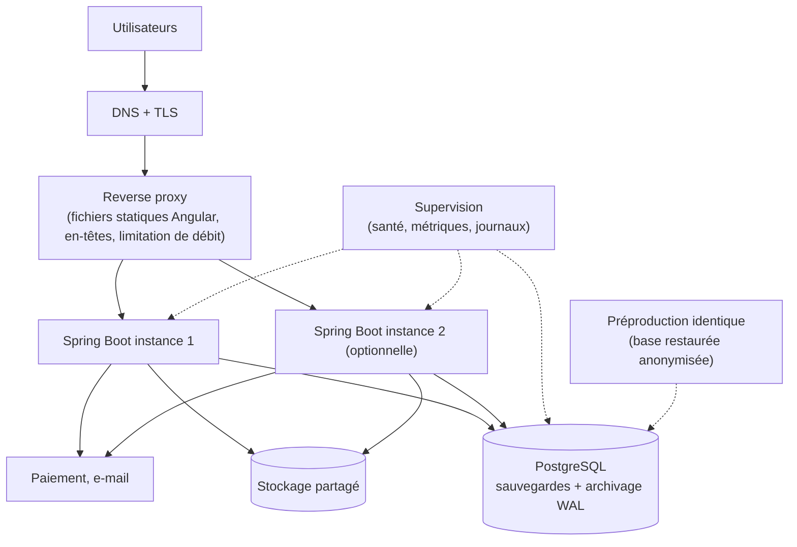
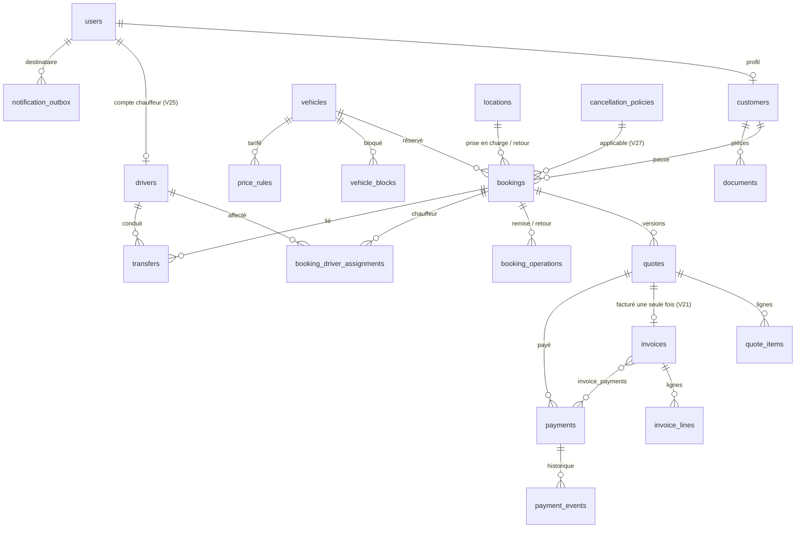

# Elite Tunisia — Benchmark international et architecture cible

> **Statut** : étude technique, document de travail. Elle a été produite en **lecture seule** : aucun code applicatif, aucune migration, aucune configuration, aucune dépendance ni aucune base de données n'ont été modifiés pour l'écrire.
> **Portée** : benchmark de 7 plateformes, évaluation de l'application réelle, produit cible, architecture cible, feuille de route V1, V2 et V3.
> **Convention de preuve** : `CONFIRMÉ` = lu directement (page publique, code, migration, configuration). `HYPOTHÈSE` = déduit ou non vérifiable avec les moyens disponibles. Les décisions métier ou d'infrastructure qui n'appartiennent pas à l'équipe technique sont regroupées en section 10.4 : elles ne sont pas tranchées ici.

---

## 0. Synthèse exécutive

**Où en est Elite Tunisia.** Le cœur transactionnel est solide : réservation protégée contre le chevauchement (verrou pessimiste sur le véhicule et contrainte d'exclusion PostgreSQL), machine à états des réservations, devis versionnés avec expiration, paiements idempotents, factures numérotées par séquence, RBAC fin côté backend, jeton d'accès conservé en mémoire. Le parcours *demande → devis → acceptation → paiement simulé* existe de bout en bout côté backend. **Le maillon facture est incomplet** : la seule création de facture branchée en production est la facture de « frais supplémentaires au retour » (`createReturnChargeInvoice`, appelée uniquement si des frais > 0 sont saisis au retour). La facture de location issue d'un devis accepté (`createFromQuote`) n'a **aucun appelant en production** ; elle n'est exercée que par les tests. Une location sans frais supplémentaires ne produit donc aucune facture.

**Ce qui sépare le produit d'une plateforme commerciale.** Ce ne sont pas les fondations, ce sont les couches visibles et opérationnelles :

1. **Aucune notification réelle** (l'interface `NotificationService` n'a pas d'implémentation) et aucun e-mail transactionnel.
2. **Aucun paiement réel** (seul `SimulatedPaymentProvider` existe) et **aucun écran de suivi des paiements**.
3. **Aucun portail chauffeur** (pas de rôle `DRIVER`, pas de compte de connexion chauffeur), **aucun écran pour les transferts** (l'API admin existe, sans interface) et **aucun parcours public de transfert**.
4. **Tarification minimale** : tarif journalier uniquement ; `pricePerWeek` est stocké mais jamais appliqué ; pas de caution, pas d'assurance, pas de politique d'annulation chiffrée ; la taxe d'un devis est un montant fixe (`default-tax-amount`, `0` par défaut), pas un taux de TVA.
5. **Catalogue sans recherche par dates** et **aucun référentiel d'agences ou de lieux** : le lieu de prise en charge est du texte libre (300 caractères).
6. **Le tableau de bord admin, le tableau de bord client, les rapports, les paiements, les partenaires, les contacts, la FAQ et les services sont des écrans provisoires** (`/admin`, `/customer`, `/admin/payments`, `/admin/reports`, `/admin/partners`, `/services`, `/contact`, `/faq`, `/chauffeur`, `/airport-transfer`).
7. **Interface en français uniquement** (aucune i18n), alors que le marché cible est trilingue FR/AR/EN.

**Ce que le benchmark apprend.** Aucun des sept concurrents étudiés ne combine location premium *et* chauffeur privé avec un parcours transparent sur le marché tunisien. Hertz.tn est le seul acteur local lu : 6 agences, tarifs TTC, frais optionnels réglés sur place, paiement intégral en ligne, pas d'espace client individuel visible. Blacklane maîtrise le chauffeur mais pas la location ; Sixt, Enterprise, DiscoverCars et Virtuo maîtrisent la location mais pas le chauffeur. **L'espace différenciant d'Elite Tunisia est donc l'offre intégrée « véhicule + chauffeur + transfert » avec un prix lisible en TND.**

**Recommandation d'architecture.** Conserver le monolithe modulaire Spring Boot + Angular + PostgreSQL. Aucun besoin mesuré ne justifie microservices, Kafka ou Redis. Les investissements d'architecture utiles sont ciblés : notifications asynchrones via une table d'envoi (*outbox*) dans PostgreSQL, abstraction de paiement déjà amorcée (`PaymentProvider`) à compléter par un prestataire réel, stockage de fichiers partagé (`FileStorageService` existe déjà), limiteur de connexion partagé, verrou d'ordonnancement pour les tâches planifiées, CSP progressive.

**Feuille de route résumée.**

| Étape | Objectif | Contenu clé |
|---|---|---|
| **V1 — Professional Core** | Fermer les workflows commerciaux et opérationnels essentiels | Facture de location réellement générée, tableau de bord admin et client, e-mails transactionnels, calendrier de disponibilité, recherche par dates, référentiel d'agences, tarification (hebdomadaire, caution, taxe), pagination des factures, écran admin des transferts, rôle `DRIVER` minimal, i18n FR/EN, multi-instance minimal |
| **V2 — Premium Experience** | Expérience client et paiements | Prestataire de paiement réel, politique d'annulation chiffrée, portail chauffeur complet, centre de notifications, parcours public de transfert, AR et RTL, documents, support, rapports |
| **V3 — Smart Mobility** | Flotte et services avancés | Clé numérique et état des lieux numérique, télématique, tarification dynamique, B2B et facturation consolidée, application mobile |

---

## Méthodologie et limites

**Code réel.** L'état d'Elite Tunisia a été établi à partir du code source, des migrations Flyway V1 à V20 (`database/migrations/`), des configurations Spring et Angular, des tests et d'un démarrage local réel, pas à partir de la documentation seule. Une fonctionnalité n'est marquée « implémentée » que si son comportement est démontré de bout en bout (frontend, backend, base).

**Recherche concurrentielle.** Deux analyses de sources publiques ont été menées par lecture directe de pages HTML (texte et `<head>`), sans compte ni navigation dynamique.

**Limites assumées.**

- Les **tunnels de réservation réels**, les **tableaux de bord clients** et les **applications mobiles** des concurrents ne sont pas accessibles sans compte ni JavaScript : leur contenu est `HYPOTHÈSE`, sauf mention contraire.
- Plusieurs pages ont renvoyé 404 ou une coquille vide (Sixt `/car-rental-app/`, Blacklane `/fr/fleet`, `/fr/services`, `/fr/faq`, `/fr/airport-transfer`, Enterprise `/en/car-rental/coverage.html`, Turo `/us/en/suv-rental`, Hertz.tn `/location-voiture`). Ces absences ne prouvent pas que la fonctionnalité n'existe pas.
- Les couleurs de Sixt, Virtuo, Enterprise et DiscoverCars n'ont pas pu être établies de façon fiable : elles ne sont pas citées.
- Les informations tarifaires des concurrents sont des constats à une date donnée. Elles doivent être revérifiées avant toute décision commerciale.
- Aucune mesure de performance sous charge n'a été réalisée pour Elite Tunisia dans cette étude. Les objectifs chiffrés de la section 9 sont des **cibles proposées**, pas des mesures.

---

## 1. Benchmark international

### 1.1 SIXT — https://www.sixt.com/

| Axe | Constat | Statut |
|---|---|---|
| Accueil et architecture d'information | Hiérarchie Monde → Pays → Ville → Agence ; **le même widget de recherche** (lieu, dates, retour dans un autre lieu) est repris à chaque niveau (`/car-rental/`, `/car-rental/usa/los-angeles/los-angeles-airport/`) ; contenu local par agence (navette, parking, horaires, retour hors horaires) | CONFIRMÉ |
| Preuve sociale | Note 4,6/5 sur 375 634 avis affichée sur l'accueil | CONFIRMÉ |
| Tunnel | 4 étapes annoncées (lieu, dates et catégorie, disponibilité, paiement en ligne) avec une section « Price details » avant confirmation (`/rental-services/one-way-car-rental/`) | CONFIRMÉ (annonce) ; détail réel HYPOTHÈSE |
| Transparence des prix | Discours « no hidden costs », frais aller simple annoncés à l'avance ; grille chiffrée non atteinte (résultats dynamiques) | CONFIRMÉ (discours) ; chiffres HYPOTHÈSE |
| Espace client | Programme **SIXT ONE**, profil, documents, confidentialité, connexion et inscription (`/help-center/categories/your-account-rewards/`) | CONFIRMÉ |
| Aide | Centre d'aide en **9 catégories** (avant réservation, modifications, prise en charge, pendant la location, retour, facturation, compte, dommages et pannes, flotte) | CONFIRMÉ |
| Contenu | Magazine voyage intégré à l'architecture (`/magazine/`) | CONFIRMÉ |
| Paiement | Carte de crédit ou de débit ; option « pay later » mentionnée dans la méta-description | CONFIRMÉ |
| Identité visuelle | Polices Roboto et Roboto Condensed Bold, Helvetica Now Display Condensed Black (ton sportif et condensé) | CONFIRMÉ (`<head>`) ; couleurs HYPOTHÈSE |
| Chauffeur, mobile | Lien « SIXT for business » non ouvert ; page application en 404 | HYPOTHÈSE |

### 1.2 Virtuo — https://www.govirtuo.com/fr/

| Axe | Constat | Statut |
|---|---|---|
| Positionnement | « Votre voiture à la demande » ; 100 % application (déverrouillage, inscription, état des lieux sans papier), accès 24/7 sans comptoir ; notes d'application 4,8 (iOS) et 4,9 (Android) affichées | CONFIRMÉ |
| Navigation | Barre minimale : réservation partenaire, Virtuo for Business, aide, créer un compte, se connecter | CONFIRMÉ |
| Catalogue | Grille d'accueil avec caractéristiques (sièges, bagages, boîte, énergie) et prix « à partir de X €/jour » ; multi-marques | CONFIRMÉ |
| Fiche véhicule | Récit (design, performance, coffre) + **tableau technique** (carrosserie, code ACRISS, boîte, sièges, bagages, caméra de recul, Bluetooth, GPS, prix) + **nombre de villes et de gares où le modèle est disponible** (`/fr/car/bmw/bmw-s2`) | CONFIRMÉ |
| Flexibilité | Annulation gratuite jusqu'à 48 h avant le départ ; prolongation simple | CONFIRMÉ |
| Longue durée | Jusqu'à 3 mois, sans apport, assurance, entretien et 3 000 km/mois inclus, renouvelable tous les 90 jours (`/fr/discover/longue-duree`) | CONFIRMÉ |
| Inscription | Formulaire minimal ; le téléphone est exigé pour la clé numérique (`/fr/register`) | CONFIRMÉ |
| Chauffeur | Aucune offre | CONFIRMÉ (absence dans les pages lues) |
| Tableau de bord client | Non accessible sans compte | HYPOTHÈSE |

### 1.3 Blacklane — https://www.blacklane.com/fr/

| Axe | Constat | Statut |
|---|---|---|
| Positionnement | Ton bien-être (« Arrivez au meilleur de votre forme ») ; attentions en cabine : accueil porte ouverte, bagages pris en charge, eau, chargeurs | CONFIRMÉ |
| Confiance | Chauffeurs locaux dans 500+ villes ; véhicules haut de gamme, modèles récents uniquement | CONFIRMÉ |
| Segmentation | Pages dédiées par audience : voyages d'affaires, agences de voyage (GDS), partenariats (`/fr/business`, `/fr/corporations`) | CONFIRMÉ |
| Flexibilité | Modification et annulation gratuites jusqu'à **1 h avant** la prise en charge ; confirmation instantanée dans 60+ pays ; assistance multilingue 24/7 ; **facturation consolidée mensuelle** | CONFIRMÉ |
| Prix | Discours « tarifs kilométriques équitables » ; aucune grille chiffrée atteinte | CONFIRMÉ (discours) ; grille HYPOTHÈSE |
| Durabilité | Compensation carbone à 100 % ; véhicules électriques dans certaines villes | CONFIRMÉ |
| Tunnel | « Réservation en une seule page » revendiquée, parcours réel non testé | HYPOTHÈSE |
| Identité visuelle | `theme-color` **#0F1319** (quasi noir) ; polices PPFragment (titres, éditorial) et Geist (texte) | CONFIRMÉ (`<head>`) |
| Mobile | Applications iOS et Android mises en avant dès le héros de l'accueil | CONFIRMÉ |

### 1.4 Turo — https://turo.com/

| Axe | Constat | Statut |
|---|---|---|
| Positionnement | Marketplace pair à pair ; recherche « Where / From / Until » en tête ; très nombreux liens SEO par ville et catégorie | CONFIRMÉ |
| Fonctionnement | 3 étapes : chercher et filtrer, choisir le lieu (**livraison aéroport, hôtel ou domicile**), louer ; tableau comparatif avec un loueur classique (`/us/en/how-turo-works`) | CONFIRMÉ |
| Remise des clés | 3 modes : en personne, boîte à clé à code, déverrouillage par l'application du constructeur | CONFIRMÉ |
| Protection | **3 formules** (Premier, Standard, Minimum), responsabilité civile incluse, assistance routière 24/7 | CONFIRMÉ |
| Conditions | Âge variable selon le pays ; permis étranger accepté ; annulation gratuite jusqu'à 24 h avant ; réductions à la semaine et au mois (`/us/en/car-rental/united-states`) | CONFIRMÉ |
| Chauffeur | Aucun : modèle d'autoconduite | CONFIRMÉ |
| Identité visuelle | Police maison « Turo Sans » (graisse 900 observée sur le centre d'aide) ; reste de l'identité non établi | CONFIRMÉ (partiel) |

### 1.5 Enterprise — https://www.enterprise.com/

| Axe | Constat | Statut |
|---|---|---|
| Accueil | Tuiles promotionnelles, programme de fidélité **Enterprise Plus**, carrousel de flotte par type de véhicule, blocs Programmes (entreprise, remplacement) et application mobile | CONFIRMÉ |
| Navigation | **Hubs par catégorie** (voitures, SUV, utilitaires, luxe, 4x4) avec nombre de modèles et page de liste | CONFIRMÉ |
| International | Un domaine par pays (ccTLD) : architecture fédérée, pas un site mondial unique | CONFIRMÉ |
| Application mobile | Gestion des réservations | CONFIRMÉ (existence) |
| Tunnel, assurances, caution, espace client | Pages assurance en 404 ; moteur dynamique non lisible | HYPOTHÈSE |
| Chauffeur | Aucun trouvé | CONFIRMÉ (absence dans les pages lues) |

### 1.6 DiscoverCars — https://www.discovercars.com/

| Axe | Constat | Statut |
|---|---|---|
| Widget de recherche | Lieu, retour au même lieu, date et heure par pas de 30 min, **pays de résidence du conducteur**, **tranche d'âge** | CONFIRMÉ |
| Réassurance | Badges (prix clairs, 24/7, annulation gratuite), distinctions, **Trustpilot 4,6/5 (293 524 avis)**, explications pédagogiques (dépôt de garantie, politique carburant), liste des documents nécessaires au retrait | CONFIRMÉ |
| Cartes de résultats | Modèle « ou similaire », catégorie, boîte, places, climatisation, prix/jour, badges **Free cancellation, Instant confirmation, Unlimited mileage, niveau de caution qualitatif (moyenne ou élevée)**, étiquette **Pay now** | CONFIRMÉ (échantillon Rome FCO) |
| Devise | Prix affichés en **TND** pour un conducteur résidant en Tunisie ; 35+ devises (`/help`) | CONFIRMÉ |
| Statut | Intermédiaire suisse (Travel Drive GmbH), sans flotte, contrat par voucher e-mail ; « Manage Booking » cité dans les CGU mais non testé | CONFIRMÉ / HYPOTHÈSE |
| Chauffeur | Aucun | CONFIRMÉ |

### 1.7 Hertz Tunisie — https://hertz.tn/

| Axe | Constat | Statut |
|---|---|---|
| Réseau | **6 points de vente** : aéroports Tunis-Carthage (avec Meet & Greet), Djerba-Zarzis, Monastir, Sfax ; agences Tunis-Charguia et Sfax. Franchisé local STLV, groupe Ennakl Automobiles. Pas de maillage national complet | CONFIRMÉ |
| Navigation | Agences, véhicules, Hertz Business, partenaires, FAQ (`/faq_hertz`), contact, **bascule FR/EN** ; **« Espace Pro » est l'unique point de connexion**, aucun espace client individuel visible | CONFIRMÉ |
| Recherche | **Barre sticky** qui se compacte au défilement puis se déplie ; départ et retour limités aux 6 agences ; aller simple possible | CONFIRMÉ |
| Pages agence | Liste de véhicules et **fiche détaillée hybride** : prix dès X DT/jour, tarif « promo internet −5 % dès 7 jours » et tarif 1 à 3 jours, passagers, carburant, boîte, portes, valises, dimensions, consommation, équipements | CONFIRMÉ |
| Transparence | « Prix TTC, taxes aéroport incluses » ; TVA 19 % ; assurance et assistance incluses ; frais optionnels (siège enfant, conducteur additionnel, assurances optionnelles, livraison hors horaires 70 DT, frais inter-agences) **réglés sur place, jamais prépayables** | CONFIRMÉ (`/article/conditions-generales`) |
| Paiement et annulation | **Paiement intégral en ligne** à la réservation (≥ 48 h avant) ; annulation : 50 % retenus si moins de 7 jours, 100 % si moins de 48 h | CONFIRMÉ (CGV) |
| Caution | Carte de crédit internationale au nom du conducteur principal, plafond disponible d'environ 1 000 € selon la catégorie | CONFIRMÉ (CGV) |
| Conditions | Âge minimum 23 ans, permis de 2 ans ; nom du conducteur non modifiable après réservation | CONFIRMÉ (FAQ) |
| Entreprises | Hertz Business : location longue durée, LOA, courte durée ; entretien, assistance 24/7, véhicule de remplacement, reporting | CONFIRMÉ |
| Transfert | Meet & Greet et navette partenaire agence ↔ aéroport Tunis-Carthage : proche d'un transfert, **pas un chauffeur privé** | CONFIRMÉ |
| Identité visuelle | Jaune **#FFD100** (variable `--color-site-1`), police **Manrope**, fond clair | CONFIRMÉ (code source) |
| Application mobile | Citée dans les pages, non vérifiée indépendamment | HYPOTHÈSE |

### 1.8 Patterns retenus, adaptés ou écartés

| Pattern observé | Origine | Décision pour Elite Tunisia | Raison |
|---|---|---|---|
| Prix TTC lisible, frais hors prépaiement listés | Hertz.tn, DiscoverCars | **Retenu (V1)** | Confiance, conformité au marché local, réduit les litiges |
| Badges courts (annulation, caution, kilométrage) sur la carte véhicule | DiscoverCars | **Retenu (V1)** | Lisible sur mobile ; suppose de modéliser ces règles (aujourd'hui absentes) |
| Fiche véhicule avec tableau technique et disponibilité | Virtuo, Hertz.tn | **Retenu (V1)** | Les champs existent déjà en grande partie dans `vehicles` |
| Barre de recherche compacte qui se déplie | Hertz.tn | **Retenu (V1)** | Mobile ; mais la recherche par dates est un prérequis |
| Widget identique à chaque niveau (pays, ville, agence) | Sixt | **Adapté (V2)** | Pertinent seulement avec un référentiel d'agences et d'aéroports |
| Preuve sociale (note, volume d'avis) | Sixt, DiscoverCars | **Adapté (V2)** | N'afficher que des avis réels et vérifiables ; sinon aucune note |
| Trois niveaux de protection | Turo | **Adapté (V2)** | Dépend du partenaire d'assurance : décision métier |
| Chauffeur, accueil en cabine, annulation tardive | Blacklane | **Retenu (V1 pour le chauffeur, V2 pour les règles)** | C'est le différenciateur local |
| Segmentation B2B et facturation consolidée | Blacklane, Hertz Business | **Reporté (V3)** | Exige des comptes d'entreprise et des factures multi-réservations |
| Clé numérique et 100 % application | Virtuo | **Reporté (V3)** | Matériel connecté et application native : coût et risque élevés |
| Marketplace pair à pair | Turo | **Écarté** | Modèle économique différent (flotte propre ou partenaires) |
| Intermédiaire sans flotte | DiscoverCars | **Écarté** | Elite Tunisia exploite sa flotte |
| Un domaine par pays | Enterprise | **Écarté** | Un seul pays visé ; une seule application avec i18n suffit |
| Espace unique « Pro » | Hertz.tn | **Écarté** | Un compte client individuel existe déjà et doit rester distinct |

---

## 2. Matrice comparative des concurrents

Légende : ● confirmé, ◐ partiel ou discours seulement, ○ absent dans les pages lues, ? non vérifiable.

| Capacité | Sixt | Virtuo | Blacklane | Turo | Enterprise | DiscoverCars | Hertz.tn | **Elite Tunisia (code réel)** |
|---|---|---|---|---|---|---|---|---|
| Recherche avec dates sur l'accueil | ● | ◐ | ● | ● | ? | ● | ● | ○ (filtres sans dates ; disponibilité par véhicule) |
| Hiérarchie pays, ville, agence | ● | ◐ | ◐ | ◐ | ● (domaines) | ● | ◐ (6 agences) | ○ (lieu en texte libre) |
| Filtres avancés de catalogue | ? | ◐ | ○ | ● | ● (hubs) | ● | ◐ | ◐ (marque, catégorie, prix, places, boîte, chauffeur, tri) |
| Fiche véhicule détaillée | ? | ● | ○ | ● | ? | ● | ● | ◐ (galerie et caractéristiques ; pas de disponibilité en contexte) |
| Prix TTC et frais listés | ◐ | ◐ | ◐ | ● | ? | ● | ● | ◐ (taxe fixe, `0` par défaut ; pas de TVA en taux) |
| Tarif semaine ou mois | ? | ◐ | ○ | ● | ? | ? | ◐ (promo ≥ 7 jours) | ○ (`pricePerWeek` non appliqué) |
| Caution et assurance visibles | ? | ◐ | ○ | ● | ? | ● | ● | ○ |
| Politique d'annulation chiffrée | ? | ● (48 h) | ● (1 h) | ● (24 h) | ? | ● | ● (50 % / 100 %) | ○ (annulation par statut, sans barème) |
| Paiement en ligne | ● | ? | ? | ● | ? | ● | ● | ◐ (simulé uniquement) |
| Espace client | ● | ◐ | ● | ● | ● | ◐ | ◐ (Pro) | ◐ (profil, réservations, devis, factures ; tableau de bord statique) |
| Notifications | ? | ● (app) | ● | ● | ● | ● (e-mail) | ? | ○ |
| Chauffeur ou transfert | ? | ○ | ● | ○ | ○ | ○ | ◐ (Meet & Greet) | ◐ (chauffeurs : fiche et affectation en admin ; transferts : API sans écran ; pas de portail ni de page publique) |
| Gestion de flotte admin | ? | ? | ? | ? | ? | ? | ? | ● (CRUD véhicules, images, marques, catégories) |
| Remise des clés numérique | ? | ● | ○ | ● | ? | ○ | ○ | ○ |
| Multilingue | ● | ● | ● | ● | ● | ● | ● (FR/EN) | ○ (FR seul) |
| Application mobile | ◐ | ● | ● | ● | ● | ? | ? | ○ (web responsive) |
| Offre B2B | ● | ● | ● | ◐ | ● | ○ | ● | ○ |

Les colonnes « ? » ne sont pas des faiblesses supposées : elles signalent des fonctionnalités non vérifiables en lecture publique.

---

## 3. État réel d'Elite Tunisia

### 3.1 Pile technique (CONFIRMÉ)

- **Backend** : Spring Boot 4.1.1, Java 21, JPA/Hibernate, Spring Security, Flyway. Packages métier : `auth`, `user`, `customer`, `catalogue`, `vehicle`, `brand`, `category`, `booking`, `quote`, `payment`, `invoice`, `driver`, `transfer`, `notification`, `common` (configuration, stockage, tarification). Les packages `report`, `document`, `partner` ne contiennent que `package-info`.
- **Frontend** : Angular 22, 53 fichiers TypeScript, HTML et SCSS hors tests, 38 tests unitaires, Playwright (21 scénarios).
- **Base** : PostgreSQL 18, 35 tables applicatives (plus `legacy_payments` et `legacy_invoices`, voir 3.4), migrations actives V1 à V20 dans `database/migrations/`. Montants en `numeric(12,3)` (adapté au millime du dinar), devise `TND` par défaut, fuseau `Africa/Tunis` configurable.
- **API** : préfixes `/api/<ressource>` (public et client) et `/api/admin/<ressource>` (administration), sans versionnement.

### 3.2 Fonctionnalités : état vérifié

| Domaine | État | Preuve et limites |
|---|---|---|
| Authentification | **Implémenté** | JWT d'accès 15 min en mémoire, refresh 30 jours en cookie `HttpOnly SameSite=Strict`, CSRF par cookie lisible, limiteur de connexion en mémoire. Mot de passe oublié : placeholder |
| RBAC | **Implémenté (backend)** | 6 rôles (SUPER_ADMIN, MANAGER, AGENT, CONCIERGE, ACCOUNTANT, CUSTOMER) et permissions fines (`bookings:manage`, `quotes:read`, `services:read/manage`, `admin:access`…) ; protection du dernier SUPER_ADMIN avec verrou de ligne et test de concurrence. **Côté Angular**, des gardes de rôle n'existent que sur quelques routes admin |
| Catalogue public | **Partiel** | Recherche paginée (texte, marque, catégorie, prix, places, boîte, chauffeur, tri) ; **pas de dates, pas de carburant, pas de lieu** |
| Disponibilité | **Partiel** | Endpoint séparé (véhicule + dates) ; pas de calendrier admin ; pas de filtre de catalogue par disponibilité |
| Réservation | **Implémenté** | Verrou `PESSIMISTIC_WRITE` sur le véhicule, contrôle de chevauchement, contrainte `bookings_no_blocking_overlap` (EXCLUDE gist, V4), machine à états PENDING, CONFIRMED, REJECTED, CANCELLED, IN_PROGRESS, COMPLETED, historique d'événements, opérations de remise et de retour (odomètre, carburant, dommages, frais supplémentaires). Confirmation conditionnée à un devis ACCEPTED cohérent |
| Devis | **Implémenté** | Version unique par réservation (`quotes_booking_version_unique`), lignes typées (chauffeur, remise, services), expiration planifiée (100 par passage). Taxe = montant fixe configurable |
| Tarification | **Minimal** | `RentalPricingService` : tarif journalier, jours arrondis au supérieur. `priceWithDriver` utilisé dans les devis. Aucune règle semaine, mois, saison, durée minimale |
| Paiements | **Simulé** | `PaymentProvider` (interface) + `SimulatedPaymentProvider` qui accepte tout montant positif ; `payments_idempotency_idx` UNIQUE (V6) ; champs de remboursement présents sans parcours ; **pas de paiement partiel, pas d'endpoint ni d'écran admin de suivi** |
| Factures | **Partiel (maillon manquant)** | Séquence `invoice_seq`, `reference` UNIQUE, lignes, événements, documents, consultation client et admin. **Seul `createReturnChargeInvoice` est appelé en production** (`BookingOperationService`, au retour, si frais > 0). **`createFromQuote` n'a aucun appelant hors tests** et n'a ni garde ni contrainte unique sur `quote_id` : brancher cette méthode sans garde permettrait des doublons. Liste admin sans pagination (`findAll()`) ; mentions légales tunisiennes non modélisées |
| Chauffeurs | **Partiel** | Fiche (nom, téléphone, permis, expiration, certification, notes) gérée dans `/admin/drivers` ; affectation à une réservation depuis le détail de réservation (V11) ; **ni rôle DRIVER ni compte de connexion** |
| Transferts | **Partiel (backend seulement)** | Statuts PENDING, CONFIRMED, COMPLETED, CANCELLED ; capacité vérifiée ; conflit de chauffeur vérifié par verrou et service **sans contrainte d'exclusion en base** ; lien avec réservation (V19) ; API `/api/admin/transfers` **sans aucun écran Angular** (aucune référence côté frontend) ; aucune API client |
| Services complémentaires | **Partiel** | Catalogue de services et demandes (`service_requests`) côté admin et devis ; page publique `/services` provisoire |
| Notifications | **Absent** | `NotificationService` : interface à une méthode (`notifyQuoteStatus`) **sans implémentation** ; table `notifications` sans contrôleur ; aucun e-mail ni temps réel |
| Documents, rapports, partenaires | **Absent** | Packages vides ; tables `documents`, `partners` sans API |
| Journal d'audit | **Partiel** | Tables `audit_logs`, `booking_events`, `quote_events`, `invoice_events`, `payment_events` ; pas d'écran de consultation |
| i18n, cache, WebSocket | **Absent** | 0 occurrence d'i18n, 0 `@Cacheable`, aucun WebSocket ni SSE |

### 3.3 Frontend : routes réelles et provisoires

- **Réelles** : accueil, catalogue et détail de véhicule, marques et catégories, authentification (connexion, connexion admin, inscription), espace client (réservations, devis, factures, profil), administration (véhicules, marques, catégories, réservations, devis, clients, chauffeurs, utilisateurs, services, factures). **Aucun écran pour les transferts.**
- **Provisoires (placeholder)** : `/chauffeur`, `/airport-transfer`, `/services`, `/about`, `/faq`, `/contact`, `/auth/forgot-password`, `/customer/notifications`, `/admin` (vue d'ensemble), `/admin/payments`, `/admin/partners`, `/admin/reports`.
- Le tableau de bord client n'affiche que des liens statiques (aucun appel API).
- Toutes les routes utilisent `loadComponent` (chargement différé par composant). Dernier build de production : environ 719 kB de JavaScript en 32 fichiers, `main` à 128 kB (valeurs relevées lors d'une mission précédente, non remesurées ici).
- Sécurité côté client : jeton d'accès en mémoire, aucun `innerHTML` ni `bypassSecurityTrust*`.
- Interface en français ; polices Google Fonts chargées depuis `fonts.googleapis.com`.

### 3.4 Modèle de données (35 tables applicatives)

`audit_logs`, `booking_driver_assignments`, `booking_events`, `booking_operations`, `booking_services`, `bookings`, `brands`, `categories`, `customers`, `documents`, `driver_documents`, `drivers`, `employees`, `invoice_events`, `invoice_lines`, `invoice_payments`, `invoices`, `notifications`, `partners`, `payment_events`, `payments`, `permissions`, `quote_events`, `quote_items`, `quotes`, `refresh_tokens`, `role_permissions`, `roles`, `service_requests`, `services`, `transfers`, `user_roles`, `users`, `vehicle_features`, `vehicle_images`, `vehicles`.

Les migrations V6 et V7 renomment les anciennes tables `payments` et `invoices` en `legacy_payments` et `legacy_invoices` **sans les supprimer** : elles s'ajoutent à la liste ci-dessus sur une base migrée (constat établi dans les fichiers de migration ; aucune base n'a été interrogée pour cette étude).

**Contraintes d'intégrité observées dans les migrations** :

- `bookings` : EXCLUDE gist anti-chevauchement (V4), index `(vehicle_id, starts_at, ends_at)`, `(status, starts_at)`, `(customer_id, created_at DESC)`.
- `quotes` : `UNIQUE (booking_id, version)`, `CHECK` de statut et d'arithmétique (`total = sous-total − remise + taxe`), index sur client, statut et validité.
- `payments` : `UNIQUE (idempotency_key)`, clés étrangères vers devis et réservation (V6).
- `invoices` (V7) : `reference` UNIQUE, **mais aucune clé étrangère sur `booking_id`, `quote_id` ni `customer_id`, aucune unicité sur `quote_id`, aucun index sur `customer_id`**.
- `transfers` (V16, V19) : clés étrangères vers chauffeur, véhicule et réservation ; `CHECK` de statut et de passagers ; **un seul horodatage `pickup_at`, pas de durée ni de fin**, donc aucune contrainte d'exclusion de chevauchement possible en l'état.

**Absents du schéma** : agence ou lieu (`locations`, `branches`), tarification (`price_rules`, `seasons`), caution et assurance, politique d'annulation, taxe en taux, modèles de messages, file d'envoi, compte chauffeur lié à `drivers`.

### 3.5 Forces à préserver

1. Création de réservation sérialisée par véhicule (`vehicles.findLocked`) **et** contrainte d'exclusion PostgreSQL : deux protections indépendantes.
2. Idempotence des paiements garantie par index unique (le script `_DISABLED_V5` est redondant).
3. Machine à états et historiques d'événements sur réservations, devis, factures et paiements.
4. Interfaces d'abstraction déjà présentes : `PaymentProvider`, `FileStorageService`, `NotificationService`.
5. Suite de tests : Surefire 164 tests et Failsafe 25 tests passés sur une base PostgreSQL recréée, 21 scénarios Playwright stables.
6. Aucun défaut de dépendance connu (`npm audit` : 0 ; analyse OSV de 117 dépendances Maven : 0 avis).

### 3.6 Écarts d'exploitation

Pas de CSP ; pas de `forward-headers-strategy` ; limiteur de connexion en mémoire ; stockage de fichiers local ; une seule tâche planifiée (expiration des devis) sans verrou inter-instances ; pas de configuration explicite du pool de connexions ; Actuator limité à `health` et `info`. Détails dans `docs/deployment-runbook.md` et `docs/security-review-images-storage-migrations.md`.

---

## 4. Matrice d'écarts fonctionnels

Légende de priorité : **P0** = bloque l'exploitation commerciale ; **P1** = nécessaire pour la V1 ; **P2** = V2 ; **P3** = V3.
Statut Elite Tunisia : un écran ou un endpoint seul ne vaut pas « implémenté ».

| # | Fonctionnalité | Elite Tunisia (vérifié) | Benchmark | Évolution recommandée | Priorité |
|---|---|---|---|---|---|
| G1 | Recherche par dates et disponibilité | Filtres sans dates ; disponibilité par véhicule | Widget lieu + dates partout (Sixt, Hertz.tn, DiscoverCars) | Ajouter `from`/`to` à `VehicleSearchRequest` ; exclure les véhicules en conflit via la même logique que `BookingService` ; barre compacte au défilement | **P1** |
| G2 | Référentiel d'agences et lieux | Texte libre de 300 caractères | Hiérarchie ville, agence, aéroport (Sixt) ; 6 agences (Hertz.tn) | Table `locations` (type : AEROPORT, AGENCE, HOTEL, ADRESSE) ; liste proposée au client, saisie libre pour livraison | **P1** |
| G3 | Tarification (semaine, options, durée minimale) | Jour seul ; `pricePerWeek` ignoré | Tarif ≥ 7 jours (Hertz.tn), semaine et mois (Turo) | Table `price_rules` + évolution de `RentalPricingService` ; décision métier sur les paliers | **P1** |
| G4 | Taxe et TTC | Montant fixe `0` par défaut | TTC, TVA 19 % (Hertz.tn) | Taux de TVA configuré, base HT/TVA/TTC sur devis et factures ; **décision métier et comptable** | **P1** |
| G5 | Caution et assurance | Absentes | Caution qualitative (DiscoverCars), 3 formules (Turo) | Champ caution par catégorie ou véhicule ; formules de protection comme services de devis ; affichage sur la carte | **P1** caution, **P2** formules |
| G6 | Politique d'annulation | Annulation par statut, sans barème ni remboursement automatique | 24 h, 48 h, 1 h ; 50 % et 100 % (Hertz.tn) | Barème paramétrable par palier, calcul du remboursement, parcours de remboursement | **P2** |
| G7 | Paiement réel | Simulé ; aucun suivi admin | Carte en ligne, option « pay later » | Prestataire réel derrière `PaymentProvider` ; webhooks signés ; écran admin de suivi | **P2** (suivi admin **P1**) |
| G8 | Facture de location depuis un devis accepté | **Jamais créée en production** (seules les factures de frais de retour le sont) ; la méthode existante n'a ni garde ni unicité sur `quote_id` | Facturation automatisée (Blacklane) | Index unique partiel sur `invoices(quote_id)` (migration V21, après contrôle des données existantes), déclenchement défini avec le métier (à la confirmation, au paiement ou à la restitution), test de double appel concurrent ; **règle de déclenchement à valider** | **P0** |
| G9 | Pagination des listes | Factures non paginées ; réservations, clients, devis, véhicules, transferts paginés | Standard | Paginer `adminList` et la liste client | **P1** |
| G10 | Notifications | Aucune | E-mail, application, Trustpilot (DiscoverCars) | Outbox PostgreSQL, modèles FR/EN, envoi asynchrone, centre de notifications | **P1** e-mail, **P2** centre |
| G11 | Tableau de bord client | Liens statiques | Trips, documents, profil (Sixt, Turo) | Réservation active, prochain départ, devis en attente, factures impayées | **P1** |
| G12 | Tableau de bord admin | Placeholder | Opérations quotidiennes | Départs et retours du jour, demandes à traiter, devis qui expirent, véhicules indisponibles | **P1** |
| G13 | Calendrier de disponibilité admin | Absent | Gestion de flotte | Vue timeline par véhicule (réservations, entretien, blocages) | **P1** |
| G14 | Portail chauffeur | Absent (pas de rôle, pas de compte) | Blacklane : mission, accueil | Rôle `DRIVER`, lien `drivers.user_id`, endpoints `/api/driver/...` limités à ses missions | **P1** minimal, **P2** complet |
| G15 | Contrainte de conflit chauffeur | Verrou et service seulement ; `transfers` n'a qu'un horodatage `pickup_at` (ni fin ni durée) | n/a | Ajouter une fin ou une durée estimée aux transferts, puis une contrainte d'exclusion en base sur les plages d'un même chauffeur (migration V21) ; **à valider avec l'exploitation** | **P1** |
| G16 | Transferts : écran admin et parcours public | API admin sans écran Angular ; page publique placeholder ; aucune API client | Blacklane (non vérifié), Hertz.tn Meet & Greet | V1 : écran admin de planification (liste, affectation, statut) ; V2 : formulaire public (aéroport, adresse, passagers, bagages, vol), devis ou prix fixe | **P1** admin, **P2** public |
| G17 | Multilingue FR / EN / AR | Français seul | FR/EN (Hertz.tn), nombreuses langues | i18n Angular, texte externalisé, RTL pour l'arabe | **P1** FR/EN, **P2** AR |
| G18 | Contenu de confiance (contact, FAQ, à propos) | Placeholders | Centre d'aide à 9 catégories (Sixt), FAQ (Hertz.tn) | Pages réelles, FAQ structurée, formulaire de contact avec file côté admin | **P1** |
| G19 | Documents client | Table `documents` sans API ; pas de téléversement client | Permis, pièce d'identité (DiscoverCars, Virtuo) | Téléversement permis et pièce d'identité, validation admin, stockage privé | **P2** |
| G20 | Rapports et analytique | Packages vides | Reporting (Hertz Business) | Indicateurs : taux d'occupation, chiffre d'affaires, délai de confirmation | **P2** |
| G21 | Journal d'audit consultable | Tables présentes, aucun écran | n/a | Écran de lecture filtré, réservé à `SUPER_ADMIN` | **P2** |
| G22 | Mot de passe oublié | Placeholder | Standard | Jeton à usage unique par e-mail (dépend de G10) | **P1** |
| G23 | Vérification de l'âge et du permis | Aucune règle | 23 ans et permis de 2 ans (Hertz.tn) | Règles configurables, contrôle à la réservation | **P2** |
| G24 | Multi-instance | Limiteur, fichiers et tâche planifiée locaux | n/a | Voir sections 7.6 et 9 | **P1** si plus d'une instance |
| G25 | Clé numérique et état des lieux numérique | Absent (état des lieux saisi par l'admin) | Virtuo, Turo | Photos horodatées d'abord ; clé connectée plus tard | **P3** |
| G26 | Offre B2B | Absente | Blacklane, Hertz Business | Comptes entreprise, facturation consolidée | **P3** |
| G27 | Application mobile | Web responsive | Virtuo, Blacklane, Enterprise | PWA d'abord ; natif seulement si un besoin mesuré apparaît | **P3** |

## 5. Produit cible : quatre espaces

**Principes communs.**

- Quatre espaces séparés par route, par garde et par jeu de permissions : `/` (public), `/customer` (client), `/admin` (personnel), `/driver` (chauffeur). Un compte ne voit que l'espace de son rôle.
- Conventions d'API : préfixes existants `/api/<ressource>` (public et client) et `/api/admin/<ressource>` ; nouveau préfixe `/api/driver/<ressource>`. Les chemins marqués **(+)** n'existent pas ; les autres existent dans le code. Les permissions marquées **(+)** sont des propositions à ajouter à la table `permissions`.
- États d'écran obligatoires pour tout écran de données : **chargement** (squelette), **vide** (message et action), **erreur** (message lisible, nouvel essai, identifiant de corrélation), **succès**. Ils sont rappelés dans les tableaux uniquement quand ils ont une particularité.
- Statut actuel des écrans : *Existe* (fonctionne de bout en bout), *Provisoire* (page de remplacement), *Nouveau*.

### 5.A Site public

| Écran (route) | But | Composants | Actions | Permissions | API | États particuliers |
|---|---|---|---|---|---|---|
| **Accueil** `/` — Existe, à refondre | Convertir : recherche immédiate, confiance, différenciation chauffeur | Barre de recherche (lieu, dates, heure), sélection de véhicules, bandeau de réassurance (TTC, annulation, caution), bloc chauffeur et transfert, services, preuve sociale **réelle** | Lancer la recherche ; ouvrir une catégorie ; demander un chauffeur | Anonyme | `GET /api/vehicles` (existant, enrichi), `GET /api/locations` **(+)** | Aucun avis réel : ne pas afficher de note |
| **Catalogue** `/vehicles` — Existe, à enrichir | Trouver un véhicule disponible aux dates voulues | Résumé de recherche modifiable, filtres (marque, catégorie, prix, places, boîte, énergie, avec chauffeur), tri, cartes véhicule, pagination | Filtrer, trier, paginer, voir le détail | Anonyme | `GET /api/vehicles?from=&to=&pickupLocationId=…` (champs de dates et lieu **(+)**) | Vide : proposer d'élargir les dates ou de retirer des filtres ; erreur de dates invalides |
| **Fiche véhicule** `/vehicles/:id` — Existe, à enrichir | Décider et réserver | Galerie, tableau technique, équipements, prix TTC détaillé, badges (annulation, kilométrage, caution), disponibilité sur les dates choisies, véhicules similaires | Choisir les dates ; ajouter chauffeur ; réserver | Anonyme | `GET /api/vehicles/{id}`, disponibilité (existant), `GET /api/vehicles/{id}/price-quote?from=&to=` **(+)** | Indisponible : proposer des dates voisines |
| **Tunnel de réservation** `/booking/...` — Existe en partie (demande de réservation) | Réserver sans ambiguïté sur le prix et les conditions | Étapes : 1 dates et lieux, 2 options (chauffeur, services, protection), 3 récapitulatif TTC, 4 connexion ou inscription, 5 confirmation | Soumettre la demande ; accepter les conditions | `bookings:create` (client connecté) | `POST /api/bookings` (existant), aperçu de prix **(+)** | Conflit de dates (409) : message précis ; session expirée : reprise sans perte de saisie |
| **Chauffeur privé** `/chauffeur` — Provisoire | Présenter et vendre l'offre intégrée | Contenu éditorial, options (heures, journée), formulaire de demande | Demander un chauffeur | Anonyme (lecture), client (envoi) | `POST /api/chauffeur-requests` **(+)** ou option de réservation | Hors zone ou hors horaires : message |
| **Transfert aéroport** `/airport-transfer` — Provisoire | Réserver un transfert à prix annoncé | Formulaire (aéroport, adresse, date, heure, vol, passagers, bagages), estimation, confirmation | Demander ; voir le statut après connexion | Anonyme (estimation), client (envoi) | `POST /api/transfers/requests` **(+)**, `GET /api/transfers/estimate` **(+)** | Capacité dépassée : proposer un véhicule plus grand |
| **Services** `/services` — Provisoire | Présenter les services complémentaires | Liste issue du catalogue de services admin | Ajouter à une réservation | Anonyme | `GET /api/services` **(+)** (le catalogue existe côté admin) | Vide : masquer la section |
| **Contact et support** `/contact` — Provisoire | Joindre l'équipe | Formulaire, téléphone, WhatsApp si décidé, horaires | Envoyer un message | Anonyme, limité en débit | `POST /api/contact` **(+)** | Succès : numéro de référence ; limite de débit atteinte |
| **FAQ, À propos, Conditions générales** — Provisoires | Informer et rassurer ; base juridique | Contenu structuré (catégories), conditions de location, politique de confidentialité | Rechercher dans la FAQ | Anonyme | Contenu versionné dans le dépôt (pas d'API en V1) | — |
| **Connexion, inscription, mot de passe oublié** — Existent sauf le dernier | Accès au compte | Formulaires validés, messages d'erreur génériques, limitation des essais | Se connecter, s'inscrire, réinitialiser | Anonyme | `/api/auth/*` (existant) ; `POST /api/auth/password-reset/*` **(+)** | Compte verrouillé temporairement : message sans fuite d'information |

### 5.B Portail client

| Écran (route) | But | Composants | Actions | Permissions | API | États particuliers |
|---|---|---|---|---|---|---|
| **Tableau de bord** `/customer/dashboard` — Provisoire (liens statiques) | Montrer l'essentiel d'un coup d'œil | Prochaine réservation, devis à accepter, facture à payer, notifications récentes, raccourcis | Ouvrir l'élément concerné | `ROLE_CUSTOMER` | `GET /api/customer/dashboard` **(+)** (agrégat en lecture seule) | Nouveau client : parcours de première réservation |
| **Réservations** `/customer/bookings` — Existe | Suivre les locations actives et passées | Onglets À venir, En cours, Passées ; filtre par statut ; pagination | Ouvrir, annuler | `bookings:read` | `GET /api/bookings` (existant) | Vide : lien vers le catalogue |
| **Détail de réservation** `/customer/bookings/:id` — Existe, à enrichir | Voir la chronologie et agir | Statut, chronologie d'événements, devis lié, chauffeur affecté, documents, conditions d'annulation | Annuler (avec barème, V2), demander une modification (V2) | `bookings:read`, `bookings:cancel` | `GET /api/bookings/{id}` (existant) | Annulation hors délai : affichage du barème et du montant retenu |
| **Devis** `/customer/quotes` — Existe | Comprendre et accepter le prix | Liste, détail avec lignes, validité, bouton d'acceptation, paiement | Accepter, refuser, payer | `quotes:read` | `/api/customer/quotes` (existant), `/api/customer/quotes/{id}/payments` (existant) | Devis expiré : action de nouvelle demande ; échec de paiement : reprise sans doublon (idempotence) |
| **Factures** `/customer/invoices` — Existe | Retrouver et télécharger ses factures | Liste paginée, détail, téléchargement du document | Télécharger | Propriétaire uniquement | `/api/invoices` (existant, à paginer) | Vide : explication des cas de facturation |
| **Documents** `/customer/documents` — Nouveau (V2) | Déposer permis et pièce d'identité | Téléversement, statut de validation, date d'expiration du permis | Téléverser, remplacer | Propriétaire | `/api/customer/documents` **(+)** | Fichier refusé : motif précis |
| **Profil et sécurité** `/customer/profile` — Existe | Gérer ses informations | Identité, coordonnées, mot de passe, sessions actives (V2), préférences de langue et de notification | Modifier, changer le mot de passe | Propriétaire | `/api/customer/profile` (existant) | Validation côté client et serveur alignée |
| **Notifications** `/customer/notifications` — Provisoire | Historique des messages | Liste, marquage lu, préférences | Marquer comme lu | Propriétaire | `/api/customer/notifications` **(+)** (la table `notifications` existe) | Vide ; erreur |
| **Support** `/customer/support` — Nouveau (V2) | Écrire à l'équipe à propos d'une réservation | Formulaire lié à une réservation, fil de messages | Envoyer | Propriétaire | `/api/customer/support-messages` **(+)** | — |

### 5.C Administration

| Écran (route) | But | Composants | Actions | Permissions | API | États particuliers |
|---|---|---|---|---|---|---|
| **Tableau de bord exécutif** `/admin` — Provisoire | Piloter la journée | Départs et retours du jour, demandes à traiter, devis qui expirent, véhicules en retard, indicateurs (occupation, chiffre d'affaires, délai de confirmation) | Ouvrir l'élément à traiter | `admin:access` ; indicateurs financiers : `reports:read` **(+)** | `GET /api/admin/dashboard` **(+)** | Données absentes : indicateur « — », jamais zéro trompeur |
| **Flotte** `/admin/vehicles` — Existe | Gérer le parc | Liste filtrable, fiche, images, statut, entretien | Créer, modifier, désactiver, téléverser | `vehicles:manage` (existant) | `/api/admin/vehicles`, `/api/admin/uploads` (existants) | Suppression refusée si réservations liées |
| **Calendrier de disponibilité** `/admin/calendar` — Nouveau | Voir et arbitrer l'occupation | Chronologie par véhicule : réservations, blocages, entretien, transferts | Bloquer une période, ouvrir une réservation | `bookings:read`, `vehicles:manage` (existants) | `GET /api/admin/fleet/calendar?from=&to=` **(+)**, `POST /api/admin/vehicles/{id}/blocks` **(+)** | Conflit de blocage : message explicite |
| **Réservations** `/admin/bookings` — Existe | Traiter les demandes et le cycle de location | Liste filtrée et paginée, détail, chronologie, affectation du chauffeur, remise et retour (odomètre, carburant, dommages, frais) | Confirmer, refuser, annuler, démarrer, clôturer | `bookings:manage` | `/api/admin/bookings` (existant) | Transition invalide : message du statut attendu |
| **Clients** `/admin/customers` — Existe | Consulter et assister | Liste, fiche, historique, documents | Désactiver, consulter | `customers:read` (existant) + garde de rôle `SUPER_ADMIN`, `MANAGER` côté Angular | `/api/admin/customers` (existant) | Données personnelles : accès journalisé |
| **Chauffeurs** `/admin/drivers` — Existe | Gérer l'équipe de chauffeurs | Fiche, permis, certification, alertes d'expiration, compte de connexion | Créer, désactiver, inviter | `drivers:manage` (existant) | `/api/admin/drivers` (existant) | Permis expiré : bloquer l'affectation |
| **Planning des transferts** `/admin/transfers` — **Nouveau (aucun écran n'existe)** | Planifier les courses | Liste et calendrier, affectation de chauffeur et de véhicule, statut | Créer, affecter, confirmer, terminer, annuler | `admin:access` + `bookings:manage` (existants, imposés par `SecurityConfig`) ; permission dédiée `transfers:manage` **(+)** seulement si l'exploitation veut isoler le rôle CONCIERGE | `/api/admin/transfers` (existant) | Conflit de chauffeur : message avec la mission en conflit |
| **Tarification et devis** `/admin/quotes` — Existe (devis) ; règles tarifaires nouvelles | Chiffrer et suivre | Éditeur de devis, règles tarifaires (semaine, saison, durée minimale), taxe | Créer, envoyer, expirer, dupliquer | `quotes:create`, `quotes:manage`, `quotes:send` (existants) ; règles tarifaires : `pricing:manage` **(+)** | `/api/admin/quotes` (existant), `/api/admin/pricing/rules` **(+)** | Devis incohérent : message d'arithmétique |
| **Services** `/admin/services` — Existe | Tenir le catalogue de services | Liste, tarif, activation | Créer, modifier | `services:read`, `services:manage` (existants) | `/api/admin/services` (existant) | — |
| **Factures** `/admin/invoices` — Existe, à paginer | Émettre, suivre, relancer | Liste paginée, détail, lignes, paiements associés, document | Émettre depuis un devis, annuler par avoir | `invoices:read` (existant, mais décrit « Consulter ses factures » et partagé avec le client) ; `invoices:manage` **(+)** pour l'émission et l'annulation (ACCOUNTANT) | `/api/admin/invoices` (existant) | Double émission refusée (409) |
| **Suivi des paiements** `/admin/payments` — Provisoire | Superviser les encaissements | Liste, statut, prestataire, référence, remboursements, rapprochement | Rembourser, relancer, exporter | `payments:read`, `payments:refund` **(+)** | `/api/admin/payments` **(+)** | Écart de rapprochement : alerte |
| **Rapports** `/admin/reports` — Provisoire | Analyser l'activité | Occupation, chiffre d'affaires, durée moyenne, annulations, répartition par catégorie | Filtrer par période, exporter CSV | `reports:read` **(+)** | `/api/admin/reports/*` **(+)** | Période vide |
| **Journal d'audit** `/admin/audit` — Nouveau | Rendre les actions traçables | Tableau filtré (acteur, entité, période) | Filtrer, exporter | `audit:read` **(+)** (SUPER_ADMIN) | `/api/admin/audit-logs` **(+)** | — |
| **Utilisateurs et rôles** `/admin/users` — Existe | Administrer les comptes du personnel | Liste, rôles, activation | Créer, attribuer, désactiver | `SUPER_ADMIN` (existant) ; protection du dernier SUPER_ADMIN en place | `/api/admin/users`, `/api/admin/roles` (existants) | Refus du retrait du dernier SUPER_ADMIN |
| **Messages de contact** `/admin/contact-messages` — Nouveau | Traiter les demandes entrantes | Boîte, statut, assignation | Répondre, clore | `support:manage` **(+)** | `/api/admin/contact-messages` **(+)** | — |
| **Partenaires** `/admin/partners` — Provisoire | À arbitrer avec le métier (V3) | — | — | — | — | À ne pas développer sans besoin confirmé |

### 5.D Portail chauffeur (nouveau)

Prérequis : rôle `DRIVER`, lien unique `drivers.user_id`, permissions `driver:missions` **(+)**. Le chauffeur ne voit que **ses** missions et jamais les prix, paiements ni factures.

| Écran (route) | But | Composants | Actions | Permissions | API | États particuliers |
|---|---|---|---|---|---|---|
| **Connexion** `/driver/login` | Accès sécurisé | Formulaire, changement de mot de passe obligatoire à la première connexion | Se connecter | Anonyme | `/api/auth/*` (existant) | Compte désactivé : message générique |
| **Missions assignées** `/driver/missions` | Voir ce qui est affecté | Liste (à venir, en cours, terminées), badge de nouveauté | Accepter, refuser (V2) | `driver:missions` | `GET /api/driver/missions` **(+)** | Vide : « Aucune mission affectée » |
| **Planning du jour** `/driver/today` | Organiser la journée | Chronologie, heure de départ, durée estimée | Ouvrir une mission | `driver:missions` | `GET /api/driver/missions?date=` **(+)** | Jour sans mission |
| **Détail de mission** `/driver/missions/:id` | Préparer la prise en charge | Passager (prénom, téléphone masqué si possible), lieu de prise en charge, vol, bagages, notes, itinéraire, véhicule | Appeler, ouvrir la navigation | Mission affectée à ce chauffeur uniquement (contrôle d'appartenance côté serveur) | `GET /api/driver/missions/{id}` **(+)** | Mission réaffectée : accès retiré immédiatement |
| **Statut de la mission** | Informer l'exploitation en temps réel | Boutons : en route, sur place, passager à bord, terminée | Changer le statut | `driver:missions` | `POST /api/driver/missions/{id}/status` **(+)** | Transition invalide refusée ; hors ligne : file locale (V3) |
| **Incident** | Remonter un problème | Formulaire (type, description, photos) | Déclarer | `driver:missions` | `POST /api/driver/missions/{id}/incidents` **(+)** | Photos : mêmes contrôles que les autres téléversements |
| **Profil et documents** | Rester conforme | Permis, certification, dates d'expiration | Consulter | `driver:missions` | `GET /api/driver/profile` **(+)** | Alerte d'expiration à 30 jours |

---

## 6. Direction UX/UI

> **Contrainte de cette mission** : le design actuel n'est pas modifié. Cette section propose une direction à valider ; aucune feuille de style n'a été touchée.

### 6.1 Point de départ mesuré

Identité actuelle (`frontend/src/styles.scss`) : fond `#f6f5f1`, encre `#202720`, texte atténué `#737970`, lignes `#d9dbd4`, olive `#52684e`, sauge `#e0e6dc`, métal doré `#b5975d` ; titres Playfair Display, texte DM Sans et Manrope ; ruptures responsive observées entre 560 et 800 px.

Rapports de contraste WCAG 2.x calculés sur ces valeurs (seuil AA : 4,5 pour le texte courant, 3 pour le grand texte et les éléments d'interface) :

| Combinaison | Rapport | Verdict AA |
|---|---|---|
| Encre sur fond | 14,03 | Conforme |
| Olive sur fond | 5,58 | Conforme |
| Fond sur olive (texte de bouton) | 5,58 | Conforme |
| Encre sur sauge | 12,04 | Conforme |
| Encre sur or | 5,50 | Conforme |
| **Texte atténué sur fond** | **4,10** | **Non conforme pour le texte courant** |
| **Texte atténué sur sauge** | **3,52** | **Non conforme** |
| **Or sur fond (texte ou icône informative)** | **2,55** | **Non conforme, même pour le grand texte** |

Ces rapports concernent les couleurs déclarées ; l'usage réel dans chaque composant n'a pas été audité composant par composant.

Valeurs de remplacement testées : texte atténué `#5f665c` (4,66 sur sauge, au-dessus de 4,5 sur fond clair aussi) ; or réservé aux ornements, aux filets et aux surfaces sombres (5,50 sur encre) ; or de texte `#7a6130` sur fond clair (5,38) ; olive clair `#8fa88a` sur encre (5,93).

### 6.2 Comparaison de trois directions

| Critère | A. Luxe sombre | B. Éditorial clair moderne | C. **Hybride premium (recommandé)** |
|---|---|---|---|
| Signal de luxe | Très fort (Blacklane `#0F1319`) | Moyen, élégance sobre | Fort sur les surfaces d'impact, sobre ailleurs |
| Confiance et lisibilité des prix | Plus difficile : texte clair sur fond sombre fatigue sur de longs contenus | Excellente | Excellente : prix et formulaires sur fond clair |
| Continuité avec l'existant | Rupture complète | Continuité totale | **Évolution** : mêmes teintes, surfaces sombres ajoutées |
| Admin (densité, tableaux) | Mal adapté | Adapté | Adapté (admin entièrement clair) |
| Photographie de véhicules | Excellente | Bonne | Excellente (héros sombre, galeries claires) |
| Coût de mise en œuvre | Élevé | Faible | Moyen |
| Accessibilité | Exige un contrôle strict des contrastes | Plus simple | Simple si l'or n'est jamais utilisé comme texte sur clair |
| Risque | Perte d'identité, refonte totale | Image moins premium | Incohérence si la règle de surfaces n'est pas appliquée |

**Recommandation : C, hybride.** Site public : alternance de surfaces claires (contenu, prix, formulaires) et de surfaces sombres couleur encre (héros, pied de page, récapitulatif de réservation), avec l'or réservé aux filets, aux icônes et aux boutons secondaires sur fond sombre. Portail client : fond clair, sobre. Administration : entièrement claire, dense, sans décor. Portail chauffeur : contraste élevé, grandes cibles tactiles, mode sombre optionnel pour la conduite de nuit.

### 6.3 Système de design

| Élément | Recommandation |
|---|---|
| **Palette** | Conserver les jetons existants (`paper`, `ink`, `olive`, `sage`, `metal`) ; ajouter `muted` corrigé `#5f665c`, `gold-text` `#7a6130`, `surface-dark` = `ink`, couleurs d'état : succès (olive), avertissement (ambre foncé), erreur (`#b3261e`, 5,99 sur fond), information (bleu sourd à choisir et à tester). Chaque couleur d'état est toujours accompagnée d'une icône et d'un texte |
| **Typographie** | Titres publics : Playfair Display (déjà en place). Texte : **une seule famille** (DM Sans), au lieu de DM Sans + Manrope, pour réduire les requêtes. Admin : DM Sans avec chiffres tabulaires pour les montants. **Héberger les polices soi-même** (sous-ensembles latin et arabe, `font-display: swap`) : supprime la dépendance à `fonts.googleapis.com`, simplifie la CSP et évite le transfert d'adresses IP à un tiers. Police arabe : à choisir (décision) |
| **Espacements** | Échelle sur base 4 px : 4, 8, 12, 16, 24, 32, 48, 64, 96 ; jetons CSS ; conteneur public à 1 200 px maximum |
| **Boutons** | Primaire (olive, texte clair, 6,09 minimum), secondaire (contour), tertiaire (lien), destructif (erreur) ; hauteur minimale 44 px ; état de chargement avec libellé conservé et blocage du double clic ; un seul bouton primaire par zone |
| **Formulaires** | Étiquette toujours visible ; message d'erreur sous le champ lié par `aria-describedby` ; résumé des erreurs en tête après soumission ; `autocomplete`, `inputmode` et types adaptés ; téléphone au format +216 ; sélecteur de plage de dates accessible au clavier ; messages identiques côté client et côté serveur (les codes d'erreur existent déjà dans l'API) |
| **Carte véhicule** | Image 16:10 chargée en différé, marque et modèle, catégorie, ligne de caractéristiques (places, boîte, énergie, bagages), badges issus de **données réelles** (annulation, kilométrage, caution), prix « à partir de X TND/jour TTC » avec total pour les dates choisies, bouton unique |
| **Navigation** | Public : en-tête fixe, recherche compacte qui se déplie (modèle Hertz.tn), sélecteur de langue ; client : barre supérieure + menu latéral court ; admin : menu latéral groupé (Exploitation, Commercial, Finance, Administration), fil d'Ariane ; chauffeur : barre inférieure à 3 onglets |
| **Tableaux (admin)** | En-tête fixe, tri et filtres côté serveur, pagination, densité réglable, montants alignés à droite en chiffres tabulaires, statuts en puces texte + icône, actions de ligne dans un menu, export CSV (V2), filtres mémorisés (V2) |
| **Widgets de tableau de bord** | Carte d'indicateur (valeur, période, variation), liste « à traiter aujourd'hui », mini-chronologie des départs et retours, alertes (permis, devis, retards), graphique d'occupation. Chaque widget a son propre état de chargement et d'erreur |
| **Points de rupture** | 480, 768, 1 024, 1 280, 1 536 px (à harmoniser avec les 560 à 800 px actuels) ; conception mobile d'abord pour le site public et le portail chauffeur ; administration utilisable dès 768 px |
| **Chargement** | Squelettes pour listes, cartes et tableaux ; indicateur circulaire réservé aux boutons ; images avec espace réservé pour éviter le décalage de mise en page |
| **États vides** | Texte court + action principale ; pas d'illustration obligatoire |
| **États d'erreur** | Distinguer 403, 404, 409 (conflit), 422 (validation), 5xx et hors ligne ; bouton « Réessayer » ; afficher l'identifiant de corrélation pour le support |
| **Accessibilité** | Cible WCAG 2.2 niveau AA ; focus visible, ordre de tabulation logique, repères (`header`, `nav`, `main`), `prefers-reduced-motion`, textes alternatifs des véhicules, annonces `aria-live` pour les erreurs et les mises à jour ; test automatisé (par exemple `@axe-core/playwright`, dépendance **de test uniquement**, à valider) ; vérification manuelle au clavier et au lecteur d'écran avant chaque version |
| **Langues** | FR et EN en V1 ; AR en V2 avec miroir RTL (propriétés logiques CSS : `margin-inline`, `padding-inline`) |

---

## 7. Architecture cible

### 7.1 Principe

Conserver le **monolithe modulaire** existant (une application Spring Boot, une application Angular, une base PostgreSQL). Aucune donnée mesurée ne justifie de scinder le système : une seule équipe, une seule base transactionnelle, des invariants (chevauchement, idempotence, numérotation) qui reposent justement sur des transactions locales. Les microservices ajouteraient des transactions distribuées sans gain. **Kafka et Redis ne sont pas introduits** ; les conditions qui pourraient les justifier sont données en 7.9.

### 7.2 Schéma logique

### 7.3 Frontières de domaine et règles de dépendance

| Module | Responsabilité | Aujourd'hui | Peut dépendre de |
|---|---|---|---|
| `identity` | Authentification, sessions, rôles, permissions | `auth`, `user` | `platform` |
| `customer` | Profil client, documents (V2) | `customer` | `identity` |
| `fleet` | Véhicules, marques, catégories, agences et lieux, blocages | `vehicle`, `brand`, `category`, `catalogue` | `platform` |
| `pricing` | Tarif journalier, hebdomadaire, saisons, options, caution, taxe | `common/pricing` (minimal) | `fleet` |
| `booking` | Réservations, disponibilité, machine à états, remise et retour | `booking` | `fleet`, `pricing`, `customer` |
| `quoting` | Devis versionnés, lignes, services complémentaires | `quote` | `booking`, `pricing` |
| `billing` | Paiements, factures, avoirs, remboursements | `payment`, `invoice` | `quoting`, `booking` |
| `dispatch` | Chauffeurs, affectations, transferts, planning | `driver`, `transfer` | `booking`, `fleet`, `identity` |
| `notification` | File d'envoi, modèles, canaux, centre de notifications | `notification` (interface seule) | aucune (reçoit des événements) |
| `reporting` | Requêtes de lecture et vues d'indicateurs | `report` (vide) | lecture seule sur les autres tables |
| `audit` | Journal des actions | `audit_logs` | aucune |
| `platform` | Configuration, stockage de fichiers, gestion d'erreurs, horloge | `common` | aucune |

**Règles** : un module n'accède pas aux dépôts d'un autre module, il appelle son service ; les effets de bord (notifications, journal d'audit) passent par des événements applicatifs publiés après validation de la transaction ; `notification` n'est dépendu de personne. Ces règles peuvent être vérifiées par un test d'architecture (par exemple ArchUnit, dépendance **de test uniquement**, à valider avant ajout). Aucun renommage massif de packages n'est proposé : la frontière se fait par convention d'abord.

### 7.4 Frontend Angular

- Passer de `loadComponent` isolés à **`loadChildren` par espace** (`public`, `customer`, `admin`, `driver`) : un fichier de routes par espace, gardes de rôle déclarées une fois par espace, et gardes de permission sur chaque route sensible (aujourd'hui, seules 4 routes admin ont une garde propre ; le backend reste l'autorité).
- Dossier `shared/ui` pour les composants réutilisables : bouton, champ de formulaire, tableau de données paginé, puce de statut, état vide, état d'erreur, squelette, sélecteur de plage de dates. Les pages existantes les adoptent progressivement, sans refonte massive.
- État : signaux Angular et services dédiés ; **pas de NgRx** (aucun besoin de partage d'état complexe démontré).
- Contrats d'API : types TypeScript maintenus à la main au début ; génération depuis OpenAPI (déjà exposé en profil de développement) envisageable plus tard.
- i18n : mécanisme Angular de traduction avec fichiers FR, EN, puis AR ; aucune chaîne en dur dans les modèles.

### 7.5 Contrats REST

- **Conventions** : ressources au pluriel, préfixes `/api`, `/api/admin`, `/api/driver` ; pas de versionnement tant qu'aucun client externe (application mobile, partenaire) n'existe ; au premier client externe, introduire `/api/v1`.
- **Erreurs** : conserver le format actuel (`ApiExceptionHandler`, codes métier du type `QUOTE_NOT_FOUND`) ; ajouter un identifiant de corrélation dans les réponses d'erreur.
- **Pagination** : enveloppe unique (`content`, `page`, `size`, `totalElements`) sur **toutes** les listes ; taille maximale imposée côté serveur ; tri limité à une liste blanche de champs.
- **Idempotence** : en-tête `Idempotency-Key` sur les créations sensibles (paiement : déjà garanti par l'index unique ; réservation et transfert : à ajouter) avec table de conservation des réponses et expiration.
- **Concurrence** : conserver verrou pessimiste + contrainte d'exclusion pour les réservations ; ajouter une version optimiste (`@Version`) sur les ressources modifiées par plusieurs agents (devis, facture) pour détecter les écrasements.

### 7.6 Intégrations et abstractions

| Intégration | État | Cible |
|---|---|---|
| **Paiement** | `PaymentProvider` (interface) + `SimulatedPaymentProvider` | Étendre l'interface (création d'intention, confirmation, remboursement, lecture et vérification de signature du webhook) ; **interdire le prestataire simulé en profil `prod`** (échec au démarrage) ; table de dédoublonnage des événements webhook (`UNIQUE (provider, event_id)`) ; le webhook est la seule route exemptée de CSRF, protégée par la signature. Prestataire à choisir : voir décision D3 |
| **Stockage de fichiers** | `FileStorageService` + `LocalFileStorageService` | Ajouter une implémentation partagée (compatible S3 ou volume réseau) ; documents clients dans un espace **privé** servi par URL signée de courte durée ; images de véhicules publiques avec en-têtes de cache |
| **Notifications** | `NotificationService` sans implémentation ; table `notifications` | Architecture en 7.7 |
| **Ordonnancement** | `QuoteExpirationWorker` (`@Scheduled`) | Rendre le traitement sûr en multi-instance : sélection `FOR UPDATE SKIP LOCKED` ou verrou consultatif PostgreSQL ; idempotence vérifiée |
| **Limiteur de connexion** | `LoginThrottle` en mémoire | Compteur en base (table avec expiration) tant qu'une seule base est partagée ; Redis non nécessaire à ce stade |
| **Cartes, vols, SMS** | Absents | Optionnels (V2 ou V3), chacun avec évaluation de confidentialité préalable |

### 7.7 Architecture des notifications

1. Un événement métier (devis envoyé, réservation confirmée, paiement reçu, facture émise, mission affectée) est publié dans la transaction.
2. Un écouteur `AFTER_COMMIT` écrit une ligne dans `notification_outbox` (destinataire, canal, modèle, langue, données, clé de dédoublonnage `UNIQUE`).
3. Un répartiteur planifié lit les lignes en attente (`FOR UPDATE SKIP LOCKED`), envoie par canal, enregistre l'issue, réessaie avec temporisation croissante et plafonne les tentatives.
4. Canaux : **e-mail** (V1), **notification dans l'application** (V2, ligne dans `notifications`, lecture par SSE ou interrogation), SMS ou WhatsApp (V2 ou V3, facultatif).
5. Les modèles sont versionnés dans le dépôt, par langue ; aucun mot de passe ni donnée de paiement dans un message.

Ce schéma garantit qu'aucun message n'est perdu si l'envoi échoue, qu'aucun message n'est envoyé pour une transaction annulée, et qu'il fonctionne sur plusieurs instances sans courtier de messages.

### 7.8 Temps réel et cache

- **WebSocket** : non justifié en V1 ni V2. **SSE** (flux serveur vers client) suffit pour les notifications et le statut de mission. Le suivi de position en direct (V3) est le seul cas qui pourrait justifier WebSocket.
- **Cache HTTP** : `Cache-Control` et `ETag` sur le catalogue public et les images (noms de fichiers à empreinte, durée longue) ; cache en mémoire de processus (Caffeine) uniquement pour les référentiels quasi statiques (marques, catégories, lieux), et seulement après mesure.
- **Redis** : écarté tant qu'aucune mesure ne montre un goulot d'étranglement que le cache HTTP et PostgreSQL ne résolvent pas.

### 7.9 Conditions qui justifieraient un changement d'architecture

| Technologie | Seuil de justification mesurable |
|---|---|
| Redis | Latence p95 d'un endpoint public lecture seule durablement hors objectif **malgré** index, pagination et cache HTTP ; ou besoin de sessions partagées à grande échelle |
| Courtier de messages (Kafka ou autre) | Débit d'événements dépassant ce que l'outbox PostgreSQL traite avec une latence acceptable, ou plusieurs consommateurs indépendants à découpler |
| Microservices | Plusieurs équipes autonomes bloquées par un déploiement commun, ou un module (par exemple le suivi en direct) dont la charge impose un dimensionnement séparé |
| Recherche dédiée (Elasticsearch) | Recherche plein texte sur un catalogue de plusieurs dizaines de milliers de véhicules avec pertinence que PostgreSQL ne fournit pas |

### 7.10 Déploiement cible

- Environnements : développement local, **préproduction identique à la production** (sur une copie anonymisée, jamais sur la base réelle), production.
- Une instance suffit au lancement ; la deuxième sert à la disponibilité lors des mises à jour. Les prérequis multi-instance sont en 9.4.
- Sauvegarde et restauration : scripts existants (`scripts/db-backup.ps1`, `db-restore.ps1`) et `docs/backup-restore.md` ; ajouter un test de restauration planifié et l'archivage WAL pour une restauration à un instant donné (décision D7).

## 8. Évolution de la base de données et de l'API

### 8.1 Règles de migration

- **Ne jamais modifier une migration appliquée** (V1 à V20) ; toute évolution est une nouvelle migration versionnée à partir de **V21**. Les numéros ci-dessous sont indicatifs : l'ordre réel suit la feuille de route.
- Méthode *expand / contract* : ajouter les nouvelles colonnes et tables, faire écrire l'application dans les deux représentations, migrer les données, puis retirer l'ancien. Les colonnes `pickup_location` et `dropoff_location` (texte) restent tant que les clés vers `locations` ne sont pas renseignées partout.
- Contraintes ajoutées sur des données existantes : `NOT VALID` puis `VALIDATE CONSTRAINT` quand PostgreSQL le permet (clés étrangères, `CHECK`). **Les contraintes d'exclusion et les index uniques n'ont pas de mode `NOT VALID`** : un contrôle préalable des doublons ou des chevauchements est obligatoire.
- Chaque migration est exécutée **d'abord sur une base isolée** (test d'intégration PostgreSQL, comme `MigrationWithExistingDataIT`), puis sur une copie restaurée et anonymisée avant la préproduction. Jamais sur la base réelle sans sauvegarde vérifiée et autorisation explicite.
- Limite connue : aucune copie représentative de données historiques n'est disponible ; les risques sur données réelles restent à vérifier (voir 8.5).

### 8.2 Migrations proposées

> **Correspondance réelle (ajoutée lors de la stabilisation backend)** : les numéros ci-dessous sont indicatifs et ne sont plus valables. Migrations réellement présentes dans `database/migrations/` : V23 partenaires (`partner_id`, historique des affectations), V24 statut ARCHIVED, V25 garanties véhicule-partenaire, V26 holds PENDING. Les contenus V21 à V29 de ce tableau ne correspondent pas aux migrations réelles et ne doivent pas être supposés implémentés. Les décisions et prérequis décrits restent valables pour les contenus non réalisés (ex. blocages de maintenance, tarification, chauffeurs). Les migrations appliquées ne sont jamais modifiées.

| N° indicatif | Contenu | Étape | Précontrôle ou risque |
|---|---|---|---|
| V21 | Facturation : index unique partiel `invoices(quote_id) WHERE quote_id IS NOT NULL` ; clés étrangères `NOT VALID` puis validées sur `booking_id`, `quote_id`, `customer_id` ; index sur `invoices(customer_id)` | V1 | Rechercher les doublons de `quote_id` et les références orphelines **avant** ; échec de migration si présents (message explicite) |
| V22 | `locations` (type, ville, adresse, horaires, aéroport oui/non, actif) ; colonnes nullables `pickup_location_id`, `dropoff_location_id` sur `bookings` et `quotes` | V1 | Aucune donnée existante modifiée |
| V23 | Tarification et taxe : `price_rules` (véhicule ou catégorie, durée min et max, tarif, période de validité), `vehicles.deposit_amount`, taux de taxe sur devis et factures (en plus de `tax_amount`) | V1 | Règles métier à valider (D2, D5) ; arrondi au millime |
| V24 | `notification_outbox` (clé de dédoublonnage unique, statut, tentatives, prochaine tentative), `contact_messages`, colonnes de préférences de notification | V1 | Aucune donnée existante modifiée |
| V25 | Chauffeurs : `drivers.user_id` unique et clé étrangère ; rôle `DRIVER` et permissions ; `transfers.ends_at` (ou durée) puis contrainte d'exclusion sur la plage d'un chauffeur | V1 | **Pas de mode `NOT VALID`** : contrôler les chevauchements existants ; `btree_gist` déjà utilisé par V4 |
| V26 | `vehicle_blocks` (véhicule, plage, motif) avec exclusion entre blocages d'un même véhicule | V1 | La disponibilité combine blocages et réservations sous le même verrou de véhicule |
| V27 | `cancellation_policies` et paliers ; colonnes d'annulation sur `bookings` (date, auteur, motif, montant retenu) | V2 | Barème à valider (D9) |
| V28 | `payment_webhook_events` (`UNIQUE (provider, event_id)`) ; statuts de paiement élargis ; `idempotency_keys` pour réservations et transferts | V2 | Compatibilité avec `payments_idempotency_idx` existant |
| V29 | Documents clients : colonnes `kind`, `status`, `expires_on`, `size_bytes`, `sha256` sur `documents` (table existante) | V2 | Réutiliser plutôt que dupliquer la table |
| V30 | Suivi de mission : `transfer_events` (statut, horodatage, acteur), `incidents` | V2 | — |

### 8.3 Entités principales et relations (cible)

### 8.4 Recommandations d'API

| Priorité | Endpoint | Rôle | Remarque |
|---|---|---|---|
| P0 | Émission de facture depuis un devis accepté (déclenchement à définir, D1) | Staff `invoices:manage` (+) | Réponse 409 sur seconde émission ; idempotente par `quote_id` |
| P1 | `GET /api/vehicles?from=&to=&pickupLocationId=` | Anonyme | Exclut les véhicules dont la plage entre en conflit avec les statuts bloquants |
| P1 | `GET /api/locations`, `/api/admin/locations` | Anonyme, staff | Liste publique légère, mise en cache HTTP |
| P1 | `GET /api/vehicles/{id}/price-quote?from=&to=` | Anonyme | Détail HT, taxe, TTC, caution ; mêmes règles que `RentalPricingService` |
| P1 | `GET /api/admin/dashboard`, `GET /api/customer/dashboard` | Staff, client | Agrégats en lecture seule ; chaque chiffre vérifiable dans une liste |
| P1 | `GET /api/admin/fleet/calendar?from=&to=`, `POST /api/admin/vehicles/{id}/blocks` | Staff | Plage maximale par requête (par exemple 92 jours) |
| P1 | `POST /api/contact`, `/api/admin/contact-messages` | Anonyme limité, staff | Limitation de débit, champ d'appât anti-robot |
| P1 | `POST /api/auth/password-reset/request` et `/confirm` | Anonyme | Réponse identique que le compte existe ou non ; jeton à usage unique et à durée courte |
| P1 | `GET /api/driver/missions`, `/{id}`, `POST /{id}/status` | `DRIVER` | Filtre sur le chauffeur du jeton, jamais sur un identifiant fourni |
| P1 | Pagination de `GET /api/invoices` et `GET /api/admin/invoices` | Client, staff | Même enveloppe que les autres listes |
| P2 | `POST /api/customer/quotes/{id}/payments` branché sur un prestataire réel ; `POST /api/payments/webhook/{provider}` | Client ; système | Signature vérifiée, dédoublonnage, exemption CSRF limitée à cette route |
| P2 | `GET /api/admin/payments`, `POST /api/admin/payments/{id}/refund` | Staff `payments:*` (+) | Remboursement partiel et total journalisé |
| P2 | `POST /api/bookings/{id}/cancel` avec calcul du barème | Client, staff | Retourne le montant retenu avant confirmation |
| P2 | `GET /api/customer/notifications`, `POST /{id}/read`, flux SSE | Client | — |
| P2 | `/api/customer/documents`, `/api/admin/customers/{id}/documents` | Client, staff | Stockage privé, URL signée courte |
| P2 | `GET /api/admin/reports/*`, `GET /api/admin/audit-logs` | `reports:read`, `audit:read` (+) | Lecture seule, filtres obligatoires |
| P2 | `POST /api/transfers/requests`, `GET /api/transfers/estimate` | Client, anonyme | Après validation du modèle tarifaire des transferts |

### 8.5 Risques liés aux données historiques

1. **`legacy_payments` et `legacy_invoices`** : tables conservées par V6 et V7 sans consommateur applicatif connu. Décider (avec le métier) de leur archivage ; ne jamais les supprimer sans copie vérifiée.
2. **Factures existantes** : `invoices` n'a ni clés étrangères ni unicité sur `quote_id` (V7) ; des doublons ou des orphelins peuvent déjà exister dans une base réelle. Le précontrôle de V21 est donc indispensable.
3. **Numérotation** : la référence de facture utilise `nextval('invoice_seq')`. Une séquence PostgreSQL **ne revient pas en arrière** lors d'une annulation de transaction : des numéros peuvent manquer. Si le cadre comptable tunisien exige une numérotation continue, il faudra une table de compteur verrouillée ou un contrôle de continuité (D2). Cette exigence n'a pas été vérifiée ici ; elle relève de l'expert-comptable.
4. **Fuseau horaire** : la date de la référence de facture est calculée en UTC (`Instant.now()`), alors que l'exploitation est en `Africa/Tunis` ; autour de minuit, la date de la référence peut différer du jour local.
5. **Scripts `_DISABLED_*`** : trois fichiers désactivés dans `backend/src/main/resources/db/migration` ; documentés dans `docs/security-review-images-storage-migrations.md`, à ne pas réactiver.
6. **Aucune copie représentative de données réelles n'a été testée** ; les migrations V21 et suivantes doivent être répétées sur une copie anonymisée avant la préproduction.

---

## 9. Performance, sécurité et montée en charge

Les « cibles » ci-dessous sont des **objectifs proposés**, pas des mesures ; aucun test de charge n'a été exécuté dans cette étude. Chaque amélioration doit être mesurée avant et après.

### 9.1 Performance

| Sujet | État vérifié | Risque | Amélioration mesurable proposée | Cible proposée |
|---|---|---|---|---|
| **Index** | Réservations : index `(vehicle_id, starts_at, ends_at)`, `(status, starts_at)`, `(customer_id, created_at)` ; devis : client, statut et validité ; **factures : aucun index sur `customer_id`** | Parcours séquentiel sur la liste des factures d'un client quand la table grossit | Index sur `invoices(customer_id)` (V21) ; `EXPLAIN` des requêtes de liste et de recherche | Plan d'exécution sans parcours séquentiel sur les tables de plus de 10 000 lignes |
| **Recherche texte du catalogue** | Paramètre `search` ; type de requête non mesuré | Parcours complet avec `ILIKE '%…%'` | Mesurer ; si nécessaire, index trigramme (`pg_trgm`) | p95 du catalogue ≤ 300 ms avec 500 véhicules et 50 utilisateurs simultanés |
| **Pagination** | Paginés : véhicules, réservations, clients, devis, transferts, marques, catégories, services ; **non paginées : factures (client et admin)** | Réponses de taille non bornée | Paginer toutes les listes, taille maximale serveur, test d'intégration par liste | Aucune liste sans plafond |
| **Requêtes N+1** | `open-in-view: false` (bon réglage) ; N+1 **non mesuré** (HYPOTHÈSE) | Dégradation silencieuse des listes | Compter les requêtes SQL par endpoint de liste dans les tests (statistiques Hibernate) | Nombre de requêtes constant quand la taille de la page varie |
| **Réservations concurrentes** | Verrou pessimiste sur le véhicule + contrainte d'exclusion ; tests de concurrence existants (`BookingEngineTests`, `QuoteEngineTests`, `PostgresIdempotencyIT`, `PostgresInvoiceConcurrencyIT`, `DriverAssignmentPostgresIT`, `LastSuperAdminConcurrencyIT`) | Les tests exécutés sur H2 ne prouvent pas l'exclusion PostgreSQL | Garder au moins un test à deux fils sur PostgreSQL pour la réservation (à confirmer qu'il existe sous cette forme) | 0 double réservation sur 1 000 tentatives concurrentes sur un même créneau |
| **Conflits de chauffeur** | Verrou et service ; pas de contrainte en base | Course concurrente sur plusieurs instances | Contrainte d'exclusion (V25) + test à deux fils | 0 chevauchement accepté |
| **Temps de réponse API** | Non mesurés | Inconnu | Journaliser la durée par route (métriques Micrometer), puis test de charge avec un outil externe au projet | Lecture publique p95 ≤ 300 ms ; création de réservation p95 ≤ 800 ms ; erreurs 5xx < 0,1 % |
| **Pool de connexions** | Aucune configuration explicite (valeurs par défaut de HikariCP) | Saturation lors d'un pic | Fixer `maximum-pool-size` et le délai d'attente, exposer l'occupation du pool | Occupation < 70 % au pic mesuré |
| **Taille du JavaScript** | Environ 719 kB en 32 fichiers (dernier build, non remesuré) ; budgets 500 kB (avertissement) et 1 MB (erreur) ; chargement différé par composant | Croissance non maîtrisée avec les nouvelles pages | Mesurer le bundle initial et par route ; fixer un budget par espace ; interdire une hausse > 10 % sans justification | LCP ≤ 2,5 s sur mobile 4G pour l'accueil et le catalogue |
| **Images** | `/api/files/{key}` avec `Cache-Control: no-cache` (sans validateur observé) ; **aucune taille dérivée** ; `loading="lazy"` présent ; plafond d'envoi 10 Mo | Une image de plusieurs Mo téléchargée à chaque affichage de carte | Générer des variantes (480, 960, 1 600 px) en WebP, noms à empreinte, `Cache-Control: public, max-age=31536000, immutable`, `srcset` | ≤ 150 ko par carte de catalogue ; 0 octet transféré à la seconde visite |
| **Polices** | Trois familles chargées depuis Google Fonts | Requêtes tierces, blocage d'affichage | Héberger soi-même, une famille de texte, `font-display: swap` | −2 requêtes tierces ; CSP plus stricte |
| **Compression et HTTP** | Aucune configuration observée côté application | Transferts plus lourds | Compression et HTTP/2 au reverse proxy | Gain mesuré sur le transfert du JavaScript |

### 9.2 Sécurité (état et améliorations)

| Sujet | État vérifié | Amélioration proposée | Preuve attendue |
|---|---|---|---|
| **Authentification** | JWT 15 min en mémoire, refresh 30 jours en cookie HttpOnly SameSite=Strict, rotation et table `refresh_tokens` | Réinitialisation de mot de passe par jeton à usage unique ; liste des sessions actives et révocation (V2) | Tests d'intégration du flux ; jeton rejoué refusé |
| **Autorisation** | `/api/admin/**` exige `admin:access` au niveau URL ; permissions fines par contrôleur ; balayage automatique des endpoints (`EndpointAuthorizationSweepTest`) | Étendre le balayage aux nouveaux espaces (`/api/driver/**`) dès leur création ; permission `invoices:manage` distincte de `invoices:read` | Le balayage échoue si un nouvel endpoint n'est pas classé |
| **IDOR** | Factures : même réponse 404 pour « inconnue » et « appartenant à un autre » | Reproduire ce modèle pour missions chauffeur, documents, notifications | Tests « utilisateur A lit la ressource de B → 404 » pour chaque nouvelle ressource |
| **CSRF** | Cookie lisible par JavaScript, jeton renvoyé en en-tête ; correctif déjà validé par Playwright | Exemption limitée au webhook de paiement signé | Test : sans signature valide, rejet ; avec signature, acceptation |
| **CSP et en-têtes** | **Pas de CSP** ; en-têtes par défaut de Spring Security (non revérifiés dans cette étude) | Déployer d'abord en `Content-Security-Policy-Report-Only`, collecter les violations pendant les tests Playwright, puis appliquer. Cible : `default-src 'self'` ; `script-src 'self'` ; `img-src 'self' data:` (+ domaine de stockage) ; `font-src 'self'` (après auto-hébergement) ; `connect-src 'self'` (+ prestataire de paiement) ; `frame-ancestors 'none'` ; `object-src 'none'` ; `base-uri 'self'` ; `form-action 'self'`. Ajouter `Referrer-Policy`, `Permissions-Policy`, HSTS une fois HTTPS validé | 0 violation non expliquée sur la suite Playwright ; en-têtes vérifiés par un test |
| **Proxy et HTTPS** | Pas de `forward-headers-strategy` ; cookies sécurisés via `SECURE_COOKIES` (faux par défaut) | Configurer la confiance aux en-têtes `X-Forwarded-*` **uniquement** depuis le proxy connu ; `SECURE_COOKIES=true` en production | Test de profil `prod` : cookies `Secure` ; adresse cliente correcte derrière le proxy |
| **Téléversements** | Images de véhicules : validations existantes (revue documentée) | Pour les documents clients : liste blanche de types vérifiée par signature de fichier, taille maximale, clé de stockage aléatoire, stockage privé, `Content-Disposition: attachment`, `X-Content-Type-Options: nosniff`, contrôle de propriété, réencodage des images (suppression des métadonnées), décision sur l'analyse antivirus | Tests : type falsifié refusé ; accès par un autre client refusé |
| **Limitation de débit** | Connexion uniquement, en mémoire | Étendre aux routes publiques sensibles (contact, réinitialisation, estimation) ; compteur partagé en base ; limitation complémentaire au proxy | Test : seuil dépassé → 429 |
| **Journalisation et erreurs** | `include-message: never`, `include-stacktrace: never` ; journal d'audit en base | Identifiant de corrélation dans journaux et réponses d'erreur ; aucune donnée personnelle dans les journaux applicatifs | Revue des journaux sur un parcours complet |
| **Dépendances** | `npm audit` 0 ; analyse OSV de 117 dépendances Maven 0 avis (à la date de l'étude) | Intégrer l'analyse Maven dans la CI (tâche planifiée hebdomadaire) | Rapport conservé comme artefact de CI |
| **Secrets** | JWT et accès base par variables d'environnement ; fichiers `.env` hors dépôt | Gestionnaire de secrets de l'hébergeur ; rotation documentée | Procédure testée en préproduction |

### 9.3 Intégrité métier à protéger lors des évolutions

- Toute nouvelle règle de prix doit conserver l'invariant `total = sous-total − remise + taxe` (contrainte `CHECK` existante sur les devis).
- Toute nouvelle voie de création de réservation (tunnel instantané, transfert lié) doit passer par `BookingService` et son verrou ; aucun contournement par écriture directe.
- Les paiements restent idempotents ; le prestataire réel ne doit jamais être appelé deux fois pour une même clé.

### 9.4 Prérequis multi-instance

| Composant | Aujourd'hui | Problème avec 2 instances | Correction minimale |
|---|---|---|---|
| Limiteur de connexion | Mémoire locale | Chaque instance compte séparément : seuil effectif multiplié | Compteur en base avec expiration |
| Stockage de fichiers | Disque local | Une image téléversée sur l'instance A est introuvable sur B | Stockage partagé (`FileStorageService` : nouvelle implémentation) |
| `QuoteExpirationWorker` | `@Scheduled` local, 100 devis par passage | Deux instances traitent les mêmes devis ; risque de doublons si le traitement n'est pas idempotent (non vérifié) | `FOR UPDATE SKIP LOCKED` ou verrou consultatif ; test à deux fils |
| Notifications (cible) | Absent | Envois en double | Outbox avec clé unique et `SKIP LOCKED` |
| Sessions | JWT sans état, refresh en base | Aucun problème identifié | — |
| Cache | Aucun | Aucun | Éviter tout cache local mutable |
| Migrations Flyway | Au démarrage | Deux instances démarrent ensemble : Flyway verrouille la table d'historique | Vérifié par conception de Flyway ; à confirmer par un test de démarrage simultané |

---

## 10. Feuille de route

Échelle de complexité : **S** (quelques jours), **M** (1 à 2 semaines), **L** (3 semaines et plus). Ces ordres de grandeur supposent une personne sur le sujet, des décisions métier prises, et ne sont pas des engagements. Priorité : **P0** bloquant commercial, **P1** cœur de la version, **P2** important, **P3** optionnel.

### 10.1 V1 — Professional Core

Objectif : un loueur peut exploiter l'activité au quotidien, facturer correctement et informer ses clients, sans intervention technique.

| ID | Fonctionnalité | Valeur métier | Complexité | Dépendances | Risques | Critères d'acceptation | Priorité |
|---|---|---|---|---|---|---|---|
| V1-01 | Facture de location réellement émise (G8) | Aucune facture n'est produite aujourd'hui pour une location sans frais de retour | M | D1 ; migration V21 | Doublons, rétro-facturation des réservations passées, données historiques | Un devis accepté produit **exactement une** facture ; deux appels concurrents : une facture et une réponse 409 (test PostgreSQL) ; facture visible côté client ; liste admin paginée ; précontrôle de V21 documenté | **P0** |
| V1-02 | Prix TTC et taxe en taux (G4) | Conformité et confiance | M | D2 ; V23 | Écart avec la comptabilité, arrondis | Devis et factures affichent HT, TVA et TTC ; l'arithmétique est validée par `CHECK` ; arrondi au millime testé sur cas limites | P1 |
| V1-03 | Recherche par dates (G1) | Le client ne voit que ce qu'il peut réserver | M | Aucune (logique existante) | Performance de la sous-requête, cohérence avec la contrainte d'exclusion | Un véhicule en conflit sur la période est exclu ; mêmes statuts bloquants que la contrainte ; p95 dans la cible ; test avec réservations limites (fin = début) | P1 |
| V1-04 | Référentiel d'agences et de lieux (G2) | Prise en charge claire, frais de livraison possibles | M | D4 ; V22 | Texte libre existant à conserver | Le client choisit un lieu de la liste ou saisit une adresse de livraison ; les anciennes réservations restent lisibles | P1 |
| V1-05 | Tarif hebdomadaire et caution (G3, G5) | Prix attractifs sur les durées longues, risque couvert | M | D5 ; V23 | Règles métier non arrêtées ; `pricePerWeek` déjà exposé | Tarif appliqué aux paliers définis (cas 6, 7 et 8 jours testés) ; caution affichée au devis ; sinon la colonne inutilisée est retirée de l'interface | P1 |
| V1-06 | E-mails transactionnels et mot de passe oublié (G10, G22) | Le client est informé, le support allégé | L | D6 ; V24 ; SMTP | Délivrabilité, données personnelles | Devis envoyé → e-mail en moins d'une minute ; panne SMTP → réessais, aucune perte, aucun doublon ; réinitialisation par jeton à usage unique et expirant | P1 |
| V1-07 | Tableaux de bord admin et client (G11, G12) | Pilotage quotidien | M | V1-03 | Requêtes lourdes | Chaque chiffre est égal au total de la liste détaillée correspondante (test) ; états vide et erreur ; temps de réponse dans la cible | P1 |
| V1-08 | Calendrier de disponibilité et blocages (G13) | Éviter les conflits d'exploitation | M à L | V1-03 ; V26 | Cohérence blocages et réservations | Un blocage empêche toute réservation sur la plage (y compris en concurrence) ; la chronologie reflète les statuts | P1 |
| V1-09 | Écran admin des transferts et contrainte chauffeur (G15, G16) | Les transferts deviennent exploitables | M | D12 ; V25 | Chevauchements déjà présents dans les données | Deux transferts qui se chevauchent pour un chauffeur : rejet en base même en concurrence (test PostgreSQL) ; actions confirmer, terminer, annuler depuis l'écran | P1 |
| V1-10 | Rôle `DRIVER` minimal (G14) | Le chauffeur voit ses missions | L | V1-09 ; V25 | Fuite de données personnelles des passagers | Le chauffeur ne voit que ses missions ; la mission d'un autre renvoie 404 ; le balayage d'autorisation couvre `/api/driver/**` | P1 |
| V1-11 | Pagination uniforme et index (G9) | Stabilité à mesure que les données grossissent | S | V21 | — | Toutes les listes paginées avec plafond serveur ; test par liste | P1 |
| V1-12 | i18n FR/EN et contenu de confiance (G17, G18) | Clientèle internationale, crédibilité | M à L | D10 | Qualité des traductions | Aucune chaîne en dur ; changement de langue conservé ; pages contact, FAQ, conditions publiées ; formulaire de contact traité côté admin | P1 |
| V1-13 | Prérequis multi-instance (G24) | Disponibilité lors des mises à jour | M | Voir 9.4 | Régressions de sécurité | Les trois composants (limiteur, stockage, tâche planifiée) fonctionnent avec deux instances (test) | P1 si plus d'une instance |
| V1-14 | CSP en Report-Only, en-têtes, proxy | Défense en profondeur | S à M | Auto-hébergement des polices | Blocage de ressources légitimes | Rapports de violations nuls sur la suite Playwright avant application | P1 |
| V1-15 | CI réellement exécutée sur GitHub | Preuve reproductible | S | Dépôt GitHub | Services indisponibles en CI | Les jobs de `.github/workflows/ci.yml` (quatre : backend-h2, backend-postgres, frontend, dependency-review) verts sur une branche ; rapports conservés | P1 |

### 10.2 V2 — Premium Experience

| ID | Fonctionnalité | Valeur métier | Complexité | Dépendances | Risques | Critères d'acceptation | Priorité |
|---|---|---|---|---|---|---|---|
| V2-01 | Paiement réel (G7) | Encaissement en ligne | L | D3 ; V28 | Conformité, rapprochement, doubles paiements | Paiement réussi, échoué et annulé testés en bac à sable ; webhook signé et dédoublonné ; le prestataire simulé est refusé en `prod` ; suivi admin | P1/P2 |
| V2-02 | Politique d'annulation chiffrée (G6) | Moins de litiges, équité | M | D9 ; V27 | Règles mal comprises du client | Le montant retenu est affiché **avant** annulation ; remboursement partiel journalisé ; paliers testés aux bornes | P2 |
| V2-03 | Portail chauffeur complet | Opérations fluides | L | V1-10 | Disponibilité sur mobile | Statuts de mission, incident avec photos, planning du jour ; transitions invalides refusées | P2 |
| V2-04 | Centre de notifications et SSE | Information en direct | M | V1-06 | Connexions longues | Notification reçue sans rechargement ; lue/non lue persistée | P2 |
| V2-05 | Parcours public de transfert (G16) | Nouvelle source de revenus | L | D3 ; modèle tarifaire des transferts | Tarification des courses | Estimation puis demande ; confirmation ; statut visible | P2 |
| V2-06 | Arabe et RTL (G17) | Marché local | M | V1-12 | Régressions de mise en page | Toutes les pages utilisables en arabe ; captures Playwright RTL | P2 |
| V2-07 | Documents clients (G19) | Contrôle du permis | M | V29 ; stockage privé | Données sensibles | Téléversement validé ; accès par un autre client refusé ; expiration signalée | P2 |
| V2-08 | Rapports et audit consultable (G20, G21) | Pilotage, traçabilité | M | V1-07 | Données incohérentes | Indicateurs recoupés avec les listes ; journal filtrable réservé à SUPER_ADMIN | P2 |
| V2-09 | Formules de protection et règles conducteur (G5, G23) | Réassurance | M | D5, D11 | Dépend d'un partenaire d'assurance | Formules affichées et facturées ; âge et ancienneté du permis contrôlés | P2 |
| V2-10 | Support lié aux réservations | Réduction des appels | M | V1-06 | Charge de modération | Messages rattachés à une réservation, notifiés | P2 |
| V2-11 | Preuve sociale vérifiable | Confiance | S à M | Avis réels | Avis non représentatifs | Aucune note affichée sans avis réels collectés | P3 |

### 10.3 V3 — Smart Mobility

| ID | Fonctionnalité | Valeur métier | Complexité | Dépendances | Risques | Critères d'acceptation | Priorité |
|---|---|---|---|---|---|---|---|
| V3-01 | État des lieux numérique (photos horodatées) puis clé numérique (G25) | Moins de litiges, retrait sans comptoir | L à très L | V2-07, matériel connecté | Matériel, sécurité, coût | État des lieux signé avec photos horodatées ; clé numérique seulement après étude de matériel | P3 |
| V3-02 | Télématique et suivi de flotte | Entretien prévisionnel, sécurité | L | Boîtiers ou API constructeur | Vie privée, coût | Kilométrage et localisation remontés ; politique de conservation définie | P3 |
| V3-03 | Tarification dynamique | Revenu par véhicule | L | Historique de données suffisant | Perception d'opacité | Règles saisonnières et d'occupation, prix toujours explicables | P3 |
| V3-04 | Offre entreprises et facturation consolidée (G26) | Segment B2B | L | V1-01, comptes d'entreprise | Complexité de facturation | Comptes d'entreprise ; facture mensuelle consolidée ; rôles d'entreprise | P3 |
| V3-05 | PWA ou application mobile (G27) | Usage mobile | L | V2-04 | Coût de maintenance | Installation, notifications ; décision native seulement sur preuve de besoin | P3 |
| V3-06 | Suivi de course en direct | Expérience premium | L | V2-03 | Charge, vie privée | Position du chauffeur visible du client pendant la course uniquement | P3 |
| V3-07 | Intégration des vols | Accueil à l'heure exacte | M | Fournisseur de données | Coût, fiabilité | Heure de prise en charge ajustée au vol | P3 |

### 10.4 Décisions à valider (hors périmètre technique)

> Note (Phase 0.1) : ces identifiants D1 à D14 sont locaux à ce benchmark. Ils ne correspondent pas aux décisions D1 à D15 de la roadmap (`implementation-roadmap.md` §15). Ne pas les fusionner. Voir [business-decisions-pending.md](./business-decisions-pending.md).

| Réf. | Décision | Impact |
|---|---|---|
| D1 | Quand émettre la facture de location (confirmation, paiement, restitution) et combien de factures par réservation | V1-01 |
| D2 | Taux de TVA, arrondi, mentions légales de facture, **continuité de la numérotation**, à confirmer avec l'expert-comptable | V1-02, 8.5 |
| D3 | Prestataire de paiement et mode d'encaissement (prépaiement intégral, acompte, paiement sur place) ; disponibilité commerciale en Tunisie non étudiée ici | V2-01 |
| D4 | Liste des agences et lieux, horaires, frais de livraison hors horaires | V1-04 |
| D5 | Paliers de durée, saisons, durée minimale, montant et moyen de la caution | V1-05 |
| D6 | Fournisseur d'e-mail ; SMS ou WhatsApp : oui ou non | V1-06 |
| D7 | Objectifs de reprise (perte de données maximale tolérée, délai de remise en service), archivage WAL | Déploiement |
| D8 | Confirmation manuelle par devis ou réservation instantanée à prix calculé | Tunnel public |
| D9 | Barème d'annulation | V2-02 |
| D10 | Langues, traduction du contenu, police arabe | V1-12, V2-06 |
| D11 | Âge minimal et ancienneté du permis | V2-09 |
| D12 | Contrainte d'exclusion de chauffeur (migration V25) | V1-09 |
| D13 | Hébergement (cloud ou local), domaine, politique de sauvegarde | Déploiement |
| D14 | Cadre de protection des données personnelles applicable en Tunisie : à faire valider par un juriste | Documents, notifications |

---

## Annexe A — Sources consultées

Pages publiques lues en lecture directe (texte et `<head>`), sans compte :

- Sixt : `https://www.sixt.com/`, `/car-rental/`, `/car-rental/usa/los-angeles/los-angeles-airport/`, `/rental-services/one-way-car-rental/`, `/help-center/`, `/help-center/categories/your-account-rewards/`, `/magazine/`
- Virtuo : `https://www.govirtuo.com/fr/`, `/fr/car/bmw/bmw-s2`, `/fr/discover/longue-duree`, `/fr/register`, `/fr/faq`
- Blacklane : `https://www.blacklane.com/fr/`, `/fr/business`, `/fr/corporations`
- Turo : `https://turo.com/`, `/us/en/how-turo-works`, `/us/en/car-rental/united-states`, centre d'aide `help.turo.com` (feuille de style)
- Enterprise : `https://www.enterprise.com/en/home.html`, `/en/car-rental/deals.html`, `/en/rental-cars/us.html`, `/en/rental-cars/us/luxury.html`, `/en/car-rental-locations.html`
- DiscoverCars : `https://www.discovercars.com/`, `/help`, `/terms-and-conditions`, `/italy-mainland/rome/fco`
- Hertz Tunisie : `https://hertz.tn/`, `/faq_hertz`, `/location-voiture/aeroport-tunis-carthage`, `/contact`, `/hertz-business`, `/article/conditions-generales`

Code et documents internes consultés : `backend/src/main/java/tn/elitetunisia/**`, `backend/src/main/resources/application*.yml`, `database/migrations/V1…V20`, `frontend/src/app/**` (dont `app.routes.ts`, layouts, services), `frontend/src/styles.scss`, `docs/cahier-des-charges.md`, `docs/product-readiness-matrix.md`, `docs/deployment-runbook.md`, `docs/security-review-images-storage-migrations.md`, `docs/audit/`.

## Annexe B — Preuves requises pour clore une étape

| Étape | Preuves à produire |
|---|---|
| Toute migration | Exécution réussie sur une base PostgreSQL **isolée** ; test d'intégration migration avec données préexistantes ; rapport de précontrôle (doublons, orphelins, chevauchements) ; sauvegarde vérifiée avant toute copie de préproduction |
| Toute règle métier | Tests unitaires des cas limites ; test d'intégration PostgreSQL ; scénario Playwright de bout en bout avec un résultat observé |
| Toute nouvelle ressource protégée | Test « propriétaire accepté, autre utilisateur 404, anonyme 401 » ; ligne ajoutée au balayage d'autorisation |
| Performance | Mesure avant et après avec la même méthode ; valeurs consignées ; comparaison à la cible |
| Sécurité (CSP, cookies, proxy) | Test automatisé des en-têtes et cookies en profil `prod` ; rapport de violations CSP vide sur la suite Playwright |
| CI | Exécution réelle sur GitHub (les trois jobs), rapports de tests conservés comme artefacts |
| Version | `verify` complet (Surefire + Failsafe), tests Angular, build de production, Playwright, `npm audit`, analyse des dépendances Maven, tous exécutés et consignés avec les nombres exacts |

*Fin du document. Aucune fonctionnalité n'est présentée comme garantie sans défaut ; les décisions de la section 10.4 restent à arbitrer par le métier.*

