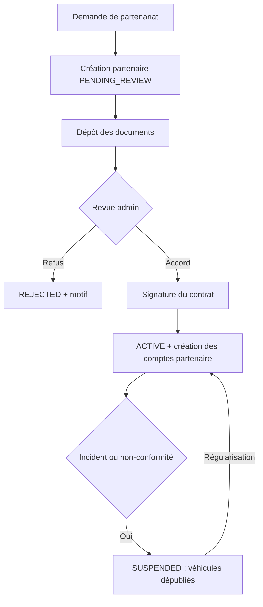
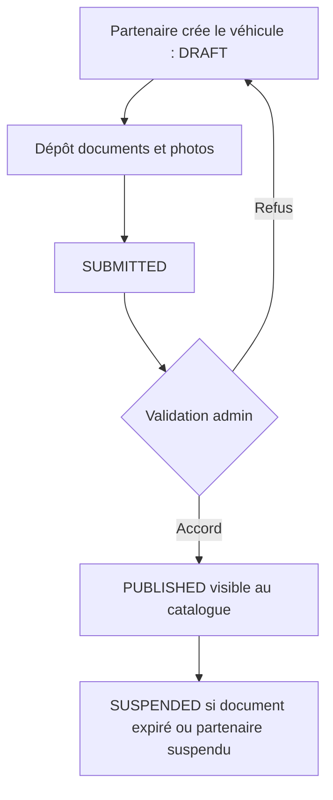
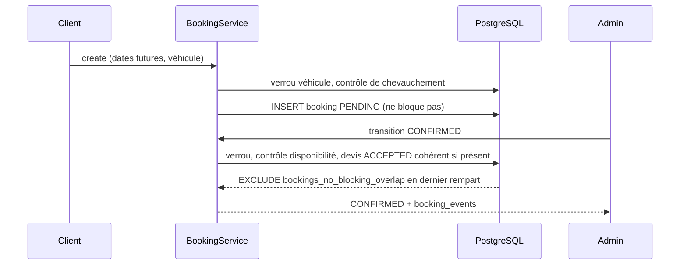
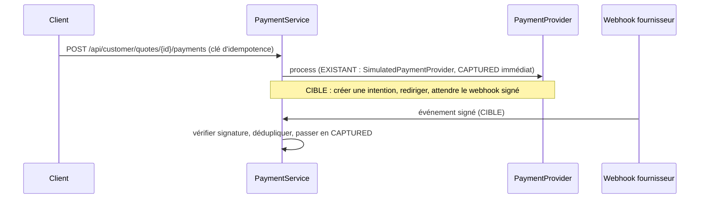
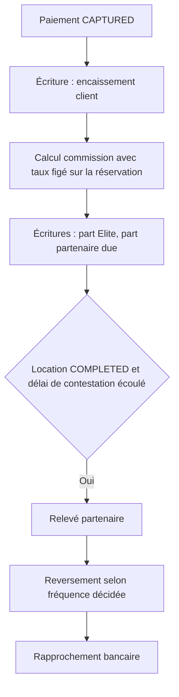
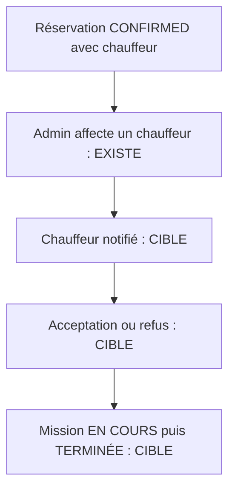
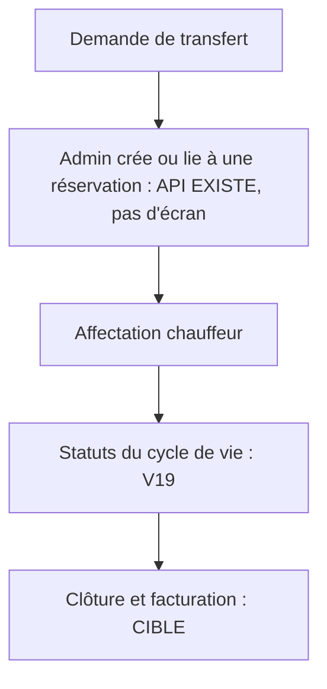
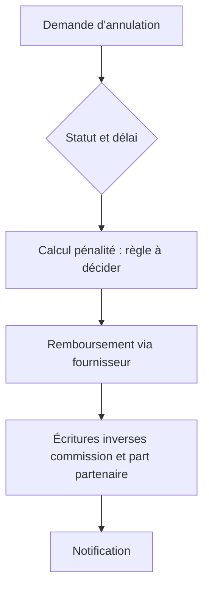

# Elite Tunisia — Analyse d'écart vers la Premium Mobility Marketplace

> Audit **lecture seule**, par analyse statique du dépôt. Aucun test, aucune migration et aucune requête de base n'ont été exécutés pour ce document.
> Légende : `[CONFIRMÉ]` démontré par le code, `[CONSTAT]` observation directe, `[HYPOTHÈSE]` à valider. Confiance : High / Medium / Low.
> Ce document complète `international-benchmark-and-target-architecture.md` (benchmark) sans le remplacer. Il tient compte des décisions métier confirmées : marketplace de partenaires, validation administrative obligatoire de toute réservation, commission en pourcentage, encaissement centralisé par Elite Tunisia, chauffeurs gérés centralement.

---

## 1. Executive Summary

**État général.** Le projet est un **monolithe modulaire Spring Boot + Angular + PostgreSQL pour un loueur mono-opérateur** (clients et personnel interne). Il n'est pas encore une marketplace : aucune notion de partenaire n'est implémentée dans le code. Maturité : *tests internes* pour le périmètre « loueur » ; *fondations seulement* pour la marketplace.

**Points forts (réutilisables)**
- Réservation robuste : verrou pessimiste du véhicule, contrainte d'exclusion PostgreSQL `bookings_no_blocking_overlap` (V4), machine à états explicite (`BookingStatus.canTransitionTo`). `[CONFIRMÉ]` High.
- **La règle « toute réservation est validée par l'administration » est déjà dans le modèle** : une réservation naît `PENDING` et ne bloque pas le véhicule ; seul le passage à `CONFIRMED` (admin, `bookings:manage`) contrôle la disponibilité et bloque la période. `[CONFIRMÉ]` High.
- RBAC par permissions en base, CSRF double-cookie, refresh tokens hachés avec rotation, audit applicatif, abstractions `PaymentProvider`, `FileStorageService`, `NotificationService`.
- Idempotence des paiements (index unique V6) et affectation de chauffeur sérialisée.

**Principales lacunes**
- Aucun partenaire, propriétaire ni rattachement véhicule-partenaire ; aucun rôle `PARTNER` ni `DRIVER`.
- Paiement **simulé** ; aucun webhook, remboursement, commission, reversement, caution.
- Le paiement est rattaché au **devis**, jamais à la réservation ; il ne conditionne ni ne déclenche aucune transition.
- Facture de location jamais émise en production (hors frais de retour).
- Transferts : API sans écran ; chauffeurs sans compte, donc pas d'espace chauffeur.
- Notifications : interface sans implémentation.

**Risques critiques** : voir §14. **Avis global** : l'évolution est réaliste **sans réécriture**. Le noyau de réservation, la sécurité et les abstractions sont conservables. Le chantier principal est l'ajout d'un **domaine partenaire** et d'un **domaine financier** (paiement, commission, grand livre, reversement), qui n'existent pas.

---

## 2. Architecture actuelle

### 2.1 Backend `[CONSTAT]`
Paquets `backend/src/main/java/tn/elitetunisia/` : `auth`, `user`, `customer`, `employee`, `brand`, `category`, `vehicle`, `catalogue`, `booking`, `quote`, `payment`, `invoice`, `driver`, `transfer`, `common` (audit, config, pricing, storage, exception). Paquets **vides** (seul `package-info.java`) : `partner`, `document`, `report`, `service`. `notification` ne contient que l'interface `NotificationService`. Contrôleurs par ressource sous `/api/<ressource>` et `/api/admin/<ressource>` ; services transactionnels ; `open-in-view: false`.

### 2.2 Frontend `[CONSTAT]`
Routes lazy dans `frontend/src/app/app.routes.ts` : public (catalogue, fiche véhicule), `auth`, `customer` (dashboard, réservations, devis, factures, profil), `admin` (véhicules, marques, catégories, réservations, clients, chauffeurs, devis, factures, services, utilisateurs). **Écrans provisoires** (composant générique `page`) : `chauffeur`, `airport-transfer`, `services`, `contact`, `forgot-password`, `customer/notifications`, `admin/payments`, `admin/partners`, `admin/reports`, accueil admin. Seules 4 routes admin ont un `roleGuard` propre (customers, drivers, quotes/new, users).

### 2.3 Base de données
Migrations et schéma : voir §2.3.1 et §2.3.2.

#### 2.3.1 Audit des migrations Flyway `[CONFIRMÉ]` High
| Emplacement | Contenu | Statut |
|---|---|---|
| `database/migrations/` | V1 à V20, 20 fichiers, **suivis par git** | **ACTIF** |
| `backend/src/main/resources/db/migration/` | `V11__create_booking_driver_assignments.sql` (hash **différent** de celui de `database/migrations/V11`) et 3 fichiers `_DISABLED_V4/V5/V6__*.sql` | **INERTE** |

Preuves :
- `application.yml` : `spring.flyway.locations: classpath:db/migration`.
- `backend/pom.xml` (lignes 145 à 155) : la ressource `src/main/resources` **exclut** `db/migration/**`, puis `${project.basedir}/../database/migrations` est copié vers `db/migration`. Le dossier backend n'atteint donc jamais le classpath.
- `application-test.yml` : `flyway.enabled: false`, H2 en mode PostgreSQL, `ddl-auto: create-drop`, `schema-test.sql`. **Les tests H2 ne valident pas les migrations.** Les tests PostgreSQL (`*IT`, `PaymentPostgresIntegrationTests`) les exercent.

Risques :
- **R-MIG-1** : un second `V11` divergent est tracké dans le backend. Un changement de `pom.xml` ou de `locations` pourrait l'activer et provoquer un conflit de version ou un checksum différent. Les fichiers `_DISABLED_*` sont ignorés par Flyway (préfixe non reconnu). Confiance : High.
- **R-MIG-2** : H2 et `schema-test.sql` peuvent diverger du schéma réel. Compensé par les tests PostgreSQL, dont l'exécution n'a **pas** été refaite ici.
- Ne pas modifier : la correction (retrait des fichiers inertes) est une décision à valider (§13).

Chaîne des dépendances : V1 (schéma initial, déjà `partners`, `documents`, `notifications`) → V2 (`user_roles`, permissions, audit) → V3 (catalogue) → V4 (réservation, EXCLUDE gist, `btree_gist`) → V5 (devis) → V6 (paiements, renomme l'ancienne table en `legacy_payments`) → V7 (factures, `legacy_invoices`) → V8 (opérations de remise/retour) → V9 à V20 (devises, chauffeurs, transferts, permissions, alignement de nullabilité). Les `legacy_*` restent en base.

#### 2.3.2 Schéma `[CONSTAT]`
Tables de V1 **jamais utilisées par le code** : `partners` (colonnes `name`, `partner_type`, `email`, `phone`, `commission_rate numeric(5,2)` 0 à 100, `active`), `documents` (`owner_user_id`, `storage_key`, `content_type`), `notifications`, `service_requests`. `ddl-auto: validate` n'échoue pas, car aucune entité ne les mappe. `[CONFIRMÉ]` High (paquets `partner`, `document` et `notification` sans entité).

Lacunes de contraintes : `vehicles` sans colonne partenaire/propriétaire/plaque/caution ; `payments.quote_id` sans unicité ; `invoices` (V7) sans clés étrangères sur `booking_id`/`quote_id`/`customer_id` ; `payments.quote_id ... ON DELETE CASCADE`.

### 2.4 Sécurité `[CONSTAT]`
`SecurityConfig` : `/api/admin/**` → `admin:access` ; transferts → `admin:access` + `bookings:manage` ; `/api/customer/**` → rôle `CUSTOMER` ; reste authentifié. CSRF via cookie `SameSite=Strict`, CORS par liste d'origines, JWT 15 minutes, refresh 30 jours en cookie HttpOnly, `LoginThrottle` en mémoire. Rôles en base : `SUPER_ADMIN, MANAGER, AGENT, CONCIERGE, ACCOUNTANT, CUSTOMER` (V1). Pas de CSP ni `forward-headers-strategy`.

### 2.5 Tests
44 classes de test backend (165 occurrences `@Test`), dont MockMvc, `EndpointAuthorizationSweepTest`, concurrence (`BookingEngineTests`, `PostgresIdempotencyIT`, `DriverAssignmentPostgresIT`, `PostgresInvoiceConcurrencyIT`, `LastSuperAdminConcurrencyIT`), un test de migration, E2E Playwright côté frontend. **Rien n'a été exécuté pendant cet audit.**

### 2.6 Dépendances externes
Aucune intégration externe réelle : paiement simulé, e-mail absent, stockage local `~/.elite-tunisia/uploads`.

---

## 3. Architecture cible recommandée

Rester en **monolithe modulaire** : un module Maven, des paquets par domaine, dépendances orientées vers les domaines stables.

| Module cible | Responsabilité | Base existante |
|---|---|---|
| Identity & Access | utilisateurs, rôles, permissions, **portée de données** (partenaire, chauffeur) | `auth`, `user` |
| Partner Management | partenaire, utilisateurs partenaires, documents, contrat, statut | table `partners` (V1), paquet `partner` vide |
| Vehicle Management | véhicule, propriétaire, partenaire, documents, publication | `vehicle` |
| Availability | disponibilité, blocages | `BookingRepository.overlaps` + EXCLUDE V4 |
| Pricing | tarifs, saisons, remises | `RentalPricingService` (minimal) |
| Search & Catalogue | recherche par dates et lieu | `catalogue`, `VehicleSpecification` |
| Booking | cycle de vie, validation admin | `booking` |
| Payment | intention, confirmation serveur, webhooks, remboursement | `payment` (+ `PaymentProvider`) |
| Financial | commission, grand livre, reversement | **absent** |
| Invoicing | factures client, relevés partenaire | `invoice` |
| Driver Operations | profils, affectations, missions, accès chauffeur | `driver` |
| Transfers | transferts | `transfer` |
| Notifications | outbox, canaux | interface seule |
| Reviews & Support | avis, tickets | absent |
| Reporting & Audit | tableaux de bord, journal | `AuditService`, `report` vide |

**Flux** : Search → Booking (`PENDING`) → validation admin (Availability + Partner actif + Vehicle publié) → Payment (intention) → Financial (écritures commission) → Invoicing → Notifications. Le **paiement ne doit jamais** modifier un statut sans confirmation serveur (webhook/vérification).

**Interfaces** : public, client, admin, **partenaire** (nouveau), **chauffeur** (nouveau). Un même `SecurityConfig` avec préfixes `/api/partner/**` et `/api/driver/**` ; la protection par préfixe ne suffit pas : chaque requête doit filtrer par `partnerId`/`driverId` issu du jeton, jamais d'un paramètre.

**Principes** : le contrôleur transporte, le service décide, le repository filtre par propriétaire ; migrations additives uniquement ; montants en `numeric(12,3)` TND ; événements financiers en ajout seul.

---

## 4. Gap Analysis fonctionnelle

| Module | État actuel | État cible | Écart | Priorité |
|---|---|---|---|---|
| Identity & Access | Implémenté (JWT, refresh, RBAC, anti-brute-force mémoire) ; rôles internes + CUSTOMER | + PARTNER, DRIVER, portée de données | Rôles et portée absents ; `admin:access` partagé par tous les rôles internes | P0 |
| Partner Management | **Non implémenté** (table V1 orpheline, paquet vide, écran provisoire) | Onboarding, validation, documents, suspension | Total | P0 |
| Vehicle Management | Implémenté mono-opérateur | Propriétaire, partenaire, documents, caution, validation avant publication | Colonnes, statuts de publication, documents | P0 |
| Availability | Implémenté (EXCLUDE + verrou) pour réservations seulement | + blocages partenaire/maintenance ; recherche par dates | Pas de blocage manuel, pas de filtre dates au catalogue | P1 |
| Pricing | Minimal (jour × tarif, `applyCommercialPrice` via devis) | Saisons, durée, options, commission | Moteur à étendre | P1 |
| Search & Catalogue | Filtres simples, pagination | Dates, lieu, partenaire, tri | Partiel | P1 |
| Booking | Implémenté, **validation admin déjà conforme** | + modification, annulation chiffrée | Pas d'expiration des `PENDING` (décision métier) ; pas de politique d'annulation | P1 |
| Payment | **Simulé** ; sur devis ; sans webhook, remboursement | Réel, serveur, idempotent, lié à la réservation | Fournisseur, webhooks, état d'intention, remboursement | P0 |
| Financial | **Non trouvé** (commission, reversement, grand livre) | Commission %, soldes partenaire, reversements | Total | P0 (conception) / P1 |
| Invoicing | Partiel : facture de retour seulement ; `createFromQuote` sans appelant | Facture client + relevé partenaire | Facture de location jamais émise | P0 |
| Driver Operations | Partiel : fiche + affectation admin | Compte chauffeur, missions, statuts, documents | Pas de rôle, pas d'espace | P1 |
| Transfers | Partiel : API admin, **aucun écran**, pas de durée de fin | Planification, conflit chauffeur | UI + modèle de temps | P1 |
| Notifications | **Non implémenté** (interface) | Outbox + e-mail | Total | P1 |
| Reviews & Support | Non trouvé | Avis, tickets | Total | P2 |
| Reporting & Audit | Audit applicatif présent ; rapports absents | Tableaux de bord financiers | Rapports | P2 |

---

## 5. Cartographie technique détaillée

| Domaine | Entité / table | Repository | Service | Contrôleur / endpoints | Écran Angular |
|---|---|---|---|---|---|
| Utilisateur | `UserEntity` / `users`, `user_roles` | `UserRepository` | `AdminUserService`, `AccountService` | `AdminUserController`, `AuthController` (`/api/auth/*`) | `auth/*`, `admin/users` |
| Client | `CustomerEntity` / `customers` | `CustomerRepository` | — | `CustomerProfileController`, `AdminCustomerController` | `customer/profile`, `admin/customers` |
| Véhicule | `VehicleEntity` / `vehicles`, images, features | `VehicleRepository` | `VehicleService` | `PublicVehicleController`, `AdminVehicleController` | catalogue, `admin/vehicles` |
| Réservation | `BookingEntity` / `bookings`, `booking_events`, `booking_operations` | `BookingRepository` | `BookingService`, `BookingOperationService` | `BookingPublicController`, `CustomerBookingController`, `AdminBookingController`, `AdminBookingOperationsController` | `customer/bookings`, `admin/bookings` |
| Devis | `QuoteEntity` / `quotes`, lignes, événements | `QuoteRepository` | `QuoteService`, `QuoteExpirationWorker` | `CustomerQuoteController`, `AdminQuoteController` | `*/quotes` |
| Paiement | `PaymentEntity` / `payments`, `payment_events` | `PaymentRepository` | `PaymentService` + `SimulatedPaymentProvider` | `CustomerPaymentController` (`POST /api/customer/quotes/{id}/payments`) | **provisoire** `admin/payments` ; pas d'écran client de paiement |
| Facture | `InvoiceEntity` / `invoices` | `InvoiceRepository` | `InvoiceService` | `CustomerInvoiceController`, `AdminInvoiceController` | `customer/invoices`, `admin/invoices` |
| Chauffeur | `DriverEntity`, `BookingDriverAssignmentEntity` | `DriverRepository`, `BookingDriverAssignmentRepository` | `DriverService`, `DriverAssignmentService` | `AdminDriverController`, `AdminDriverAssignmentController` | `admin/drivers` |
| Transfert | `TransferEntity` / `transfers` | `TransferRepository` | `TransferService` | `AdminTransferController` | **Non trouvé** |
| Partenaire | table `partners` seule | **Non trouvé** | **Non trouvé** | **Non trouvé** | provisoire `admin/partners` |
| Document | table `documents` seule | **Non trouvé** | **Non trouvé** | upload d'images seulement (`ImageUploadController`) | — |
| Notification | table `notifications` seule | **Non trouvé** | interface | **Non trouvé** | provisoire `customer/notifications` |
| Audit | `AuditLogEntity` | `AuditLogRepository` | `AuditService` | — | — |

Termes recherchés pour « Non trouvé » : `partner`, `commission`, `payout`, `webhook`, `owner`, `deposit`, `refund` dans `backend/src/main` et `frontend/src`.

---

## 6. Évolutions du modèle de données (propositions, rien n'est créé)

**À conserver** : `bookings` + EXCLUDE, `booking_events`, `booking_operations`, `quotes`, `payments` (idempotence), `drivers`, `transfers`, `audit_logs`, `refresh_tokens`, `roles`/`permissions`.

**À faire évoluer**
- `vehicles` : `partner_id` (FK `partners`), `owner_type`/`owner_name` (propriétaire légal distinct du partenaire commercial), `registration_number` (unique), `deposit_amount`, `publication_status` (DRAFT, SUBMITTED, PUBLISHED, SUSPENDED).
- `partners` (existante) : statut de validation (distinct de `active`), identité légale, coordonnées bancaires chiffrées, version du contrat. `commission_rate` existant ne doit **pas** être utilisé tel quel avant décision (§13) ; le taux appliqué doit être **figé sur chaque réservation**.
- `bookings` : `partner_id` dénormalisé, `commission_rate_applied`, `commission_amount`, `payment_status`, `expires_at` (PENDING), lieux référencés.
- `payments` : rattacher à `booking_id` obligatoire, `provider`, `provider_reference` unique, statuts d'intention, **unicité d'un paiement capturé par réservation** (index unique partiel), remplacer `ON DELETE CASCADE` par `RESTRICT`.
- `invoices` : clés étrangères manquantes, unicité `quote_id`/`booking_id` selon la règle décidée, index `customer_id`.
- `transfers` : durée ou `ends_at` pour permettre une contrainte d'exclusion chauffeur.

**Nouvelles entités potentielles** : `partner_users`, `partner_documents`, `vehicle_documents`, `driver_users` (ou `users.driver_id`), `ledger_entries` (écritures en ajout seul), `partner_statements`, `payouts`, `refunds`, `payment_webhook_events` (id fournisseur unique), `cancellation_policies`, `notification_outbox`, `reviews`, `support_tickets`.

**Contraintes nécessaires** : EXCLUDE sur chauffeur/période ; unicité `provider_reference` ; CHECK `commission_rate` ; somme des écritures par réservation égale au montant encaissé (contrôle applicatif + test) ; interdiction de `UPDATE/DELETE` sur `ledger_entries` (trigger ou droits).

---

## 7. Workflows métier

Les diagrammes distinguent **[EXISTE]** (vérifié dans le code) et **[CIBLE]** (proposé, soumis aux décisions du §13).

### 7.1 Onboarding et validation d'un partenaire — [CIBLE] (rien n'existe)

### 7.2 Ajout et publication d'un véhicule — [EXISTE] partiel
Aujourd'hui l'admin crée un véhicule (`AdminVehicleController`) avec un statut ; il n'y a ni partenaire ni étape de validation.

### 7.3 Réservation et validation administrative — [EXISTE]

Points `[CONFIRMÉ]` : `BookingService.create`, `transition`, `requireAvailable`, contrainte V4. Écarts : la confirmation **n'exige pas de paiement** ; sans devis, elle est possible au tarif de base ; aucune expiration des `PENDING` (règle métier définitive : pas d'expiration automatique).

### 7.4 Paiement et confirmation — [EXISTE] simulé, [CIBLE] réel

### 7.5 Commission et reversement — [CIBLE] (rien n'existe)

### 7.6 Location avec chauffeur — [EXISTE] partiel
Existant : affectation admin d'un chauffeur à une réservation, avec verrou du chauffeur et contrôle de chevauchement (`DriverAssignmentService`, V11). Absent : compte chauffeur, missions, statuts.

### 7.7 Gestion d'un transfert — [EXISTE] API seulement

### 7.8 Annulation et remboursement — [EXISTE] annulation seulement
Existant : `customerCancel` et `transition(CANCELLED)`. Aucune pénalité, aucun remboursement ; `payments.refunded_*` jamais alimentés.

---

## 8. Analyse des risques

| Catégorie | Risque | Preuve | Gravité | Confiance |
|---|---|---|---|---|
| Paiements | **Double paiement d'un même devis** avec deux clés d'idempotence différentes : seule `idempotency_key` est unique ; aucune unicité par devis, aucun contrôle d'un paiement `CAPTURED` existant | `PaymentService.createForQuote` ; V6 `payments_idempotency_idx` ; pas d'index sur `quote_id` | Haute | High |
| Paiements | Paiement simulé capturé immédiatement, aucune vérification serveur externe | `SimulatedPaymentProvider.process` | Critique avant production | High |
| Paiements | `ON DELETE CASCADE` de `quotes` vers `payments` : la suppression d'un devis efface des traces financières | V6 `fk_payments_quote` | Moyenne | High |
| Finance | Aucune commission, aucun grand livre, aucun reversement | recherche `commission`/`payout` : seulement la colonne `partners.commission_rate`, jamais lue | Critique pour la marketplace | High |
| Finance | Facture de location non émise ; `createFromQuote` sans appelant en production, sans garde d'unicité | `InvoiceService`, `BookingOperationService` ligne ~91 | Haute | High |
| Finance | Factures sans clés étrangères | V7 | Moyenne | High |
| Réservations | Confirmation possible sans paiement ni devis | `BookingService.transition` | Haute (décision) | High |
| Réservations | `PENDING` sans expiration : demandes dormantes | seul `QuoteExpirationWorker` existe | Moyenne | High |
| Sécurité | Aucune isolation partenaire (inexistante) ; un rôle partenaire recevant `admin:access` verrait toute l'administration | `SecurityConfig` ligne 87 | Critique si on ajoute le rôle sans portée | High |
| Sécurité | `LoginThrottle` en mémoire : inefficace en multi-instance | `LoginThrottle` | Moyenne | High |
| Données | Migrations en double emplacement, V11 divergent | §2.3.1 | Moyenne | High |
| Données | Tests H2 ne valident pas les migrations | `application-test.yml` | Moyenne | High |
| Exploitation | Pas de CSP, pas de `forward-headers-strategy`, stockage local non partagé | `application.yml` | Moyenne | Medium |
| Architecture | `partners`, `documents`, `notifications` orphelines : risque d'ignorer des contraintes déjà présentes | V1 | Faible | High |
| Performance | Liste admin des factures sans pagination (`findAll`) | `InvoiceService.adminList` | Moyenne | High |
| UX | Pas de recherche par dates, parcours chauffeur/transfert provisoires, notifications absentes | `app.routes.ts` | Moyenne | High |

---

## 9. Stratégie d'évolution et de migration

1. **Ne rien casser** : tout changement de schéma passe par une migration `V21+` additive, dans `database/migrations/` uniquement.
2. **Colonnes nullables d'abord**, remplissage, puis `NOT NULL` dans une migration ultérieure ; les véhicules existants reçoivent un partenaire « Elite Tunisia (interne) » pour préserver les données.
3. **Expand / contract** : ajouter les colonnes, déployer le code qui les lit et les écrit, puis resserrer les contraintes.
4. **Aucune migration sur une base réelle sans sauvegarde** testée avec `scripts/db-backup.ps1` et restaurée avec `db-restore.ps1` sur une base isolée.
5. **Données historiques** : une copie représentative n'est pas disponible ici ; toute contrainte unique ou clé étrangère ajoutée à `invoices`/`payments` exige un contrôle préalable des doublons sur les données réelles.
6. **Tests avant chaque palier** : PostgreSQL isolé (port 15432), tests de concurrence rejoués, balayage d'autorisations étendu aux nouveaux préfixes.
7. **Compatibilité d'API** : conserver les endpoints existants ; ajouter `/api/partner/**` et `/api/driver/**` plutôt que modifier `/api/admin/**`.
8. **Feature flags** pour le paiement réel et le reversement : le mode simulé reste le défaut tant que les décisions §13 ne sont pas prises.
9. **Décision préalable sur l'emplacement des migrations** : conserver `database/migrations/` comme source unique.

---

## 10. Backlog de développement priorisé

Taille : S ≤ 2 jours, M ≤ 1 semaine, L > 1 semaine. « BD » = base de données.

### P0 — Blocages critiques et fondations
| ID | Description | Module | Taille | Dépend de | Critères d'acceptation | Backend | Frontend | BD |
|---|---|---|---|---|---|---|---|---|
| P0-01 | Interdire un second paiement capturé par devis/réservation | Payment | S | — | 2 requêtes concurrentes avec clés différentes : une seule `CAPTURED` ; test PostgreSQL | `PaymentService` | — | index unique partiel |
| P0-02 | Rattacher le paiement à la réservation et définir l'effet sur le statut | Payment, Booking | M | décision paiement/validation | un paiement ne change jamais un statut sans confirmation serveur | `PaymentService`, `BookingService` | écran de paiement client | `payments.booking_id` |
| P0-03 | Émettre la facture de location (règle à valider) | Invoicing | M | décision facturation | une facture par location, idempotente, test de concurrence | `InvoiceService`, `BookingOperationService` | — | unicité, FK |
| P0-04 | Domaine Partenaire : entité, repository, service, statut, CRUD admin | Partner | L | décision statut juridique | partenaire créé, validé, suspendu ; audit | paquet `partner` | `admin/partners` | évolution de `partners` |
| P0-05 | Rôles `PARTNER` et `DRIVER` avec **portée de données** | Identity | L | P0-04 | scénarios d'isolation 1 à 4 du §11 verts ; aucun accès `/api/admin/**` | `SecurityConfig`, services, repositories | gardes, menus | `user_roles`, `partner_users` |
| P0-06 | Rattacher véhicule ↔ partenaire ↔ propriétaire | Vehicle | M | P0-04 | véhicule sans partenaire refusé ; filtrage partenaire | `VehicleService` | formulaire véhicule | colonnes `vehicles` |
| P0-07 | Conception du grand livre et de la commission (sans taux codé) | Financial | M | décisions commission | taux figé par réservation, écritures en ajout seul | nouveau `finance` | — | `ledger_entries` |
| P0-08 | Clarifier les migrations en double | Plateforme | S | décision | un seul emplacement documenté, build identique | `pom.xml` seulement si validé | — | — |

### P1 — Indispensables à la marketplace
| ID | Description | Module | Taille | Dépend de | Critères d'acceptation | Backend | Frontend | BD |
|---|---|---|---|---|---|---|---|---|
| P1-01 | Fournisseur de paiement réel, webhooks signés, remboursement | Payment | L | P0-02, décision fournisseur | webhook rejoué sans double effet ; signature invalide rejetée | `provider/*` | statut paiement | `payment_webhook_events`, `refunds` |
| P1-02 | ~~Expiration des réservations `PENDING`~~ **Abandonnée** : décision métier, aucune expiration automatique | — | — | — | — | — | — | — |
| P1-03 | Politique d'annulation et pénalités | Booking | M | décision annulation | calcul reproductible, test des bornes | `BookingService` | écran client | `cancellation_policies` |
| P1-04 | Documents partenaire, véhicule, chauffeur et validation | Document | L | P0-04 | upload contrôlé, accès limité au propriétaire | `FileStorageService` + `document` | écrans dépôt | `documents`, liaisons |
| P1-05 | Publication de véhicule soumise à validation | Vehicle | M | P1-04 | non publié tant que non validé | `VehicleService` | file de validation admin | `publication_status` |
| P1-06 | Espace partenaire : véhicules, disponibilités, réservations | Partner | L | P0-05 | partenaire A ne voit rien de B | `/api/partner/**` | module lazy | — |
| P1-07 | Blocages de disponibilité | Availability | M | P0-06 | blocage empêche la confirmation | service | calendrier | table de blocages + EXCLUDE |
| P1-08 | Reversements et relevés partenaires | Financial | L | P0-07, décision reversement | relevé = somme des écritures | `finance` | écrans admin et partenaire | `payouts`, `partner_statements` |
| P1-09 | Espace chauffeur : missions affectées uniquement | Driver | L | P0-05 | chauffeur A ne lit pas la mission de B | `/api/driver/**` | module lazy | lien `driver_users` |
| P1-10 | Écran admin des transferts et contrainte chauffeur | Transfers | M | décision V21 | chevauchement refusé en base | `TransferService` | écran admin | `ends_at`, EXCLUDE |
| P1-11 | Notifications par outbox | Notifications | M | — | message émis une seule fois ; reprise après erreur | `notification` | centre de notifications | `notification_outbox` |
| P1-12 | Recherche par dates et lieux | Search | M | — | seuls les véhicules disponibles sont listés | `VehicleSpecification` | formulaire de recherche | index |
| P1-13 | Limitation de connexion partagée, CSP, en-têtes proxy | Sécurité | M | — | limite effective sur 2 instances | `LoginThrottle`, `SecurityConfig` | — | table ou cache |
| P1-14 | Pagination des factures | Invoicing | S | — | `adminList` paginé | `InvoiceService` | tableau | index `customer_id` |

### P2 — Améliorations
| ID | Description | Module | Taille | Dépend de | Critères d'acceptation | Backend | Frontend | BD |
|---|---|---|---|---|---|---|---|---|
| P2-01 | Avis et notes | Reviews | M | P1-06 | un avis par location terminée | nouveau | fiche véhicule | `reviews` |
| P2-02 | Support et tickets | Support | M | P1-11 | ticket lié à la réservation | nouveau | centre d'aide | `support_tickets` |
| P2-03 | Rapports et tableaux de bord financiers | Reporting | L | P1-08 | chiffres rapprochés du grand livre | `report` | `admin/reports` | vues |
| P2-04 | Nettoyage des tables `legacy_*` | Données | S | décision | après archivage vérifié | — | — | migration dédiée |
| P2-05 | Internationalisation | Frontend | M | — | FR/AR/EN | — | i18n | — |

---

## 11. Stratégie de tests

| Type | Existant (non exécuté ici) | Reste à faire |
|---|---|---|
| Unitaires | `LoginThrottleTest`, `LastSuperAdminProtectionTest`, `RentalPricing`, `BookingOperationServiceTest` | commission, pénalités, expiration |
| Intégration (H2) | `BookingEngineTests`, `QuoteEngineTests`, MockMvc par contrôleur | nouveaux services partenaire/finance |
| PostgreSQL réel | `PaymentPostgresIntegrationTests`, `PostgresIdempotencyIT`, `DriverAssignmentPostgresIT`, `PostgresInvoiceConcurrencyIT`, `LastSuperAdminConcurrencyIT`, test de migration | contraintes V21+, EXCLUDE chauffeur/transfert |
| Sécurité | `EndpointAuthorizationSweepTest`, `InvoiceAccessControlTest`, `AdminTransferControllerSecurityTest`, `ProductionProfileHardeningTest` | balayage `/api/partner/**` et `/api/driver/**` |
| Isolation partenaires | **Aucun** (concept absent) | scénarios 1 à 3 : A modifie un identifiant vers B pour véhicule, réservation, finance → 404 |
| Isolation chauffeur | **Aucun** (pas de rôle) | scénario 4 : mission non affectée → 404 |
| Accès administrateur | balayage existant | scénario 5 : jeton partenaire/chauffeur/client sur `/api/admin/**` → 403 |
| Concurrence réservations | `BookingEngineTests` | rejouer sur PostgreSQL à chaque palier |
| Idempotence paiement | `PostgresIdempotencyIT` | clés différentes sur un même devis (P0-01), webhook rejoué |
| Workflows complets | Playwright (client, admin) | réservation → validation → paiement → facture → reversement |
| E2E Angular | Playwright | espaces partenaire et chauffeur |

Tests **exécutés pendant cet audit** : aucun. Les chiffres ci-dessus sont des comptages statiques de fichiers.

---

## 12. Ordre d'implémentation recommandé

1. Décisions bloquantes (§13) et clarification des migrations (P0-08).
2. Correctifs de cohérence existants : P0-01, P0-03, P1-14.
3. Domaine partenaire (P0-04) → rôles et portée de données (P0-05) → véhicule rattaché (P0-06).
4. Conception financière (P0-07), paiement lié à la réservation (P0-02).
5. Documents et publication (P1-04, P1-05), espace partenaire (P1-06), blocages (P1-07).
6. Paiement réel (P1-01), annulation et expiration (P1-02, P1-03).
7. Reversements (P1-08).
8. Espace chauffeur et transferts (P1-09, P1-10), notifications (P1-11), recherche (P1-12).
9. Durcissement multi-instance (P1-13), puis P2.

Raison : l'isolation des données doit exister **avant** d'ouvrir un portail externe, et la finance doit être conçue **avant** le paiement réel pour ne pas encaisser sans pouvoir répartir.

---

## 13. Décisions métier restantes

| Décision | Impact technique ou fonctionnel |
|---|---|
| Taux de commission | Valeur de configuration et figée par réservation ; ne rien coder en dur |
| Base de calcul (globale, partenaire, catégorie) | Détermine si le taux vit sur `partners`, `categories` ou une table de règles ; priorité entre règles |
| Fréquence et modalités de reversement | Calendrier, relevés, rapprochement, virement manuel ou automatique ; délai de contestation |
| Annulation, remboursement, pénalités, no-show | Calcul d'annulation, écritures inverses de commission, états de réservation supplémentaires |
| Cautions et dépôts de garantie | Pré-autorisation ou empreinte bancaire, restitution, nouvelles colonnes et statuts de paiement |
| TVA, facturation, obligations contractuelles | Taux et calcul (aujourd'hui montant fixe), numérotation, facture au nom d'Elite ou du partenaire, mandat de facturation ; **à valider par un expert-comptable** |
| Prestataire de paiement | Compatibilité marketplace (encaissement centralisé, éventuelle séparation des fonds), webhooks, remboursement partiel, devises |
| Assurances, dommages, responsabilités | Champs et documents d'assurance, workflow de sinistre, conditions générales |
| Statut juridique des chauffeurs | Salarié, indépendant ou partenaire : documents requis, facturation, accès aux données ; **à valider par un juriste** |
| Règle de facturation depuis un devis (déjà posée) | Une ou plusieurs factures par réservation, unicité en base |
| Contrainte d'exclusion des chauffeurs sur transferts | Ajout d'une fin de mission ou d'une durée |
| Un paiement conditionne-t-il la confirmation ? | Ordre des étapes validation admin, paiement, confirmation |
| Délai d'expiration d'une réservation `PENDING` | Worker et message client |
| Suppression du dossier de migrations inerte | Voir §2.3.1 |
| Parcours simplifié du « modèle hybride » | Définir ce qui est simplifié ; la validation admin reste obligatoire |

---

## 14. Conclusion et recommandations

### Problèmes les plus critiques
1. **Aucun domaine partenaire** : modèle, rôle, portée de données et écran inexistants (§5, V1 `partners` orpheline).
2. **Aucun domaine financier** : ni commission, ni grand livre, ni reversement.
3. **Paiement simulé** et rattaché au devis ; pas de webhook, pas de remboursement.
4. **Double paiement possible** d'un même devis avec deux clés d'idempotence.
5. **Facture de location jamais émise** (hors frais de retour).
6. **Aucune isolation à tester** : ajouter un rôle partenaire sans portée l'exposerait à `/api/admin/**`.
7. **Migrations en double emplacement**, avec un `V11` divergent tracké.
8. **Confirmation sans paiement** et `PENDING` sans expiration.
9. **Chauffeurs et transferts non exploitables** : aucun compte, aucun écran de transfert.
10. **Limiteur de connexion en mémoire** et pas de CSP : durcissement multi-instance requis.

### Actions prioritaires
P0-01, P0-03 (corrections peu risquées), puis P0-04 à P0-07 dans l'ordre du §12, après les décisions du §13.

### Risques à ne pas négliger
Montants financiers sans écritures immuables ; données historiques non testées sur une copie ; conformité fiscale et juridique hors du périmètre technique ; H2 masquant des écarts de schéma.

### Recommandation
**Faire évoluer le code existant, sans réécriture.** Conserver le moteur de réservation, la sécurité et les abstractions. Commencer par trois actions : (1) corriger les deux incohérences financières existantes (P0-01, P0-03) ; (2) obtenir les décisions bloquantes (commission, paiement, annulation, TVA) ; (3) construire le domaine partenaire **avec** son isolation de données et ses tests avant d'ouvrir tout portail externe. Le paiement réel et les reversements viennent ensuite, et seulement lorsque le grand livre est conçu.

---

## Annexe — Vérifications et limites

**Réalisées (statique)** : état Git, inventaire des paquets et routes, lecture de `BookingService`, `BookingStatus`, `PaymentService`, `SimulatedPaymentProvider`, `CustomerPaymentController`, `SecurityConfig` (règles d'URL), `application*.yml`, `pom.xml`, migrations V1, V4, V6, recherche de termes marketplace, comparaison par hash des deux dossiers de migrations.

**Non réalisées** : compilation, exécution de tests, interrogation de toute base (5432 et 15432 non touchés), vérification du schéma réel migré, relecture complète de chaque service (`QuoteService`, `TransferService`, `InvoiceService` repris des audits précédents), lecture des fichiers `.env` (exclus par politique), CI GitHub, mesures de performance.

**Limites** : les constats de facturation et de transferts reprennent des vérifications faites lors de missions précédentes dans cette session. Aucune donnée historique représentative n'est disponible.
