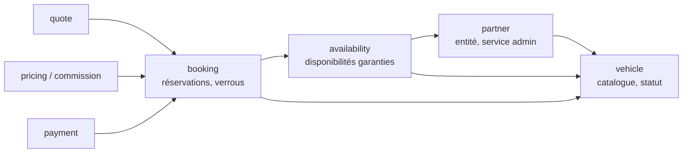

# 03 — Architecture technique cible

## 1. Principes

- Monolithe modulaire existant (Spring Boot 4.1.1, Java 21). Pas de microservice.
- Le code des modules qui fonctionnent n'est pas réécrit.
- Ordre de verrouillage inchangé : **Vehicle → Booking → autres entités** (Quote, Driver, Transfer).
- Contrôles d'autorisation et de métier côté backend uniquement.

## 2. Modules

| Module | Responsabilité | Nouveauté |
|---|---|---|
| `partner` | Cycle de vie des partenaires, rattachement véhicules, historique | Nouveau code (le package existe, vide). |
| `vehicle` | Catalogue, statut opérationnel | Ajout d'une référence `partner`. |
| `availability` | Disponibilités garanties : création, modification, retrait, requête de couverture | Nouveau module. |
| `booking` | Workflow et verrouillage | Ajout d'une vérification de couverture ; pas de réécriture. |
| `pricing` | Calcul du prix et commission (D1) | Snapshot ; hors périmètre de ce lot. |
| `payment` | Paiements | Hors périmètre ; `PaymentEntity` non modifiée. |

Dépendances : `availability` dépend de `partner` et `vehicle` ; `booking` dépend de `availability` ; aucun cycle. `vehicle` ne dépend pas de `availability`.

## 3. Services applicatifs

- `PartnerService` : CRUD, activation, désactivation, historique. Réservé à `partners:manage` (permission à créer).
- `VehiclePartnerTransferService` (nouveau, D-PA-12 validé) : transfert d'un véhicule vers un autre partenaire, sous verrou véhicule, refusé si un engagement actif existe ; clôt le rattachement courant, ouvre le nouveau, met à jour `vehicles.partner_id`, trace l'admin, le motif et la date, dans une seule transaction (review/08 §3.6).
- `BookingService` : pour toute nouvelle réservation garantie, exige `availability_id` (review/08 §5), vérifié dans la transaction.
- `GuaranteedAvailabilityService` : création, modification, retrait sous verrou véhicule ; interroge `BookingRepository` pour les conflits. À la création, vérifie que le partenaire rattaché au véhicule est actif, puis enregistre son identifiant comme **partenaire porteur** (D-PA-05 validé).
- `AvailabilityCoverageService` : fonction pure `couvre(garanties, début, fin)` utilisée par la recherche et la réservation.
- `BookingService` : appelle la couverture avant `requireAvailable`, dans la même transaction et après le verrou véhicule.

### 3.1 Trois notions distinctes (D-PA-05)

| Notion | Où elle est stockée | Mutable | Usage |
|---|---|---|---|
| 1. Partenaire **actuellement** rattaché au véhicule | `vehicles.partner_id` | Oui (transfert contrôlé, D-PA-12 validé) | Règles de création, catalogue, isolation courante |
| 2. Partenaire **porteur** d'une garantie | `guaranteed_availabilities.partner_id` | **Non** après création | Traçabilité de l'engagement, isolation des garanties |
| 3. Historique des rattachements véhicule-partenaire | Table `vehicle_partner_assignments` (validée, review/08 §4) | Non (append-only) | Reconstituer les propriétaires passés |

Ces trois notions ne se confondent pas. Une garantie ne se recalcule jamais à partir du partenaire actuel du véhicule.

## 4. Contrôleurs

| Surface | Préfixe | Accès |
|---|---|---|
| Admin partenaires | `/api/admin/partners` | `admin:access` + `partners:manage` ou `partners:read` |
| Admin disponibilités | `/api/admin/vehicles/{id}/availabilities` | `admin:access` + `availability:manage` |
| Public recherche | `/api/vehicles/available` (existant, à faire évoluer) | Public |
| Partenaire (plus tard) | `/api/partner/...` | Rôle `PARTNER`, filtré par identifiant partenaire |

## 5. DTO

- Un DTO de requête et de réponse par cas d'usage (pas d'entité exposée).
- Validation : `@NotNull`, `@Future` pour la création, bornes de période, `start < end`.
- Erreurs métier : `DomainException` avec code (`AVAILABILITY_OVERLAP`, `AVAILABILITY_HAS_BOOKING`, `PARTNER_INACTIVE`, etc.) traduits par `ApiExceptionHandler` en HTTP 409 ou 422.

## 6. Permissions

Permissions à créer par migration future (non réalisé) : `partners:read`, `partners:manage`, `availability:read`, `availability:manage`. Le rôle `PARTNER` n'existe pas encore ; décision requise avant sa création.

## 7. Journalisation

- Chaque création, modification, retrait de disponibilité et de partenaire est écrit dans `audit_logs` (table existante, V1/V2).
- Champs obligatoires : acteur, action, ressource, avant/après résumé, horodatage, IP.

## 8. Ce qui ne doit pas changer

- `BookingService.BLOCKING`, la contrainte V4, le verrou véhicule.
- Le workflow `PENDING → CONFIRMED`.
- Le paiement et l'idempotence.
