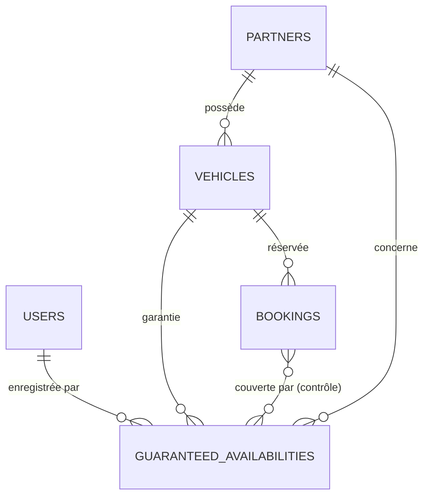

# 04 — Modèle de données proposé

Statut : **proposition uniquement**. Aucune migration n'est écrite ni appliquée. Toute évolution exige une autorisation distincte et une validation sur base PostgreSQL isolée.

## 1. Existant pertinent

- `partners` (V1) : existe, non utilisée. Champ `commission_rate` à retirer ou remplacer selon D1 (décision ouverte sur le mécanisme exact).
- `vehicles` (V1, V3) : pas de `partner_id`.
- `bookings` (V1, V4) : `vehicle_id`, `starts_at`, `ends_at`, EXCLUDE `bookings_no_blocking_overlap`.
- `audit_logs` (V1, V2) : traçabilité réutilisable.

## 2. Modèle recommandé

### 2.1 Modification de `vehicles`
- Ajouter `partner_id UUID` (nullable pendant la transition, puis `NOT NULL` pour les nouveaux véhicules après rattachement des anciens).
- Clé étrangère `REFERENCES partners(id)` **sans** `ON DELETE CASCADE`. Un partenaire ne se supprime pas, il se désactive.
- Index sur `partner_id`.
- `vehicles.partner_id` désigne le partenaire **actuellement** rattaché : valeur unique et modifiable. Il ne sert jamais à reconstituer le partenaire porteur d'une garantie passée.
- Historique des rattachements (**validé**, review/08 §4) : table append-only `vehicle_partner_assignments`, avec EXCLUDE `(vehicle_id WITH =, valid_during WITH &&)`, un seul rattachement courant (index unique partiel `WHERE ended_at IS NULL`), motif, administrateur, date d'opération et `transfer_operation_id` nullable. Les partenaires ne sont jamais supprimés : FK sans cascade.
- Anciens véhicules : `partner_id` reste `NULL`, ils sont exclus du catalogue public tant qu'ils ne sont pas rattachés.

### 2.2 Table `guaranteed_availabilities` (nouvelle)

| Colonne | Type | Contrainte |
|---|---|---|
| `id` | UUID | PK |
| `vehicle_id` | UUID | NOT NULL, FK `vehicles(id)` |
| `partner_id` | UUID | NOT NULL, FK `partners(id)` |
| `period` | `tstzrange` | NOT NULL, `lower < upper`, borne `[)` |
| `status` | VARCHAR(20) | NOT NULL, CHECK (`ACTIVE`, `WITHDRAWN`, `EXPIRED`) |
| `confirmed_at` | TIMESTAMPTZ | NOT NULL |
| `confirmed_by_user_id` | UUID | NOT NULL, FK `users(id)` |
| `created_at`, `updated_at` | TIMESTAMPTZ | NOT NULL |
| `withdrawn_at`, `withdrawn_by_user_id`, `withdrawal_reason` | nullable | Trace du retrait |
| `version` | BIGINT | NOT NULL (verrou optimiste complémentaire) |

Contraintes proposées :
- `EXCLUDE USING gist (vehicle_id WITH =, period WITH &&) WHERE (status = 'ACTIVE')` : pas deux garanties actives qui se chevauchent sur un même véhicule (**recommandation**, dépend de la règle de traitement du chevauchement : identifiant D-PA-14 validé, règle à préciser).
- `CHECK (partner_id = (SELECT partner_id FROM vehicles ...))` n'est pas possible en CHECK ; la cohérence « partenaire porteur = partenaire rattaché à la création » est assurée par le service (sous verrou véhicule) et par les tests.
- **Interdit** : clé étrangère composite `(vehicle_id, partner_id) → vehicles(id, partner_id)`. Elle forcerait la cohérence rétroactive et empêcherait la conservation des garanties historiques après un changement de partenaire.
- `partner_id` d'une garantie est **immuable** après création : un trigger optionnel refuse toute modification de cette colonne (à valider en phase d'implémentation, sans migration à ce stade).
- Index `(vehicle_id, status)`.

Extension requise : `btree_gist` (déjà utilisée par V4 ; à vérifier).

### 2.3 Historique
Table `guaranteed_availability_events` (append-only) : `availability_id`, `action`, `actor_user_id`, `payload jsonb`, `created_at`. Alternative : seule `audit_logs`. Recommandation : table dédiée pour requêtes métier.

### 2.4 Réservations
- **Validé dans son principe** (review/08 §5) : `bookings.availability_id UUID NULL`, FK vers `guaranteed_availabilities(id)` `ON DELETE RESTRICT`. Toute nouvelle réservation garantie doit la renseigner. `bookings.booking_model` (`LEGACY` ou `GUARANTEED`) permet un CHECK : `availability_id IS NOT NULL OR booking_model = 'LEGACY'`. Les anciennes lignes restent `LEGACY` et NULL. Le contrôle backend reste obligatoire.
- Garanties : jamais supprimées physiquement si référencées. Retrait et expiration passent par un statut.
- Le contrôle de couverture est une lecture (`guaranteed_availabilities` avec `period @> tstzrange(start, end, '[)')`) dans la même transaction que la création.

## 3. Pourquoi une table et non un statut sur `vehicles`

Le statut `vehicles.status` décrit l'état opérationnel courant ; une garantie porte une période future et un engagement. Les mélanger rendrait impossible la gestion de plusieurs périodes. La table dédiée est donc justifiée.

## 4. Points à ne pas faire

- Ne pas stocker une liste de dates en texte ou en JSON.
- Ne pas créer de partenaire fictif pour les anciens véhicules.
- Ne pas supprimer `partners.commission_rate` sans décision D1 (la migration est un changement de schéma distinct).

## 5. Migrations (non écrites)

Migrations réellement présentes dans `database/migrations/` (état constaté au lot 8) :

| Ordre | Fichier | Contenu réel | Statut |
|---|---|---|---|
| V23 | `V23__partner_foundations.sql` | Partenaires INDIVIDUAL/COMPANY, `vehicles.partner_id`, historique des affectations | Appliquée, validée (lot 2) |
| V24 | `V24__vehicle_archived_status.sql` | Statut véhicule ARCHIVED | Appliquée, validée (lot 3) |
| V25 | `V25__vehicle_guarantees.sql` | Garanties véhicule-partenaire, triggers de chevauchement, immutabilité, durée max 90 jours | Appliquée, validée (lot 4) |
| V26 | `V26__booking_holds.sql` | Holds PENDING (expiration persistante), garde de disponibilité | Appliquée, validée (lot 5) |

Le plan initial (`guaranteed_availabilities`, permissions `partners:*`, `availability:*`) n'a pas été suivi tel quel : les garanties sont portées par `vehicle_guarantees` (V25). Il n'existe aucune migration de permissions dédiée. Les numéros V21 et V22 sont utilisés par les migrations actives des paiements (`V21__payments_one_captured_per_quote.sql`, `V22__payments_quote_restrict.sql`) ; ne pas les réutiliser.

Le dossier `database/proposed/` contient des copies V21 et V22 (`V21__payments_one_captured_per_quote.sql`, `V22__payments_quote_fk_restrict.sql`) qui ne sont pas les migrations actives. Ne pas les appliquer. Ce doublon est à supprimer sur accord du propriétaire.

Les migrations déjà appliquées ne doivent jamais être modifiées pour correspondre à cette documentation.

## 6. Validation requise avant toute migration

- Sauvegarde et restauration d'une base isolée (procédure à documenter, non exécutée).
- Test de l'EXCLUDE sur PostgreSQL isolé (port 15432 uniquement, autorisé par une mission dédiée).
- Vérification de l'effet des FK sans `ON DELETE` sur `bookings.vehicle_id`.
