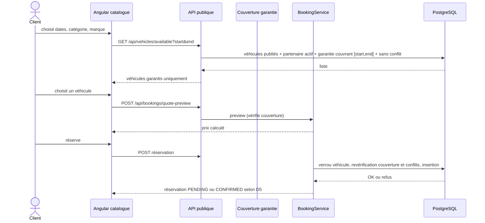

# 06 — Parcours client : rechercher et réserver un véhicule garanti

## 1. Parcours cible

## 2. Étapes et règles

1. **Dates** : début et fin obligatoires, `début < fin`, date de début future, durée minimale selon règles existantes.
2. **Recherche** : seuls les véhicules couverts pour `[début, fin[` sont listés. Une garantie partielle ou fragmentée n'est pas listée.
3. **Détail** : affiche le prix (calcul existant), la disponibilité confirmée pour la période, et non la liste des garanties internes.
4. **Preview** : refait la vérification de couverture ; refus si non couvert, code `VEHICLE_NOT_GUARANTEED`.
5. **Réservation** : refait la couverture et les conflits sous verrou. Une seconde requête concurrente sur le même véhicule attend le verrou puis reçoit `VEHICLE_ALREADY_BOOKED`.

## 3. Cas d'erreur côté client

| Situation | Message attendu | Code HTTP |
|---|---|---|
| Dates invalides | Corrigez les dates. | 400 |
| Non couvert | Ce véhicule n'est pas disponible pour ces dates. | 409 |
| Conflit | Ce véhicule vient d'être réservé. | 409 |
| Véhicule inconnu ou non publié | Véhicule introuvable. | 404 |
| Erreur serveur | Réessayez plus tard. | 500 |

Les messages ne divulguent ni le partenaire ni les garanties internes.

## 4. État actuel du frontend (vérifié)

- Le formulaire de réservation appelle `/api/vehicles/{id}/availability` puis `/api/bookings/quote-preview` (`frontend/src/app/features/bookings/booking-form.component.ts`).
- Le README du dossier indique à tort « NOT IMPLEMENTED ».
- Le filtrage de couverture n'existe pas côté frontend ni backend.
- Le build Angular n'a pas été exécuté (Node 18.20.8 non conforme).

## 5. Décision de sécurité

La liste affichée au client n'est qu'un confort. La **réservation** doit refuser tout véhicule non couvert, même si le client appelle directement l'API.

## 6. Tests

Voir [09-test-strategy.md](./09-test-strategy.md) : cas de recherche, preview, réservation hors période, concurrence.
