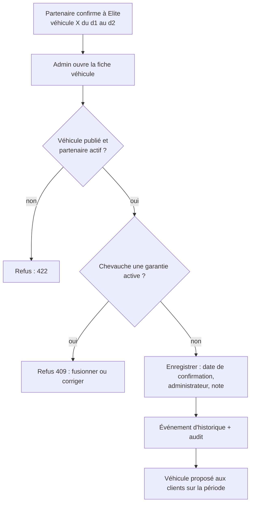

# 07 — Parcours administrateur Elite

Rôles existants : `SUPER_ADMIN`, `MANAGER`, `AGENT`, `CONCIERGE`, `ACCOUNTANT`, `CUSTOMER` (V1). Aucun rôle `PARTNER` n'existe.

## 1. Gestion des partenaires

1. Créer le partenaire (nom, type, coordonnées, informations légales).
2. Vérifier les informations, puis activer.
3. Rattacher les véhicules existants ou nouveaux.
4. Désactiver si nécessaire : le partenaire disparaît du catalogue, ses garanties futures ne sont plus proposées, mais l'historique reste.

Décision requise : quel rôle peut gérer les partenaires (recommandation : `MANAGER` et `SUPER_ADMIN`).

## 2. Enregistrer une disponibilité garantie

Saisie :
- véhicule (le partenaire est déduit) ;
- début et fin (borne incluse au début, exclue à la fin) ;
- date de confirmation par le partenaire (obligatoire) ;
- note libre.

## 3. Modifier ou retirer

| Situation | Action autorisée |
|---|---|
| Aucune réservation ne couvre la garantie | Modifier ou retirer, avec motif, traçé. |
| Une réservation CONFIRMED ou IN_PROGRESS la couvre | Refus 409 `AVAILABILITY_HAS_BOOKING`. Le retrait n'annule pas la réservation. |
| Réservation PENDING | Décision ouverte (D-PA-04). |
| Garantie expirée | Lecture seule. |

## 4. Consulter

- Par véhicule : toutes les garanties, passées et futures.
- Par partenaire : vue consolidée.
- Par date : quels véhicules sont garantis un jour donné.

## 5. Cas limites à gérer

- Période qui chevauche une autre : refus ou fusion explicite (décision ouverte D-PA-14 provisoire ; l'ancien « D-PA-05 » désigne désormais la garantie liée au partenaire porteur, validée).
- Création : le partenaire porteur est figé à partir du partenaire actuellement rattaché au véhicule (D-PA-05 validé). Un changement de partenaire du véhicule n'altère jamais les garanties existantes.
- Maintenance planifiée dans une période garantie : décision D-PA-16 (provisoire) ; par défaut, la maintenance ne doit pas être posée si une réservation confirmée existe (règle validée).
- Changement de véhicule pour une garantie : interdit, il faut retirer et recréer.

## 6. Traçabilité

Chaque action enregistre : administrateur, date, action, valeurs avant et après, motif.
