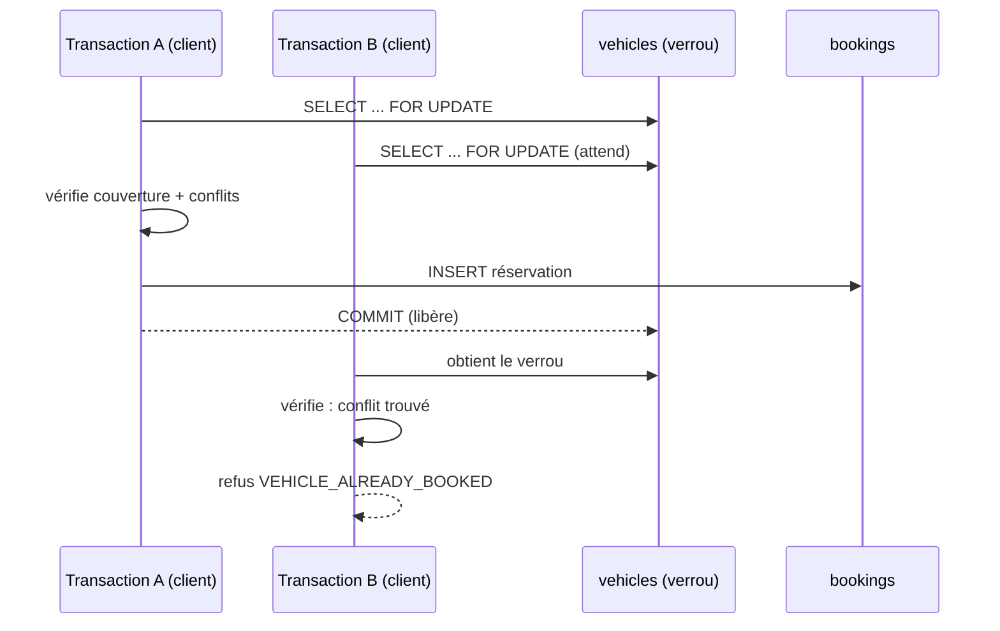

# 08 — Sécurité, isolation et concurrence

## 1. Autorisations

| Surface | Contrôle | État actuel |
|---|---|---|
| `/api/admin/**` | `admin:access` | Existant (`SecurityConfig`). |
| Véhicules admin | `vehicles:manage` via `@PreAuthorize` | Existant. |
| Partenaires et garanties | Permissions à créer | **Absent**. |
| Rôle partenaire | Filtre sur identifiant partenaire | **Absent**. |

Règle : aucune route partenaire ne reçoit d'identifiant partenaire en paramètre. Il est déduit de l'utilisateur authentifié (`Authentication`).

## 2. Isolation des partenaires

- Un partenaire ne lit que ses véhicules, ses garanties (celles dont il est **partenaire porteur**) et les réservations liées.
- Un partenaire ne modifie aucune garantie ni commission.
- Une garantie dont le partenaire porteur n'est plus le partenaire actuel du véhicule reste visible par son partenaire porteur d'origine (historique), mais n'est plus modifiable par lui.
- Tests : tout identifiant d'un autre partenaire renvoie 404 (pas 403, pour ne pas révéler l'existence).

## 3. Concurrence et ordre de verrouillage

Ordre imposé : **Vehicle → Booking → autres**.

Points :
- La couverture garantie est lue **après** le verrou véhicule, dans la même transaction.
- L'EXCLUDE `bookings_no_blocking_overlap` (V4) reste la protection finale : une course éventuelle est rejetée par PostgreSQL.
- Une garantie n'est jamais un substitut à ces protections.

## 4. Modification ou retrait d'une garantie

- Création d'une garantie : verrou véhicule, lecture du partenaire actuellement rattaché, contrôle d'activité, puis enregistrement du partenaire porteur. Si le rattachement change pendant la transaction, la création échoue (verrou véhicule).
- Changement de rattachement : même verrou véhicule. Les garanties existantes gardent leur partenaire porteur.
- Verrou sur le véhicule (même ordre), puis lecture des réservations bloquantes sur la période.
- Si une réservation existe : refus. Le retrait ne peut pas invalider une réservation confirmée.
- Insertion d'une garantie : la contrainte d'exclusion sur garanties actives (proposée, dépend de la règle de chevauchement D-PA-14) empêche le chevauchement concurrent.

## 5. Réservations PENDING

Une réservation PENDING ne bloque pas actuellement (`BookingService.BLOCKING` = CONFIRMED, IN_PROGRESS). Une garantie ne doit pas être retirée à cause d'un PENDING sans décision (D-PA-04 ; ancien libellé « D-PA-06 » dans les tableaux de cette série).

## 6. Transactions

- `@Transactional` sur les services d'écriture ; lectures en `readOnly`.
- Pas d'appel réseau fournisseur dans une transaction de verrou (paiement hors verrou, comme aujourd'hui).

## 7. Erreurs

- Conflit : HTTP 409 avec code métier.
- Entrée invalide : HTTP 400.
- Ressource absente ou non autorisée : HTTP 404.
- Jamais de trace de pile, SQL ou nom de contrainte dans la réponse. (À vérifier : `DataIntegrityViolationException` est traité, message générique.)

## 8. Journalisation

Actions sensibles journalisées dans `audit_logs` : création, modification, retrait de garantie, activation ou désactivation de partenaire, rattachement de véhicule.

## 9. Risques restants

- R-S1 : sans permissions dédiées, toute personne avec `admin:access` peut gérer les garanties. Acceptable en phase 1, à documenter.
- R-S2 : pas de limitation de débit sur la recherche publique ; à évaluer.
- R-S3 : aucun test de concurrence PostgreSQL n'a été exécuté dans cette mission.
