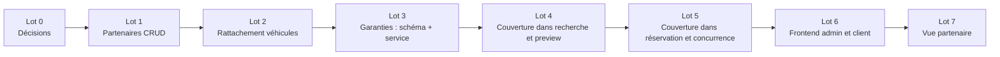

# 11 — Plan d'implémentation par lots

Aucun lot ne démarre sans autorisation écrite pour les migrations et sans les décisions bloquantes indiquées.

| Lot | Contenu | Migration | Bloquant | Effort | Risque |
|---|---|---|---|---|---|
| 0 | Trancher D-PA-01, 04, 07, 09, 10 (D5), 14 (règle), 16 à 18 (provisoires) ; D-PA-05, D-PA-12 et historique validés | Non | Oui | Décision | Élevé si retardé |
| 1 | Entité, repository, service, contrôleur admin partenaires ; permissions `partners:*` | Oui (permissions, enrichissement `partners`) | D-PA-11 | M | Faible |
| 2 | `vehicles.partner_id` nullable, rattachement, exclusion des véhicules non rattachés | Oui (V23 réalisée : `partner_id` et historique des affectations) | D-PA-12 (validé), historique (validé) | M-L | Élevé (données historiques, transfert) |
| 3 | Table `guaranteed_availabilities` ; D-PA-05 validé (Option A) ; chevauchement à trancher (D-PA-14 provisoire) | Pour la règle de chevauchement | Oui (V25 réalisée : table `vehicle_guarantees`, les numéros V24 et V25 de ce tableau sont obsolètes) | D-PA-01, D-PA-14 | L | Élevé |
| 4 | Couverture dans `/available`, `/availability`, `quote-preview` | Non | Lot 3 | M | Moyen (régression de recherche) |
| 5 | Couverture dans la réservation, tests de concurrence PostgreSQL | Non | Lot 4, autorisation PostgreSQL | M | Élevé |
| 6 | Angular : admin partenaires, garanties, recherche | Non | Lot 4 | L | Moyen (build Node non conforme) |
| 7 | Vue partenaire lecture seule | Oui (rôle) | D-PA-18 | M | Élevé (isolation) |

## Pré-requis transverses

- Sauvegarde et restauration d'une base isolée, procédure documentée, non exécutée.
- Node 22.22.3+ ou 24.15.0+ pour le frontend.
- Autorisation distincte pour chaque migration.

## Ordre de risque

Les lots 3 et 5 portent le risque principal (schéma et concurrence) et doivent être précédés des décisions et des tests PostgreSQL autorisés.
