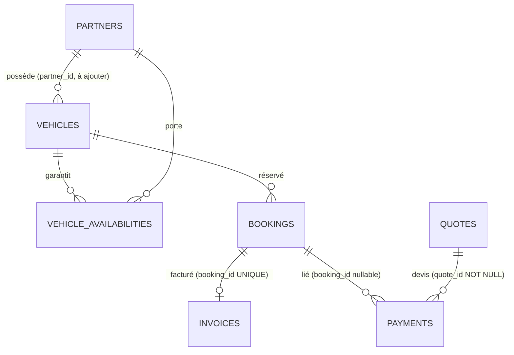

# 03 — Revue finale du modèle de données

Statut : revue documentaire. **Aucune migration, aucune entité Java modifiée.** Le modèle cible ci-dessous est une proposition documentaire, soumise aux décisions du propriétaire.

## 1. Existant confirmé

| Table | Source | Constat |
|---|---|---|
| `vehicles` | V1 | Pas de `partner_id`. Statut `VehicleStatus`. |
| `bookings` | V1, V4 | `vehicle_id` FK sans ON DELETE (NO ACTION). Statuts vérifiés par CHECK. Montants et CHECK positifs. |
| `bookings` EXCLUDE | V4 l.25-28 | `EXCLUDE USING gist (vehicle_id WITH =, tstzrange(starts_at, ends_at, '[)') WITH &&) WHERE status IN ('CONFIRMED','IN_PROGRESS')`. Protège contre les doubles réservations en base. |
| `invoices` | V1 | `booking_id UNIQUE`, FK sans ON DELETE. |
| `partners` | V1 l.181-189 | Existe, avec `commission_rate NUMERIC(5,2)`. Non relié à `vehicles` ni `bookings`. Aucun code Java ne la référence. |
| `payments` | V6 | Nouvelle table, `quote_id NOT NULL` FK CASCADE, `booking_id` nullable FK SET NULL, index d'idempotence unique, pas de snapshot de commission. |
| `legacy_payments` | V6 | Ancienne table renommée. Son traitement de migration n'a pas été relu en détail. **[À VÉRIFIER]** |
| `payment_events` | V6 | Présent. |
| `database/proposed/V21, V22` | — | Non appliquées. V21 : index unique partiel `uq_payments_one_captured_per_quote`. V22 : FK quote en RESTRICT. |

Remarque : `partners` existe déjà mais ne suffit pas. Il faut ajouter le lien véhicule → partenaire, pas une seconde table partenaire.

## 2. Modèle cible proposé

### 2.1 Partenaire et lien véhicule

- Réutiliser `partners` (V1). Ajouter un statut `active` déjà présent ; décider de la sémantique (D-PA-13).
- **Retirer l'usage de `partners.commission_rate`** : interdit par D1. Ne pas le supprimer sans migration de données validée ; le marquer comme non utilisé dans la doc.
- Ajouter `vehicles.partner_id` en trois temps :
  1. Colonne nullable.
  2. Rattachement des véhicules existants à un partenaire de transition, validé par le propriétaire.
  3. `NOT NULL` après rattachement complet.

  SQL ne peut pas imposer « NOT NULL pour les nouveaux seulement » sans contrainte transitoire. Cette étape est P0.

### 2.2 Garanties de disponibilité

Table proposée : `vehicle_availabilities`.

| Colonne | Type | Contrainte |
|---|---|---|
| `id` | UUID | PK |
| `vehicle_id` | UUID | FK vers `vehicles(id)`, NOT NULL |
| `partner_id` | UUID | FK vers `partners(id)`, NOT NULL, **partenaire porteur figé à la création** (D-PA-05 validé) ; non modifiable ensuite, pas de contrainte composite avec `vehicles.partner_id` |
| `period` | `tstzrange` | NOT NULL, `lower < upper`, borne `[)` |
| `status` | VARCHAR | CHECK (`ACTIVE`, `WITHDRAWN`, `EXPIRED`) |
| `confirmed_by_partner_at` | TIMESTAMPTZ | nullable, date de confirmation partenaire |
| `recorded_by_admin_id` | UUID | FK vers `users(id)` |
| `created_at`, `updated_at` | TIMESTAMPTZ | NOT NULL |

Contraintes :
- EXCLUDE USING gist (`vehicle_id` WITH =, `period` WITH &&) WHERE (`status` = 'ACTIVE') : pas de chevauchement de garanties actives pour un même véhicule. **Cohérent avec V4.**
- Cohérence « partenaire porteur = partenaire rattaché à la création » : contrôle service sous verrou véhicule + test. **Pas de contrainte composite** `(vehicle_id, partner_id) → vehicles(id, partner_id)` : elle casserait la conservation des garanties historiques après un changement de partenaire du véhicule (voir `07-dpa-05-validation-record.md`).

Historique : ne pas écraser une garantie. Modifier = `WITHDRAWN` + nouvelle ligne. Ou table d'événements `vehicle_availability_events` (à décider).

### 2.3 Réservations

Aucune colonne ajoutée à `bookings` pour la garantie. La couverture est vérifiée par requête, pas stockée. Le snapshot de commission (D1) est décrit en 2.4.

### 2.4 Snapshot de commission (D1)

Non localisé dans les documents. Recommandation : colonnes figées sur `bookings` au moment de la confirmation :

- `commission_level_code`, `commission_rate_snapshot NUMERIC(5,2)`, `commission_base_snapshot`, `commission_amount`, `snapshot_taken_at`.

Pas dans `payments` (le paiement n'est pas la réservation). Décision à valider par le propriétaire (D1 paramètres ouverts 1 à 3).

## 3. Relations et cardinalités

Cardinalités : un véhicule a plusieurs garanties non chevauchantes ; un partenaire a plusieurs véhicules ; une réservation a au plus une facture ; un devis peut avoir plusieurs paiements (contrainte à réviser avec D5).

## 4. Contraintes d'intégrité, index, suppression

| Élément | Règle actuelle | Constat | Recommandation |
|---|---|---|---|
| `bookings.vehicle_id` | NO ACTION | Suppression refusée par PostgreSQL (non testé) | Conserver. Ne pas passer en CASCADE. |
| `invoices.booking_id` | UNIQUE, sans ON DELETE | Suppression de booking refusée si facture | Conserver. |
| `payments.booking_id` | SET NULL | Paiement survit à la suppression de réservation | Justifié pour l'historique financier. Conserver. |
| `payments.quote_id` | CASCADE | Suppression de devis supprime les paiements | **Risque** : perte d'historique financier. V22 le corrige en RESTRICT (non appliquée). Priorité avant application. |
| Index `bookings` (status, starts_at) | V4 | Présent | Suffisant pour les requêtes de garantie. |
| Index garanties | — | À créer avec EXCLUDE (gist) | Obligatoire. |
| Index `vehicles(partner_id)` | — | À créer | Obligatoire pour l'isolation. |

## 5. Statuts et dates

- Statuts réservation : PENDING, CONFIRMED, REJECTED, CANCELLED, IN_PROGRESS, COMPLETED (CHECK V4). Cohérent avec le code.
- Statuts garantie proposés : ACTIVE, WITHDRAWN, EXPIRED. Ne pas ajouter de statut tant que D-PA-09 n'est pas tranché.
- Dates : toutes en `TIMESTAMPTZ`, compatibles avec `tstzrange`. Vérifier le fuseau (`timeZone()` dans le code).

## 6. Redondances

- `partners.commission_rate` : redondant avec D1. À neutraliser.
- `vehicles.partner_id` et `vehicle_availabilities.partner_id` : redondance volontaire pour l'isolation, à contrôler par contrainte.
- `legacy_payments` et `payments` : redondance héritée de V6 ; à documenter, pas à supprimer.

## 7. Points de risque

- Migration V23 à découper (voir `01`, C3 et C7).
- Données historiques de véhicules sans partenaire : aucune copie représentative disponible. **Limite non vérifiable dans cet environnement.**
- Sauvegarde et restauration non testées.

## 8. Ce qui n'a pas été vérifié

- Comportement réel des FK NO ACTION et des EXCLUDE sous PostgreSQL 18 (tests PostgreSQL interdits).
- Contenu de `legacy_payments` après migration V6.
- Cohérence des migrations dans `backend/src/main/resources/db/migration/` (divergence).
