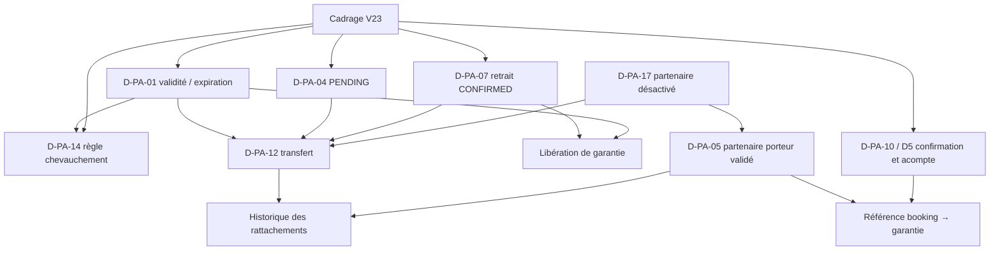

# 09 — Audit documentaire exhaustif (D-PA-01 à D-PA-18)

> Statut : audit documentaire en lecture seule. Aucun document existant n'a été modifié par cette mission. Aucun code, migration, configuration ni base de données n'a été touché. Aucun test PostgreSQL n'a été exécuté. Le registre de référence est `review/08-owner-decisions-validation-record.md` §2.2.

## 1. Résumé exécutif

- Le registre 08 est cohérent avec les décisions validées : **D-PA-05** (partenaire porteur, Option A), **D-PA-12** (transfert refusé en présence d'engagements actifs), **D-PA-14** (identifiant du chevauchement, règle de traitement ouverte) et **D-PA-05 / historique des rattachements / référence booking → garantie** (validés en principe).
- Les identifiants **D-PA-15 à D-PA-18 sont provisoires** et n'ont pas été confirmés par le propriétaire.
- **Plusieurs documents actifs utilisent encore l'ancienne numérotation** (`review/02`, `review/05`, `review/03`, `review/04`, `review/07`). Les corrections ne sont pas encore appliquées ; elles sont listées en §4.
- **Une contradiction de règle métier subsiste dans le document 10** (option de transfert « avec garanties futures retirées »), à corriger pour être alignée sur D-PA-12.
- **Plusieurs décisions bloquantes restent ouvertes** : D-PA-01, D-PA-04, D-PA-07, D-PA-14 (règle de traitement), D5.

**Verdict : NON PRÊT pour le cadrage de V23.** Les blocages sont listés en §10.

## 2. Inventaire des fichiers contrôlés

| Fichier | Contrôle | Méthode |
|---|---|---|
| 01-… à 12-… (`docs/architecture/partner-availability/`) | Oui | Recherche ciblée des occurrences D-PA, anciens motifs et règles ; relecture de la section décisionnelle (doc 10, 04, 03, 05 pour les points clés) |
| `review/01-document-consistency-audit.md` | Oui | Lecture des lignes C3–C6, C13 |
| `review/02-business-decisions-analysis.md` | Oui | Bannière + corps (ancienne numérotation) |
| `review/03-data-model-final-review.md` | Oui | Recherche ciblée |
| `review/04-booking-and-payment-impact.md` | Partiel | Ligne 22 (D-PA-09) relevée |
| `review/05-final-implementation-roadmap.md` | Oui | Lignes 10, 12, 25 |
| `review/06-owner-decision-pack.md` | Oui | Recherche ciblée |
| `review/07-dpa-05-validation-record.md` | Oui | §10 et §12 relus |
| `review/08-owner-decisions-validation-record.md` | Oui | §1, §2.1, §2.2, §3–§5, §7, §8 |

**Limite :** la lecture n'est pas une relecture ligne à ligne de l'intégralité des 18 documents. Une partie des occurrences a été relevée par recherche ciblée, dont les sorties ont été tronquées. Le tableau du §3 est donc un inventaire des occurrences **relevées**, non une garantie d'exhaustivité.

## 3. Tableau des occurrences D-PA-xx (occurrences relevées)

Statuts : **V** = validé, **O** = ouvert, **P** = provisoire, **X** = obsolète dans ce contexte.

| ID | Intitulé officiel (registre 08) | Fichier | Section / ligne | Statut | Conformité registre 08 | Correction nécessaire |
|---|---|---|---|---|---|---|
| D-PA-01 | Durée et validité d'une garantie, expiration | 10 ; review/08 §2.2 | §2 | O | Conforme | Aucune |
| D-PA-01 | (idem) | review/03 l.97 | Statuts garantie | O | **Non conforme** : « tant que D-PA-09 n'est pas tranché » | Remplacer D-PA-09 par D-PA-01 |
| D-PA-01 | (idem) | review/04 l.22 | Expiration pendant PENDING | O | **Non conforme** : cite D-PA-09 | Remplacer par D-PA-01 |
| D-PA-01 | (idem) | review/02 l.21, 124 | Expiration (ancien D-PA-09) | X | Ancienne numérotation, bannière présente | Corriger le corps ou garder la bannière comme seule référence |
| D-PA-02 | Libre | review/02 (ancien type partenaire) | — | X | Ancien usage → D-PA-15 | Corriger dans review/02 |
| D-PA-03 | Modification d'une garantie | 10 ; review/08 | §2 | O | Conforme | Aucune |
| D-PA-04 | Traitement des réservations PENDING | 10 ; review/08 | §2 | O | Conforme | Aucune |
| D-PA-04 | (idem) | review/02 l.122 (ancien D-PA-06 visibilité PENDING) | Tableau | X | Ancien usage, absorbé dans D-PA-04 | Corriger ou annoter |
| D-PA-05 | Partenaire porteur d'une garantie (Option A) | 02, 03, 04, 05, 07, 08, 09, 10, 11, 12 ; review/07 | multiples | V | Conforme | Aucune |
| D-PA-05 | Ancien usage « chevauchement » | review/07 l.114 (historique, explicite) | §12 | X | Note historique | Acceptable, à garder |
| D-PA-06 | Libre (fusionné dans D-PA-04) | review/08 §2.2 | — | X | Conforme | Ne plus utiliser |
| D-PA-07 | Retrait d'une garantie avec réservation CONFIRMED | 10 ; review/08 | §2 | O | Conforme | Aucune |
| D-PA-07 | Ancien usage « maintenance » | review/02 (ancienne numérotation) | — | X | Obsolète | Corriger |
| D-PA-08 | Visibilité publique | 05 l.9 ; review/06 l.36 ; review/08 | — | O | Conforme | Aucune |
| D-PA-08 | Ancien usage « partenaire désactivé » | review/07 l.61 | §5 | X | **Non conforme** : doit être D-PA-17 | Corriger en D-PA-17 |
| D-PA-08 | Ancien usage « partenaire désactivé » | review/02, review/08 §2.1 | — | X | Historique | Annoté |
| D-PA-09 | Pénalités (juridique, comptable) | review/08 ; review/06 l.44 ; 10 | — | O | Conforme | Aucune |
| D-PA-09 | Expiration (usage erroné) | review/03 l.97 ; review/04 l.22 ; review/05 l.12 | — | X | **Non conforme** | Corriger en D-PA-01 |
| D-PA-10 | Moment de confirmation (D5 rattaché) | 10 ; review/08 | §2 | O | Conforme. D5 n'a pas d'identifiant propre | Aucune |
| D-PA-11 | Droit de création de partenaires | 10 ; review/08 | §2 | O | Conforme | Aucune |
| D-PA-11 | Ancien usage « conséquence financière » | review/02 l.124 | — | X | Historique | Corriger |
| D-PA-12 | Transfert de véhicule (validé) | review/08 §3 ; 03 ; 05 ; 08 | — | V | Conforme | Voir contradiction doc 10 (§5) |
| D-PA-12 | Ancien usage « PARTENAIRE rôle » dans doc 10 | 10 §3 (ancienne table) | — | X | **Non conforme** | Vérifier la relabellisation |
| D-PA-13 | Durée minimale de location | 10 l.38 ; review/08 l.61 | — | O | Conforme | Aucune |
| D-PA-13 | Ancien usage « désactivation partenaire » | review/03 l.25 ; review/05 l.10 ; review/02 l.25, 128 | — | X | **Non conforme** (doit être D-PA-17) | Corriger |
| D-PA-14 | Chevauchement de garanties (identifiant validé, règle ouverte) | review/08 §2.2 ; 02 l.67 ; 04 l.48 ; review/05 l.12 | — | V (identifiant) / O (règle) | Conforme dans 04 et 08 | Corriger review/05 l.25 (« à renuméroter ») et review/07 l.90, l.114 (« provisoire ») |
| D-PA-14 | Ancien « D-PA-05 » pour chevauchement | historique documentée dans review/07 | §12 | X | Note historique | Acceptable |
| D-PA-15 | Type juridique du partenaire (ancien D-PA-02) | review/08 §2.2 ; review/02 l.3 | — | P | Provisoire | Validation propriétaire |
| D-PA-16 | Maintenance dans une garantie | review/08 §2.2 | — | P | Provisoire | Validation propriétaire |
| D-PA-17 | Partenaire désactivé avec garanties futures (ancien D-PA-08/D-PA-13) | review/08 §2.1 ; review/07 | — | P | Provisoire | Validation propriétaire ; corriger review/07 l.61 |
| D-PA-18 | Rôle PARTNER en phase 1 | review/08 §2.2 | — | P | Provisoire | Validation propriétaire |

## 4. Incohérences détectées

| # | Fichier | Problème | Gravité | Correction proposée (non appliquée) |
|---|---|---|---|---|
| I1 | 10-business-decisions-required.md §2 | D-PA-12 marqué « (validé) » dans une table de décisions ouvertes | Faible | Déplacer la ligne en §1 |
| I2 | 10 §3 (ou tableau de transfert) | Option « transfert avec garanties futures retirées » : contraire à D-PA-12 (refus si engagement actif) | **Élevée** | Retirer l'option ou la marquer « hors périmètre initial » |
| I3 | review/07 l.61 | Partenaire désactivé cité sous D-PA-08 | Moyenne | Remplacer par D-PA-17 |
| I4 | review/07 l.90 et l.114 | D-PA-14 présenté comme « provisoire / renumérotation à confirmer » alors que l'identifiant est validé | Moyenne | Préciser : identifiant validé, règle ouverte |
| I5 | review/07 §12 point 1 et paragraphe final | Affirme que le doc 10 utilise encore l'ancienne numérotation (corrigé depuis) | Moyenne | Mettre à jour le texte |
| I6 | review/05 l.25 | « D-PA-14 (chevauchement, à renuméroter) » | Moyenne | Remplacer par « D-PA-14 (identifiant validé, règle ouverte) » |
| I7 | review/03 l.25 | Statut partenaire rattaché à D-PA-13 (durée minimale) | Moyenne | Remplacer par D-PA-17 |
| I8 | review/03 l.97 | Expiration des garanties rattachée à D-PA-09 (pénalités) | Moyenne | Remplacer par D-PA-01 |
| I9 | review/04 l.22 | Expiration en PENDING rattachée à D-PA-09 | Moyenne | Remplacer par D-PA-01 |
| I10 | review/02 corps (l.21 à 153) | Ancienne numérotation dans le corps, malgré la bannière | Faible (bannière présente) | Corriger ou laisser la bannière comme mapping officiel |
| I11 | review/05 l.10 | L1 dépend de D-PA-13 pour le statut partenaire | Moyenne | Remplacer par D-PA-17 |
| I12 | review/06 | Liste de décisions bloquantes incluant D-PA-13 pour un lot d'isolation (déjà signalé en C13) | Faible | Non traité dans cette mission |

## 5. Références obsolètes

Références à supprimer dans les documents actifs (hors notes historiques explicitement marquées) :

- « D-PA-05 = chevauchement » : historique acceptable dans review/07 §12 et review/02 (bannière). À conserver uniquement comme note.
- « D-PA-08 = partenaire désactivé » : review/07 l.61 (à corriger en D-PA-17).
- « D-PA-09 = expiration » : review/03 l.97, review/04 l.22, review/05 l.12 (à corriger en D-PA-01).
- « D-PA-13 = désactivation » : review/03 l.25, review/05 l.10, review/02 (à corriger en D-PA-17).
- « D-PA-14 à renuméroter / provisoire » : review/05 l.25, review/07 l.90, l.114.
- « D-PA-12 = rôle PARTNER » : vérifier la section ancienne du doc 10.

## 6. Décisions provisoires

| ID | Sujet | Statut | Action attendue |
|---|---|---|---|
| D-PA-15 | Type juridique du partenaire | Provisoire | Validation ou renumérotation |
| D-PA-16 | Maintenance dans une garantie | Provisoire | Validation ou renumérotation |
| D-PA-17 | Partenaire désactivé avec garanties futures | Provisoire | Validation ou renumérotation |
| D-PA-18 | Rôle PARTNER en phase 1 | Provisoire | Validation ou renumérotation |

Ces identifiants ne doivent pas être cités comme décisions validées.

## 7. Décisions ouvertes

- **D-PA-01** : durée, période de validité, expiration d'une garantie.
- **D-PA-03** : modification d'une garantie.
- **D-PA-04** : traitement des réservations PENDING.
- **D-PA-07** : retrait d'une garantie avec réservation CONFIRMED.
- **D-PA-08** : visibilité publique.
- **D-PA-09** : pénalités (avis juridique et comptable requis).
- **D-PA-10** : moment de confirmation, D5 rattaché (acompte et cycle de paiement).
- **D-PA-11** : droit de création de partenaires.
- **D-PA-13** : durée minimale de location.
- **D-PA-14** : règle de traitement du chevauchement (refus, fusion manuelle ou automatique). L'identifiant est validé.
- **D-PA-15 à D-PA-18** : provisoires (§6).

## 8. Dépendances

Dépendances à valider avant V23 :

1. **D-PA-01** avant D-PA-14, D-PA-12 (libération) et toute expiration de garantie.
2. **D-PA-04** avant de définir ce qui bloque un transfert (PENDING).
3. **D-PA-07** avant toute libération de garantie.
4. **D-PA-12 §3.5** : liste exhaustive des « autres engagements contractuels » bloquants, non documentée.
5. **D-PA-17** avant de traiter les transferts de véhicules dont le partenaire est désactivé.
6. **D-PA-10 / D5** avant de figer le cycle de paiement lié à la réservation garantie.

## 9. Vérification des 12 thèmes métier

| # | Thème | Résultat | Commentaire |
|---|---|---|---|
| 1 | Partenaire actuel d'un véhicule | Cohérent | Distinct du partenaire porteur (D-PA-05, review/08 §3) |
| 2 | Partenaire porteur d'une garantie | Cohérent | Figé à la création (D-PA-05) |
| 3 | Historique des rattachements | Cohérent | Table validée, append-only (review/08 §4) |
| 4 | Transfert d'un véhicule | **Contradiction** | Doc 10 : option « garanties futures retirées » contraire à D-PA-12 (I2) |
| 5 | Garanties actives | Partiel | Règle « future ou en cours bloque » cohérente ; définition d'« actif » dépend de D-PA-01 et D-PA-07 |
| 6 | Réservations PENDING | Ouvert | Non bloquant ou bloquant : D-PA-04 |
| 7 | Réservations CONFIRMED | Cohérent | Futures CONFIRMED bloquent le transfert (D-PA-12) |
| 8 | Réservations IN_PROGRESS | Cohérent | Bloquent le transfert (D-PA-12) |
| 9 | Booking ↔ availability | Cohérent | `availability_id` NULL pour LEGACY, obligatoire pour GUARANTEED, `ON DELETE RESTRICT` |
| 10 | Archivage / suppression d'un véhicule | **À vérifier** | Non traité de manière explicite dans les documents lus ; à compléter |
| 11 | Engagements historiques | Cohérent | Garanties et réservations historiques non modifiées par transfert |
| 12 | Règle de maintenance | **Ouvert** | D-PA-16 provisoire ; écart de code connu (MAINTENANCE non bloquant pour une réservation future) |

## 10. Validations attendues du propriétaire

1. Confirmer ou renuméroter **D-PA-15 à D-PA-18**.
2. Choisir la **règle de traitement du chevauchement** (D-PA-14) : refus, fusion manuelle ou automatique.
3. Fixer **D-PA-01** : durée, validité et expiration des garanties.
4. Fixer **D-PA-04** : PENDING bloque-t-il un transfert ?
5. Fixer **D-PA-07** : retrait d'une garantie avec réservation CONFIRMED.
6. Fournir la **liste exhaustive** des engagements contractuels bloquant un transfert (D-PA-12 §3.5).
7. Décider du sort des **garanties d'un partenaire désactivé** (D-PA-17).
8. Décider du **cycle d'acompte et de confirmation** (D-PA-10 / D5).
9. Décider de l'**archivage / suppression d'un véhicule** avec historique.
10. Décider de la **règle de maintenance** (D-PA-16).

## 11. Risques métier et techniques

| Risque | Niveau | Source |
|---|---|---|
| Transfert autorisé à tort si la liste des engagements est incomplète | Élevé | D-PA-12 §3.5 |
| Libération implicite d'une garantie sans D-PA-01 / D-PA-07 | Élevé | review/08 §5 |
| Contradiction doc 10 (option transfert avec retrait de garanties) | Élevé | §4 I2 |
| Mauvais identifiant cité dans le code ou les tickets (D-PA-05, D-PA-09, D-PA-13) | Moyen | §4 |
| Règle de maintenance non appliquée au niveau des réservations futures | Moyen | Gap de code connu |
| Expiration de garantie mal rattachée à D-PA-09 (pénalités) | Moyen | review/03, review/04 |
| Équivalence Turo / Getaround / Booking.com non vérifiée en ligne | Faible | Non vérifiable dans cette mission |
| Comportement PostgreSQL (EXCLUDE, FK RESTRICT) non testé | Moyen | Aucun test PostgreSQL autorisé |

## 12. Verdict

**NON PRÊT pour le cadrage de V23.**

Motifs :

- D-PA-01, D-PA-04, D-PA-07 et D-PA-14 (règle de traitement) restent ouverts et conditionnent la définition d'un engagement actif et la libération d'une garantie.
- Le document 10 contient encore une option de transfert contraire à D-PA-12.
- Les identifiants D-PA-15 à D-PA-18 sont provisoires.
- Plusieurs documents actifs citent des identifiants obsolètes (§4).

Un cadrage de V23 pourra être établi lorsque les points 1 à 6 de §10 seront tranchés et que les corrections I2, I4, I6, I7, I8 et I9 auront été appliquées.

## 13. Contrôle final

- `git status --short -- docs` comparé au snapshot initial : **identique** (`M docs/start-local.md`, `?? docs/architecture/`, `?? docs/technical-audit.md`).
- Aucun fichier source, migration, configuration ou base de données modifié.
- Aucun test PostgreSQL exécuté.
- Aucune modification non autorisée supprimée.
- Ce document est le seul fichier créé par cette mission.
- Les corrections identifiées en §4 n'ont **pas** été appliquées. Elles doivent faire l'objet d'une mission dédiée ou d'une validation.
