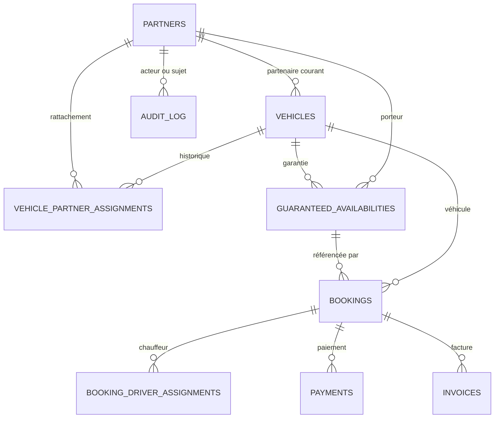

# 12 — Modèle de données cible conceptuel (Mission 6)

> **Statut : conception, aucune migration créée.** Les contraintes marquées « à vérifier » n'ont pas été testées sur PostgreSQL (interdit par la mission). Le modèle ne reprend pas `partners.commission_rate` (interdit).

## 1. Trois notions distinctes

| Notion | Table | Question à laquelle elle répond |
|---|---|---|
| Partenaire actuel du véhicule | `vehicles.partner_id` (courant, à ajouter) | À qui appartient le véhicule aujourd'hui ? |
| Partenaire porteur d'une garantie | `guaranteed_availabilities.partner_id` (figé) | Qui a engagé cette garantie ? |
| Historique des rattachements | `vehicle_partner_assignments` | Qui a possédé le véhicule, et quand ? |

Ces trois notions ne se confondent pas (D-PA-05, validé ; historique, validé).

## 2. Diagramme

## 3. Tables

### 3.1 partners (existante, V1)
Colonnes existantes : id, name, partner_type, email, phone, commission_rate (**ne pas utiliser**), active.
- Pas d'entité Java `Partner` dans `backend/src/main` : intégration backend à créer.
- `partner_type` : valeurs à définir (D-PA-15).
- `active` : sémantique à définir (D-PA-17).

### 3.2 vehicles (existante, V1) — ajouts conceptuels
- `partner_id` (FK partners, NOT NULL à terme). **Absent aujourd'hui.** Ajout nécessaire, avec backfill contrôlé (voir `review/14`).
- Pas d'état archivé : `VehicleStatus` ne le contient pas (proposition §11 du doc 10, non validée).

### 3.3 vehicle_partner_assignments (nouvelle, validée au principe)

| Colonne | Type | Contrainte |
|---|---|---|
| id | BIGINT identity | PK |
| vehicle_id | BIGINT | FK vehicles, NOT NULL, ON DELETE RESTRICT |
| partner_id | BIGINT | FK partners, NOT NULL, ON DELETE RESTRICT |
| starts_at | TIMESTAMPTZ | NOT NULL |
| ends_at | TIMESTAMPTZ | NULL = rattachement actif |
| operated_at | TIMESTAMPTZ | NOT NULL (date de l'opération) |
| admin_user_id | BIGINT | FK users, NOT NULL |
| reason | VARCHAR(500) | NOT NULL |
| transfer_ref | VARCHAR(64) | NULL, référence de l'opération de transfert |

Contraintes :
- **Un seul rattachement actif par véhicule** : index unique partiel `UNIQUE (vehicle_id) WHERE ends_at IS NULL` (à vérifier sur PostgreSQL).
- **Pas de chevauchement** : EXCLUDE USING gist `(vehicle_id WITH =, tstzrange(starts_at, ends_at, '[)') WITH &&)`. Nécessite l'extension `btree_gist` pour `=` sur BIGINT : **nouvelle dépendance de base à justifier** (extension PostgreSQL, à valider).
- `CHECK (ends_at IS NULL OR ends_at > starts_at)`.
- Jamais de DELETE : la table n'est pas purgée lorsqu'un partenaire est désactivé.

### 3.4 guaranteed_availabilities (nouvelle, D-PA-05 validé)

| Colonne | Type | Contrainte |
|---|---|---|
| id | BIGINT identity | PK |
| vehicle_id | BIGINT | FK vehicles, NOT NULL, ON DELETE RESTRICT |
| partner_id | BIGINT | FK partners, NOT NULL, ON DELETE RESTRICT, **figé** |
| valid_from | TIMESTAMPTZ | NOT NULL |
| valid_until | TIMESTAMPTZ | NOT NULL (D-PA-01 : règle à valider) |
| status | VARCHAR(20) | CHECK IN (ACTIVE, WITHDRAWN, EXPIRED) |
| confirmed_at | TIMESTAMPTZ | NOT NULL |
| confirmed_by_admin_id | BIGINT | FK users, NOT NULL |
| withdrawn_at, withdrawn_by_admin_id, withdrawal_reason | … | NULL sauf si WITHDRAWN |

Contraintes :
- `CHECK (valid_until > valid_from)`.
- **Pas de chevauchement ACTIVE** (D-PA-14, identifiant validé, règle à valider) : EXCLUDE partiel `WHERE (status = 'ACTIVE')` sur `(vehicle_id WITH =, tstzrange(valid_from, valid_until, '[)') WITH &&)`. **À vérifier sur PostgreSQL.**
- **Partenaire autorisé au moment de la création** : contrôlé par le service, en transaction, en verrouillant la ligne `vehicles` (`SELECT … FOR UPDATE`). Une contrainte CHECK ne peut pas lire `vehicles.partner_id` : la règle reste applicative, doublée d'un test.
- Aucune suppression physique si référencée (RESTRICT + statut).

### 3.5 bookings (existante, V4) — ajouts conceptuels
- `availability_id` BIGINT, FK guaranteed_availabilities, **NULL pour l'historique**, **obligatoire pour toute nouvelle réservation** (validé). Contrôle obligatoire dans `BookingService` ; NULL SQL ne doit pas permettre une création sans garantie.
- Recommandation : `booking_model` VARCHAR(20) avec CHECK IN (LEGACY, GUARANTEED) et contrainte `CHECK (booking_model = 'LEGACY' OR availability_id IS NOT NULL)`. **Cette contrainte doit être comparée à la règle de migration (`review/14`).**
- FK `ON DELETE RESTRICT` (jamais CASCADE ni SET NULL sur garantie).
- Couverture : un trigger ou un contrôle service vérifie que `[starts_at, ends_at]` est inclus dans `[valid_from, valid_until]`. **Ce point est fragile en SQL** : préférer le contrôle service + test.
- Contrainte existante V4 conservée : EXCLUDE sur CONFIRMED/IN_PROGRESS (vérifiée dans le code, non testée en base dans cette mission).

### 3.6 booking_driver_assignments (existante ou à vérifier)
Non examinée en détail dans cette mission. Hors périmètre des décisions D-PA.

### 3.7 payments (existante, V6)
- `quote_id` NOT NULL, FK `ON DELETE CASCADE` : **risque** (un paiement peut être effacé avec son devis). V22 proposée (`database/proposed/`), non appliquée.
- `booking_id` nullable, `ON DELETE SET NULL` : à revoir pour la traçabilité.
- Unicité d'un paiement capturé par devis : V21 proposée, non appliquée.

### 3.8 transfers (existante, V19)
- `booking_id` nullable, FK `ON DELETE RESTRICT` (V19). Les transferts désignent le transport client, **pas** le changement de partenaire (voir doc 10 §6, note de nommage).

### 3.9 invoices, audit_log
- Factures : présentes dans le code ? À vérifier avant toute conception. Non traitées ici.
- audit_log : **à créer** pour retrait, transfert, garantie, et rattachement. Aucune table d'audit métier dédiée n'a été constatée dans les migrations V1–V20.

## 4. Règles de suppression et d'archivage

| Entité | Suppression physique | Archivage / statut |
|---|---|---|
| partners | Interdite si référencé | `active = false` (sémantique D-PA-17) |
| vehicles | Interdite si référencé | Archivage à créer (proposition doc 10 §11, non validée) |
| vehicle_partner_assignments | Interdite | Fermeture par `ends_at` |
| guaranteed_availabilities | Interdite si référencée | WITHDRAWN ou EXPIRED |
| bookings | Interdite (historique) | CANCELLED, COMPLETED |

## 5. Points de contrôle à vérifier sur PostgreSQL isolé (non exécutés)

1. EXCLUDE partiel (`WHERE status = 'ACTIVE'`) sur garanties.
2. EXCLUDE sur rattachements (nécessite `btree_gist`).
3. Index unique partiel `WHERE ends_at IS NULL`.
4. FK RESTRICT sur garanties et rattachements.
5. Comportement de `payments.quote_id` CASCADE (V6) avant V22.
6. Migration à partir d'une base vide (Flyway) et sur copie représentative (non disponible).
