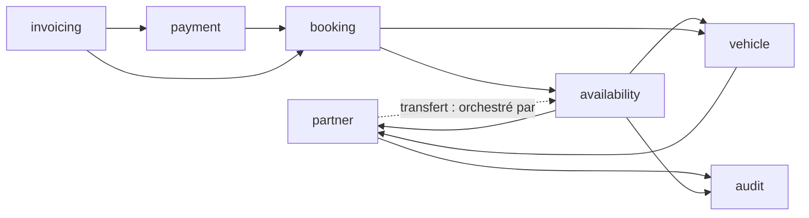

# 13 — Architecture modulaire cible (Mission 6)

> **Statut : conception.** Aucune classe Java, aucune API, aucun code n'est créé. Les contrats sont des propositions.

## 1. Modules

| Module | Responsabilité | Entités principales | État actuel |
|---|---|---|---|
| partner | Partenaires, statut, type | Partner | Table V1 ; pas d'entité Java |
| vehicle | Véhicules, statut, partenaire courant | Vehicle, VehicleStatus | Existant (`vehicle`) |
| availability | Garanties, historique des rattachements | GuaranteedAvailability, VehiclePartnerAssignment | À créer |
| booking | Réservations, transitions | Booking, BookingStatus | Existant (`booking`) |
| payment | Devis, paiements | Payment, Quote | Existant (`payment`) |
| invoicing | Factures | Invoice | À vérifier |
| audit | Traçabilité des opérations sensibles | AuditEvent | À créer |

## 2. Règles de dépendance

Règles :
1. **booking dépend de availability**, jamais l'inverse.
2. **availability ne dépend pas de booking** : la garantie ignore les réservations. Le contrôle « garantie utilisée » est un contrôle de booking. Pour D-PA-07 et D-PA-12, la vérification des réservations futures passe par un port en lecture exposé par booking, pour éviter un cycle.
3. **payment ne modifie jamais un statut de booking** directement ; il passe par le service booking.
4. **Le transfert de véhicule** (changement de partenaire) est un service orchestrateur dans `availability` ou `vehicle` ; il ne modifie jamais les garanties ni les réservations historiques.
5. Aucun module n'accède au repository d'un autre module.

## 3. Services et transactions

| Opération | Service propriétaire | Transaction | Verrou |
|---|---|---|---|
| Créer une garantie | availability | Oui | `FOR UPDATE` sur vehicle |
| Retirer une garantie | availability | Oui | `FOR UPDATE` sur garantie |
| Transférer un véhicule | availability (orchestration) | Oui, unique | `FOR UPDATE` sur vehicle ; contrôle des engagements dans la même transaction |
| Créer une réservation garantie | booking | Oui | `FOR UPDATE` sur vehicle ; lecture garantie ACTIVE |
| Confirmer une réservation | booking | Oui | Contrainte EXCLUDE existante |
| Mise en maintenance | vehicle | Oui | Contrôle des réservations CONFIRMED futures (D-PA-16) |

## 4. Contrats d'API proposés (sans implémentation)

Préfixe `/api/admin/` pour l'administration, `/api/` pour le public. Authentification et autorisation : ADMIN uniquement pour les écritures d'availability et de partner (voir `review/14` et la sécurité).

| Méthode | Route | Rôle | Corps | Réponse | Codes d'erreur |
|---|---|---|---|---|---|
| POST | /api/admin/vehicles/{id}/guarantees | ADMIN | valid_from, valid_until, partner_id, reason | 201 garantie | 400 dates ; 403 ; 404 ; 409 chevauchement ; 422 partenaire non autorisé |
| GET | /api/admin/vehicles/{id}/guarantees | ADMIN | — | liste paginée | 403 ; 404 |
| POST | /api/admin/guarantees/{id}/withdrawal | ADMIN | reason | 200 | 409 engagements (D-PA-07) |
| POST | /api/admin/vehicles/{id}/partner-transfers | ADMIN | new_partner_id, effective_at, reason | 201 | 409 engagements actifs (D-PA-12) |
| GET | /api/admin/vehicles/{id}/partner-assignments | ADMIN | — | historique | 403 ; 404 |
| GET | /api/vehicles/{id}/availability?from&to | public | — | disponibilité agrégée | 400 ; 404 |
| POST | /api/bookings | CLIENT | vehicle_id, availability_id, dates | 201 | 400 ; 409 conflit ; 422 garantie absente ou non couvrante |

Règles transverses :
- Les erreurs ne renvoient jamais de stack trace ni de SQL.
- Les identifiants de partenaire n'apparaissent pas dans la réponse publique (confidentialité).
- Un client ne voit que ses propres réservations (ASVS V4).

## 5. Points d'extension et risques d'architecture

- **Cycle potentiel** availability ↔ booking : résolu par port de lecture (règle 2).
- **Couplage transfert/booking** : le transfert doit lire les réservations via port, sans modifier leur statut.
- **Dualité `transfers` et transfert de véhicule** : nom réservé pour le transport client ; le changement de partenaire porte un nom distinct (`partner-transfers`) dans les contrats.
- **Dépendance au partenaire courant** : `vehicles.partner_id` absent aujourd'hui. Sans cette colonne, le transfert n'a pas de source de vérité unique (voir `review/14`).

## 6. Ce qui n'est pas proposé

- Pas de microservice, pas de file de messages : hors périmètre et non justifié à ce stade.
- Pas de nouveau moteur de recherche.
- Pas de dépendance externe ajoutée.
